# 复变函数

> **课程主线：** **复数与复变函数** → **导数与解析性** → **复积分与柯西公式** → **级数、延拓与奇点** → **特殊函数**

## 第 1 章：复数、复变函数与解析性

### 1.1 复数与复数运算

#### 1.1.1 复数的代数表示

> [!knowledge]
> - ==🔴复数的代数表示==：$z=x+\mathrm{i}y$，其中 $x,y\in\mathbb R$；$x=\operatorname{Re}z$ 是实部，$y=\operatorname{Im}z$ 是虚部，$\mathrm{i}^2=-1$。
> - **相等与零：** $z_1=z_2$ 当且仅当实部、虚部分别相等；$z=0$ 当且仅当 $\operatorname{Re}z=\operatorname{Im}z=0$。
> - **不可排序：** 复数域中不能像实数那样定义与四则运算相容的大小关系。
> - **共轭：** $z=x+\mathrm{i}y$ 的共轭为 $\bar z=x-\mathrm{i}y$；几何上二者关于实轴对称，且 $z\bar z$ 是非负实数。

> [!knowledge]
> - ==🔴复平面、模与辐角==：$z=x+\mathrm{i}y$ 与复平面点 $(x,y)$、从原点指向该点的向量一一对应；横轴为实轴，纵轴为虚轴。
> - **模：** $|z|=\sqrt{x^2+y^2}$。
> - **辐角：** 对 $z\ne0$，若向量 $\overrightarrow{Oz}$ 的方向角为 $\varphi$，则 $\arg z=\varphi+2k\pi\ (k\in\mathbb Z)$；课件取 $0<\operatorname{Arg}z<2\pi$ 为主值范围。$z=0$ 的辐角不确定。
> - **三角与指数形式：** $z=r(\cos\varphi+\mathrm{i}\sin\varphi)=re^{\mathrm{i}\varphi}$，其中 $r=|z|$。

**[ 例题 ] 将复数写成三角形式与指数形式**

将 $z_0=-1+\sqrt3\,\mathrm{i}$ 写成三角形式与指数形式。

解
1. 由 $z_0=x+\mathrm{i}y$ 可知 $x=-1$、$y=\sqrt3$，因此 $z_0$ 位于第二象限。
2. 先求模：$|z_0|=\sqrt{x^2+y^2}=\sqrt{(-1)^2+(\sqrt3)^2}=2$。
3. 参考角为 $\pi/3$；结合第二象限，取主辐角 $\varphi=2\pi/3$。其一般辐角为 $2\pi/3+2k\pi$。
4. 代入 $z=r(\cos\varphi+\mathrm{i}\sin\varphi)=re^{\mathrm{i}\varphi}$。

**结论：** $z_0=2\bigl(\cos\frac{2\pi}{3}+\mathrm{i}\sin\frac{2\pi}{3}\bigr)=2e^{2\pi\mathrm{i}/3}$。

#### 1.1.2 运算、棣莫弗公式与不等式

> [!knowledge]
> - ==🔴复数的运算规则==：$(x_1+\mathrm{i}y_1)\pm(x_2+\mathrm{i}y_2)=(x_1\pm x_2)+\mathrm{i}(y_1\pm y_2)$；几何上加法满足平行四边形（或三角形）法则。
> - **乘除：** 若 $z_j=r_je^{\mathrm{i}\varphi_j}$，则 $z_1z_2=r_1r_2e^{\mathrm{i}(\varphi_1+\varphi_2)}$，$\frac{z_1}{z_2}=\frac{r_1}{r_2}e^{\mathrm{i}(\varphi_1-\varphi_2)}\ (z_2\ne0)$。
> - **棣莫弗（De Moivre）公式：** $(\cos\varphi+\mathrm{i}\sin\varphi)^n=\cos(n\varphi)+\mathrm{i}\sin(n\varphi)$，$n\in\mathbb Z$。
> - **常用模性质：** $|z_1z_2|=|z_1||z_2|$，$|\frac{z_1}{z_2}|=\frac{|z_1|}{|z_2|}$，$|z_1+z_2|\le|z_1|+|z_2|$。

#### 1.1.3 无穷远点与复数序列

> [!knowledge]
> - ==🔴无穷远点与复数序列==：通过球极投影把复平面与球面除北极外的点一一对应；北极对应复平面的无穷远点 $\infty$。可把 $\infty$ 看作模大于任何整数、辐角不确定的广义点。
> - **复数序列：** $z_n=x_n+\mathrm{i}y_n$；它等价于实部、虚部两个实数序列。
> - **收敛：** $\lim_{n\to\infty}z_n=z$ 指任意 $\varepsilon>0$，存在 $N(\varepsilon)$，当 $n>N(\varepsilon)$ 时有 $|z_n-z|<\varepsilon$。
> - **判别：** 复数序列收敛当且仅当实部、虚部分别收敛；也可用柯西判别：对任意 $\varepsilon>0$，存在 $N(\varepsilon)$，$n>N(\varepsilon)$ 时对任意正整数 $p$ 有 $|z_{n+p}-z_n|<\varepsilon$。
> - **聚点：** 一个序列的极限必是唯一聚点；无界序列不收敛。Bolzano–Weierstrass 定理：有界无穷序列至少有一个聚点。

### 1.2 复变函数、极限与连续性

#### 1.2.1 点集、区域与边界方向

> [!knowledge]
> - ==🔴邻域、区域与边界==：$N(z_0,\delta)=\{z:|z-z_0|<\delta\}$；去心邻域 $N'(z_0,\delta)=\{z:0<|z-z_0|<\delta\}$。
> - **点的分类：** 若某邻域全含于 $E$，则该点为 $E$ 的内点；若某邻域全不含 $E$ 的点，则为外点；任意邻域同时含 $E$ 内、外的点，则为边界点。
> - **区域：** 连通开集称为区域；区域连同其边界称为闭区域（闭域）。
> - **边界正向：** 沿边界前进时，区域始终位于左侧。对环域 $a<|z|<b$，外圆正向为逆时针，内圆正向为顺时针。
> - **连通性：** 区域内任意简单闭曲线的内部均属于该区域，称单连通；否则称多连通。

**[ 例题 ] 判断不等式确定的区域**

分别判断下列不等式在复平面中确定的区域及其连通性：$\operatorname{Re}(z^2)\le1$，$\arg z<\pi/3$，$1/|z|<3$，$|z-1|+|z+1|<4$。

解
1. 令 $z=x+\mathrm{i}y$，则 $z^2=x^2-y^2+2xy\mathrm{i}$，故 $\operatorname{Re}(z^2)\le1$ 化为 $x^2-y^2\le1$。其边界为双曲线，区域向无穷远延伸且没有“孔洞”，故为==无界单连通域==。
2. $\arg z<\pi/3$ 应按辐角的主支理解为 $-\pi/3<\arg z<\pi/3$。它表示以原点为顶点、开角为 $2\pi/3$ 的扇形内部，原点不属于该域，区域仍为无界单连通域。
3. $1/|z|<3$ 等价于 $|z|>1/3$。这是半径 $1/3$ 的闭圆外部；被挖去的圆盘形成一个孔洞，故为==无界多连通域==。
4. $|z-1|+|z+1|<4$ 是到焦点 $1,-1$ 的距离和小于常数 $4$ 的点集，即椭圆内部。椭圆内部有界且无孔，故为有界单连通域。

**结论：** 判断区域时，先把复条件改写成 $x,y$ 或极坐标条件，再检查边界、是否有孔洞及是否有界。

#### 1.2.2 复变函数与映射

> [!knowledge]
> - ==🔴复变函数与映射==：设 $E,F$ 是复平面点集。若法则 $f$ 使 $E$ 中每个 $z$ 对应 $F$ 中一个或几个复值 $w$，则 $w=f(z)\ (z\in E)$ 称为复变函数；$E$ 为定义域，$F$ 为值域。
> - **单值与多值：** 每个 $z$ 仅对应一个 $w$ 为单值函数；对应两个或更多值为多值函数。
> - **实虚部表示：** $f(z)=u(x,y)+\mathrm{i}v(x,y)$，$z=x+\mathrm{i}y$；一个复变函数由两个二元实函数 $u,v$ 表示。
> - **映射观点：** $w=f(z)$ 将 $z$ 平面定义域 $E$ 映为 $w$ 平面点集 $F$；$w$ 为 $z$ 的像，$z$ 为 $w$ 的原像。

**[ 例题 ] 常用映射的几何意义**

说明 $w=\bar z$、$w=z^2$、$w=\mathrm{i}z$ 与 $w=1/z$ 的几何作用；其中对倒数映射，考察曲线 $|z-a|=|a|\ (a\ne0)$ 的像。

解
1. 对 $w=\bar z$，若 $z=a+\mathrm{i}b$，则 $w=a-\mathrm{i}b$。横坐标不变、纵坐标变号，因此它是==关于实轴的对称==。
2. 对 $w=z^2$，有 $u=x^2-y^2$、$v=2xy$。在 $z$ 平面的 $u=c_1$、$v=c_2$ 是两族双曲线；它们分别映为 $w$ 平面中实部、虚部固定的两族直线。
3. $w=\mathrm{i}z=ze^{\mathrm{i}\pi/2}$ 不改变模，只使辐角增加 $\pi/2$。因此上半单位圆盘整体逆时针旋转 $\pi/2$。
4. 对 $w=1/z$，即 $z=1/w$。将它代入 $|z-a|=|a|$，得 $|1-aw|=|a||w|$；两边平方并约去 $|a|^2|w|^2$，得到 $2\operatorname{Re}(aw)=1$。

**结论：** 乘以模为 $1$ 的复数对应旋转；倒数映射常把经过原点的圆映为直线。

> [!note] 待插图
> 来源：课件 p. 68–71；内容：$w=z^2$ 下双曲线族与平行直线族的对应；用途：理解实部、虚部等值线如何被映射。
> 裁剪建议：保留 $z$、$w$ 两平面及两族曲线的标签。

#### 1.2.3 极限与连续性

> [!knowledge]
> - ==🔴复极限与连续性==：$f$ 在 $z_0$ 的去心邻域有定义。若对任意 $\varepsilon>0$，存在 $\delta(\varepsilon)>0$，使 $0<|z-z_0|<\delta$ 时 $|f(z)-A|<\varepsilon$，则 $\lim_{z\to z_0}f(z)=A$。
> - **核心要求：** 极限必须与 $z\to z_0$ 的==趋近方式无关==；若沿不同路径得到不同值，则极限不存在。
> - **实虚部判定：** $f=u+\mathrm{i}v,\ A=u_0+\mathrm{i}v_0$ 时，$\lim_{z\to z_0}f(z)=A$ 当且仅当 $\lim u=u_0$ 且 $\lim v=v_0$。
> - **运算：** 极限存在时，和、差、积的极限按通常规则运算；商还要求分母极限不为零。
> - **连续：** $\lim_{z\to z_0}f(z)=f(z_0)$ 时，$f$ 在 $z_0$ 连续；等价于 $u,v$ 分别在 $(x_0,y_0)$ 连续。连续函数的和、差、积及分母非零时的商仍连续，复合函数也保持连续。
> - **闭区域性质：** $f$ 在闭区域 $G$ 连续，则 $|f|$ 有界且能取到上下界；$f$ 在 $G$ 上一致连续。

**[ 例题 ] 判断复极限是否存在**

考察 $f(z)=\frac{\operatorname{Re}z}{z}$ 在 $z\to0$ 时的极限。

解
1. 写 $z=x+\mathrm{i}y$，则 $\operatorname{Re}z=x$，从而 $f(z)=\frac{x}{x+\mathrm{i}y}$。
2. 沿实轴 $y=0$、$x\to0$（$x\ne0$）趋近时，$f(x)=x/x=1$。
3. 沿虚轴 $x=0$、$y\to0$（$y\ne0$）趋近时，$f(\mathrm{i}y)=0/(\mathrm{i}y)=0$。
4. 两条趋近路径给出不同极限，违反“与趋近方式无关”的必要条件。

**结论：** $\displaystyle\lim_{z\to0}\frac{\operatorname{Re}z}{z}$ ==不存在==。

### 1.3 导数与柯西—黎曼条件

#### 1.3.1 导数、微分与求导法则

> [!knowledge]
> - ==🔴复导数与微分==：若极限 $f'(z)=\lim_{\Delta z\to0}\frac{f(z+\Delta z)-f(z)}{\Delta z}$ 存在且与 $\Delta z\to0$ 的方式无关，则 $f$ 在 $z$ 可导。
> - **连续性：** 在一点可导 $\Rightarrow$ 在该点连续；反之不成立。
> - **求导法则：** 实变函数的常数、幂、和差、乘积、商及复合求导法则可直接推广；例如 $(z^n)'=nz^{n-1}$，$\left(\frac{f}{g}\right)'=\frac{f'g-fg'}{g^2}$，$\{f[g(z)]\}'=f'(g(z))g'(z)$。

**[ 例题 ] 由定义求 $z^2$ 的导数**

由导数定义求 $f(z)=z^2$ 的导数。

解
1. 由定义，$f'(z)=\lim_{\Delta z\to0}\frac{(z+\Delta z)^2-z^2}{\Delta z}$。
2. 展开分子：$(z+\Delta z)^2-z^2=2z\Delta z+(\Delta z)^2$。
3. 当 $\Delta z\ne0$ 时约去一个 $\Delta z$，差商为 $2z+\Delta z$。
4. 令 $\Delta z\to0$，所得极限与趋近方向无关。

> **结论：** $(z^2)'=2z$。

**[ 例题 ] 连续但不可导的函数**

设 $f(z)=\operatorname{Im}z$，说明它连续但在任一点不可导。

解
1. 令 $z=x+\mathrm{i}y$，则 $f(z)=y$，它作为 $(x,y)$ 的实函数连续，因此在复平面处处连续。
2. 在任意固定点 $z_0$，取增量 $\Delta z=\Delta x+\mathrm{i}\Delta y$，有 $\Delta f=\Delta y$，故差商为 $\frac{\Delta y}{\Delta x+\mathrm{i}\Delta y}$。
3. 若沿实轴方向趋近，$\Delta y=0$，差商恒为 $0$；若沿虚轴方向趋近，$\Delta x=0$，差商恒为 $1/\mathrm{i}=-\mathrm{i}$。
4. 两个方向的极限不同，故导数定义中的极限不存在。

**结论：** $f(z)=\operatorname{Im}z$ 在复平面处处连续、==处处不可导==。

#### 1.3.2 柯西—黎曼方程

> [!knowledge]
> - ==🔴柯西—黎曼（C-R）方程==：设 $f(z)=u(x,y)+\mathrm{i}v(x,y)$ 在点 $(x,y)$ 可导。令 $\Delta z$ 分别沿实轴、虚轴趋于零并比较极限，可得
>
> $\frac{\partial u}{\partial x}=\frac{\partial v}{\partial y},\qquad \frac{\partial u}{\partial y}=-\frac{\partial v}{\partial x}$。
>
> - **极坐标形式：** $z=\rho e^{\mathrm{i}\varphi}$ 时，
>
> $\frac{\partial u}{\partial\rho}=\frac1\rho\frac{\partial v}{\partial\varphi},\qquad \frac1\rho\frac{\partial u}{\partial\varphi}=-\frac{\partial v}{\partial\rho}$。
>
> - **充分条件：** 若 $u,v$ 的一阶偏导在该点存在、连续且满足 C-R 方程，则 $f$ 在该点可导。
> - **充要条件：** $f=u+\mathrm{i}v$ 在一点可导，当且仅当 $u,v$ 在该点可微且满足 C-R 方程。
> - **导数表达式：** $f'(z)=u_x+\mathrm{i}v_x=u_x-\mathrm{i}u_y=v_y+\mathrm{i}v_x$。

#### 1.3.3 导数的几何意义

> [!knowledge]
> - ==🔴导数的几何意义==：若 $w=f(z)$ 在 $z_0$ 可导，则 $|f'(z_0)|$ 表示 $z_0$ 附近无穷小线段映为 $w$ 平面线段时的长度放大系数。
> - $\arg f'(z_0)$ 表示映射前后曲线切线的转动角。

### 1.4 解析函数与调和函数

#### 1.4.1 解析性与奇点

> [!knowledge]
> - ==🔴解析函数与奇点==：$f$ 在 $z_0$ 的某邻域内处处可导，称 $f$ 在 $z_0$ 解析；在区域 $B$ 每点都解析，称为 $B$ 内的解析函数。
> - **区分：** 在一点解析必在该点可导；在一点可导不必在该点解析。例如 $|z|^2=x^2+y^2$ 只在 $z=0$ 可导，故不在复平面任何区域解析。
> - **奇点：** 函数不解析的点称奇点：可以是无定义、无确定值、不连续、不可导，或虽可导但找不到处处可导的邻域。$1/z$ 的 $z=0$ 是奇点。
> - **无穷远点：** 讨论 $z=\infty$ 的解析性时，令 $t=1/z$，改为讨论 $f(1/t)$ 在 $t=0$ 的解析性。
> - **区域判定：** $f=u+\mathrm{i}v$ 在区域 $B$ 解析，当且仅当 $u,v$ 在 $B$ 内可微，且处处满足 C-R 方程。

**[ 例题 ] 判断函数的可导与解析区域**

分别判断 $w=\bar z$、$f(z)=e^x(\cos y+\mathrm{i}\sin y)$ 与 $w=z\operatorname{Re}z$ 的可导性、解析性。

解
1. 对 $w=\bar z=x-\mathrm{i}y$，$u=x$、$v=-y$。有 $u_x=1$、$v_y=-1$，不满足 $u_x=v_y$，故它在任何点都不可导，更不可能解析。
2. 对 $f(z)=e^x(\cos y+\mathrm{i}\sin y)$，$u=e^x\cos y$、$v=e^x\sin y$。直接计算得 $u_x=v_y=e^x\cos y$，$u_y=-v_x=-e^x\sin y$，且偏导连续。因此它全平面解析；按定义它正是 $e^z$，从而 $f'(z)=e^z$。
3. 对 $w=z\operatorname{Re}z=x^2+\mathrm{i}xy$，$u=x^2$、$v=xy$。C-R 条件给出 $2x=x$ 与 $0=-y$，仅可能在 $(0,0)$ 成立；再由导数定义可验证 $z=0$ 处导数为 $0$。
4. 解析要求某邻域内每点可导，第三个函数只在孤立点可导，故不在任何区域解析。

**结论：** C-R 方程是判定的核心；“某一点可导”不能替代“某邻域内处处可导”。

#### 1.4.2 调和函数与共轭调和函数

> [!knowledge]
> - ==🔴调和函数与共轭调和函数==：二元函数 $\phi(x,y)$ 在区域内有二阶连续偏导并满足拉普拉斯方程 $\Delta\phi=\phi_{xx}+\phi_{yy}=0$。
> - **共轭调和：** 若 $u,v$ 均调和且满足 C-R 方程，则 $v$ 是 $u$ 的共轭调和函数。
> - **解析函数的实虚部：** 若 $f=u+\mathrm{i}v$ 在区域 $B$ 解析，则 $u,v$ 均为 $B$ 内调和函数，且互为共轭调和函数。
> - **构造原则：** 已知一个调和函数时，先核验 $\Delta u=0$，再用 C-R 方程求共轭调和函数；课件给出不定积分法、凑全微分法和曲线积分法。

**[ 例题 ] 由实部构造解析函数**

已知 $u(x,y)=x^2-y^2+xy$ 是解析函数 $f(z)=u+\mathrm{i}v$ 的实部，且 $f(0)=0$，求 $f(z)$。

解
1. 先核验可构造性：$u_{xx}+u_{yy}=2-2=0$，故 $u$ 是调和函数。
2. 由 C-R 方程 $v_y=u_x=2x+y$，对 $y$ 积分，得 $v=2xy+\frac12y^2+\varphi(x)$。
3. 再用 $v_x=-u_y=-( -2y+x)=2y-x$。而 $v_x=2y+\varphi'(x)$，因此 $\varphi'(x)=-x$，即 $\varphi(x)=-\frac12x^2+C$。
4. 于是 $v=2xy+\frac12(y^2-x^2)+C$。代入 $f(0)=0$，得到 $C=0$。
5. 合并实、虚部并用 $z^2=x^2-y^2+2\mathrm{i}xy$ 化简：$u+\mathrm{i}v=\left(1-\frac{\mathrm{i}}2\right)z^2$。

**结论：** $\displaystyle f(z)=\left(1-\frac{\mathrm{i}}2\right)z^2$。

#### 1.4.3 正交曲线族与保角性

> [!knowledge]
> - ==🔴正交曲线族与保角性==：若 $f=u+\mathrm{i}v$ 在区域内解析，则 $u(x,y)=C_1$ 与 $v(x,y)=C_2$ 是两族相互正交曲线，因为 $\nabla u\cdot\nabla v=0$。
> - 若 $f$ 在 $D$ 内解析且 $f'(z_0)\ne0$，则映射在 $z_0$ 处==保角==：两条曲线的切线夹角在映射前后相等。

> [!note] 待插图
> 来源：课件 p. 121、123–125；内容：$f(z)=z^2,e^z$ 的实、虚部等值线，以及两曲线经解析映射后的夹角。
> 裁剪建议：保留两条曲线、交点、切线和夹角标注。

### 1.5 初等解析函数与多值函数

#### 1.5.1 单值初等函数

> [!knowledge]
> - ==🔴单值初等解析函数==：$z^n=r^ne^{\mathrm{i}n\theta}$，$(z^n)'=nz^{n-1}$。当 $n=0,1,2,\ldots$ 时，$z^n$ 全平面解析；当 $n=-1,-2,\ldots$ 时，$z^n$ 在 $z=0$ 外解析。
> - **多项式与有理函数：** $P_n(z)=a_nz^n+\cdots+a_0$；$R(z)=P_n(z)/Q_m(z)$。有理函数在分母非零处解析。
> - **指数函数：** 定义 $e^z=e^x(\cos y+\mathrm{i}\sin y)$。它全平面解析，$(e^z)'=e^z$，$e^{z_1}e^{z_2}=e^{z_1+z_2}$，以 $2\pi\mathrm{i}$ 为周期，且不取零值。
> - **三角函数：** $\sin z=\frac{e^{\mathrm{i}z}-e^{-\mathrm{i}z}}{2\mathrm{i}}$，$\cos z=\frac{e^{\mathrm{i}z}+e^{-\mathrm{i}z}}2$；二者全平面解析，$(\sin z)'=\cos z$，$(\cos z)'=-\sin z$，周期为 $2\pi$。$\sin z$ 的零点为 $n\pi$，$\cos z$ 的零点为 $(n+\frac12)\pi$。
> - **正切与双曲函数：** $\tan z=\sin z/\cos z$，周期为 $\pi$；$\sinh z=(e^z-e^{-z})/2$，$\cosh z=(e^z+e^{-z})/2$，二者以 $2\pi\mathrm{i}$ 为周期，且 $\cosh^2z-\sinh^2z=1$。
> - **注意：** $\sin z,\cos z$ 在复数域内无界；例如 $y\to\infty$ 时，$\sin(\mathrm{i}y)$、$\cos(\mathrm{i}y)$ 均无界。

#### 1.5.2 根式、对数与幂函数的多值性

> [!knowledge]
> - ==🔴多值函数、支点与分支==：$w=(z-a)^{1/m}=\rho^{1/m}e^{\mathrm{i}(\arg(z-a)+2k\pi)/m}$。当 $m=2,3,\ldots$ 时，对应 $m$ 个不同值。
> - **支点：** 若 $z$ 绕点 $a$ 一周后函数值不复原，而绕若干周后复原，则 $a$ 为分支点。对 $(z-a)^{1/m}$，$a$ 与 $\infty$ 都是支点。
> - **单值分支与割线：** 限制 $\arg(z-a)$ 的一个长度 $2\pi$ 区间，或从 $a$ 到 $\infty$ 作割线以限制路径，即可得到单值分支；割线的形状和分支的划分并不唯一。
> - **黎曼面：** 将割开的多个 $z$ 平面按割线粘接后，多值函数在该面上成为解析的单值函数；$\sqrt{z-a}$ 对应二叶面，$\ln z$ 对应无穷多叶面。
> - **对数：** $\ln z=\ln|z|+\mathrm{i}\arg z+2k\pi\mathrm{i}$，$k\in\mathbb Z$；支点为 $0,\infty$。在任一单值分支内 $(\ln z)'=1/z$。
> - **一般幂：** $z^\alpha=e^{\alpha\ln z}\ (z\ne0)$；一般为无穷多值函数，取 $\ln z$ 的主值可定义 $z^\alpha$ 的主值，且 $(z^\alpha)'=\alpha z^{\alpha-1}$。

**[ 例题 ] 连续路径决定根式的取值**

对 $w=\sqrt{z-1}$，规定初值 $w(2)=1$。令 $z$ 沿两条不同路径从 $2$ 连续移动到 $0$，比较终值。

解
1. 在起点 $z=2$，有 $z-1=1$，其辐角取 $0$；初值 $w(2)=1$ 就固定了平方根的一个连续分支。
2. 若路径绕支点 $z=1$ 的上方通过，则 $\arg(z-1)$ 从 $0$ 连续增加到 $\pi$。由于 $\arg w=\frac12\arg(z-1)$，终点的辐角为 $\pi/2$。
3. 此时 $|w(0)|=|0-1|^{1/2}=1$，故 $w(0)=\mathrm{i}$。
4. 若路径绕支点的下方通过，$\arg(z-1)$ 连续减至 $-\pi$，则 $\arg w=-\pi/2$，因而 $w(0)=-\mathrm{i}$。

**结论：** 相同的终点可给出不同的连续取值；对多值函数，必须同时说明==初值分支或连续路径==。

> [!note] 待插图
> 来源：课件 p. 151–160；内容：根式函数的割线、上下两支与二叶黎曼面。
> 裁剪建议：保留支点 $a,\infty$、割线及两张粘接平面。

### 1.6 平面标量场与复势

> [!knowledge]
> - ==🔴平面标量场与复势==：对与某方向均匀、仅需研究垂直平面的恒定场，取 $z=x+\mathrm{i}y$。场向量可写作 $A(z)=A_x(x,y)+\mathrm{i}A_y(x,y)$。
> - **适用对象：** 可用解析函数描述的场应是标量、恒定、平面且相应势函数满足拉普拉斯方程的场。
> - **复势：** 若 $w=f(z)=u(x,y)+\mathrm{i}v(x,y)$，并取 $u$ 为电势 $\phi$，则 $u=C_1$ 是等势线族，$v=C_2$ 是电场线族（通量线族）。
> - **物理量：** 对两点 $A,B$，$u(B)-u(A)$ 给出标量势差；$v(B)-v(A)$ 给出从 $A$ 到 $B$ 穿过的电通量（取单位纵深宽度）。

**[ 例题 ] 复势 $f(z)=z^2$ 所描述的场**

设复势 $f(z)=z^2$，写出其等势线族与场线族，并说明二者的关系。

解
1. 展开 $z^2=(x+\mathrm{i}y)^2=x^2-y^2+2xy\mathrm{i}$，故可取 $u=x^2-y^2$、$v=2xy$。
2. 令 $u=C_1$，得到等势线族 $x^2-y^2=C_1$；令 $v=C_2$，得到场线（通量线）族 $2xy=C_2$。
3. 因为 $f$ 在全平面解析，$u,v$ 满足 C-R 方程，故 $\nabla u\cdot\nabla v=0$；两族等值线在交点处正交。
4. 这正符合无旋平面场中等势线与场线相互垂直的物理图像。

**结论：** $x^2-y^2=C_1$ 与 $2xy=C_2$ 是一对==正交==的等势线/场线族。

**[ 例题 ] 已知电力线求等势线**

已知一族电力线为 $y^2=c^2+2cx\ (c>0)$，求与之正交的等势线族。

解
1. 将曲线族改写为 $c=-x+\sqrt{x^2+y^2}$。因此可取通量函数 $v(x,y)=C_1(-x+\sqrt{x^2+y^2})+C_2$；令 $v$ 为常数便给回题设的电力线。
2. 在极坐标 $x=\rho\cos\varphi$、$y=\rho\sin\varphi$ 下，有 $-x+\rho=\rho(1-\cos\varphi)=2\rho\sin^2(\varphi/2)$。
3. 由 C-R 方程求共轭势函数，可把等势线写为 $C_1\sqrt{2\rho}\cos\frac{\varphi}{2}+C_2=\text{常数}$。
4. 消去极坐标参数，得到与原曲线族正交的直角坐标形式 $y^2=c^2-2cx\ (c>0)$。

**结论：** 两族曲线只差一次横向反向；它们分别是通量线与等势线，交点处正交。

> [!note] 待插图
> 来源：课件 p. 172–175、181–184；内容：等势线与电场线的正交关系、无限长带电直导线的同心圆/射线场线。
> 裁剪建议：保留坐标轴、势线/场线及 $\rho,\varphi$ 标注。

## 第 2 章：复变函数积分与柯西公式

### 2.1 复变函数的积分

#### 2.1.1 有向曲线与复积分
> [!knowledge]
> - ==🔴有向曲线==
>   - **非闭合曲线：** 任选定一个方向为正向；反向记作 $l^-$。
>   - **简单闭曲线：** 正向规定为前进时曲线内部始终在左侧。
> - ==🔴复积分定义==
>   - 设 $l$ 从 $A=z_0$ 到 $B=z_n$，取分点及每段一点 $\zeta_k$。
>   - 记 $\Delta z_k=z_k-z_{k-1}$，$d=\max_k|\Delta z_k|$。
>   - 当 $d\to0$ 时，若 $\sum_{k=1}^nf(\zeta_k)\Delta z_k$ 有唯一极限，则 $\int_lf(z)\,dz=\lim_{n\to\infty}\sum_{k=1}^nf(\zeta_k)\Delta z_k$。
> - ==🔴复积分说明==
>   - **存在性：** $f$ 连续且 $l$ 光滑时，积分一定存在。
>   - **与实积分的关系：** 若 $l$ 为实轴区间且 $f(z)=u(x)$，该定义退化为**一元实函数定积分**。

#### 2.1.2 两种计算方法与性质

> [!knowledge]
> - ==🔴化为二元实函数的第二型曲线积分==
>   - 若 $f=u+\mathrm{i}v$，则 $\int_lf(z)\,dz=\int_l(u\,dx-v\,dy)+\mathrm{i}\int_l(v\,dx+u\,dy)$。
> - ==🔴参数方程法==
>   - 若 $z=z(t)\ (\alpha\le t\le\beta)$，则 $\int_lf(z)\,dz=\int_\alpha^\beta f[z(t)]z'(t)\,dt$。
> - ==🔴基本性质与估值==
>   - **线性与可加性：** 反向路径积分变号；常数因子可提出；积分对函数加减线性；分段曲线的积分等于各段积分之和。
>   - **估值：** $\left|\int_lf(z)\,dz\right|\le\int_l|f(z)|\,|dz|$；若 $|f(z)|\le M$ 且 $l$ 的长度为 $L$，则 $\left|\int_lf(z)\,dz\right|\le ML$。
>   - **注意：** 实积分中值定理一般不能推广到复积分。

**[ 例题 ] 参数法计算线积分**
计算下列积分，并说明复积分何时会依赖路径：
1. $l$ 为从 $0$ 到 $3+4\mathrm{i}$ 的直线段，计算 $\int_lz\,dz$；
2. $l:|z|=2$（取逆时针方向），计算 $\oint_lz\,dz$；
3. 对 $f(z)=\operatorname{Re}z$，从 $0$ 到 $1+\mathrm{i}$ 分别沿“先水平后竖直”和“先竖直后水平”的折线积分。

解
1. 对第 1 问，参数化为 $z(t)=(3+4\mathrm{i})t\ (0\le t\le1)$，故 $dz=(3+4\mathrm{i})dt$。于是 $\int_lz\,dz=(3+4\mathrm{i})^2\int_0^1t\,dt=\frac{(3+4\mathrm{i})^2}{2}$。
2. 对第 2 问，令 $z=2e^{\mathrm{i}\theta}$，$dz=2\mathrm{i}e^{\mathrm{i}\theta}d\theta$。因此 $\oint_lz\,dz=\int_0^{2\pi}4\mathrm{i}e^{2\mathrm{i}\theta}d\theta=0$。
3. 对第 3 问，若先水平后竖直：在 $0\to1$ 上 $\operatorname{Re}z=x$，积分为 $\int_0^1x\,dx=1/2$；在 $1\to1+\mathrm{i}$ 上 $\operatorname{Re}z=1$，积分为 $\int_0^1\mathrm{i}\,dy=\mathrm{i}$，总计 $1/2+\mathrm{i}$。
4. 若先竖直后水平：在 $0\to\mathrm{i}$ 上实部恒为 $0$，积分为 $0$；在 $\mathrm{i}\to1+\mathrm{i}$ 上 $z=x+\mathrm{i}$，积分为 $\int_0^1x\,dx=1/2$。

**结论：** 前两问分别得到 $\frac{(3+4\mathrm{i})^2}{2}$ 与 $0$；第 3 问的两个结果不同，说明一般复积分依赖==路径与端点==。

> [!knowledge]
> - ==🔴圆周上的基本积分==
>   - 对以 $z_0$ 为圆心的任意正向圆周 $l$，当 $n=0$ 时，$\oint_l\frac{dz}{z-z_0}=2\pi\mathrm{i}$；当 $n\ne0$ 时，$\oint_l\frac{dz}{(z-z_0)^{n+1}}=0$。
>   - **结论：** 积分值与圆周的中心、半径无关；该结论将在柯西积分公式中反复使用。

**证明：圆周基本积分**
令 $z=z_0+re^{\mathrm{i}\theta}\ (0\le\theta\le2\pi)$，则 $dz=\mathrm{i}re^{\mathrm{i}\theta}d\theta$。于是
$$
\oint_l\frac{dz}{(z-z_0)^{n+1}}
=\mathrm{i}r^{-n}\int_0^{2\pi}e^{-\mathrm{i}n\theta}\,d\theta.
$$
当 $n=0$ 时，上式逐项化为
$$
\oint_l\frac{dz}{z-z_0}=\mathrm{i}\int_0^{2\pi}d\theta=2\pi\mathrm{i}.
$$
当 $n\ne0$ 时，直接积分得
$$
\mathrm{i}r^{-n}\int_0^{2\pi}e^{-\mathrm{i}n\theta}\,d\theta
=\mathrm{i}r^{-n}\left[\frac{e^{-\mathrm{i}n\theta}}{-\mathrm{i}n}\right]_0^{2\pi}
=\frac{r^{-n}}{-n}\bigl(e^{-2\pi\mathrm{i}n}-1\bigr)=0.
$$
这里使用了 $n$ 为整数，故 $e^{-2\pi\mathrm{i}n}=1$。若圆周改取反向，参数区间或 $dz$ 同时反向，积分整体变号；后续使用这一基本积分时不能略去方向。

### 2.2 柯西定理

#### 2.2.1 单连通域与多连通域
> [!knowledge]
> - ==🔴**单连通域的柯西定理**==
>   - 若$f$在闭单连通域$B$上解析，则沿$B$内任一分段光滑闭曲线 $l$ 有 $\oint_lf(z)\,dz=0$。
>   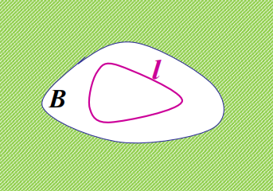
>   - **推论：** 在同一单连通解析区域内，连接固定起点、终点的积分与路径无关。
> - ==🔴多连通域的柯西定理==
>   - ==若有界 $n+1$ 连通域 $B$ 的边界为 $C=l+l_1+\cdots+l_n$（均取关于 $B$ 的正向），$f$ 在 $B$ 上连续、在内部解析，则 $\oint_Cf(z)\,dz=0$==。
>   - 说明：
> 	  - 若$f$有孤立奇点，可以将每个奇点的有限小邻域挖掉，成为复连通区域。
> 	  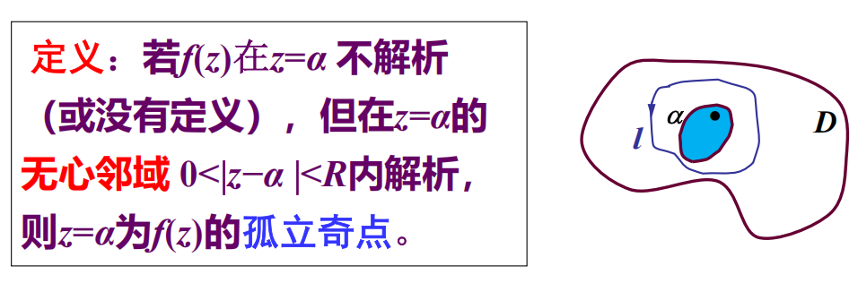
> 	  - **边界方向：** 外边界取逆时针时，内边界关于区域的正向为顺时针；等价地，外边界的积分等于各内边界逆时针积分之和。
>   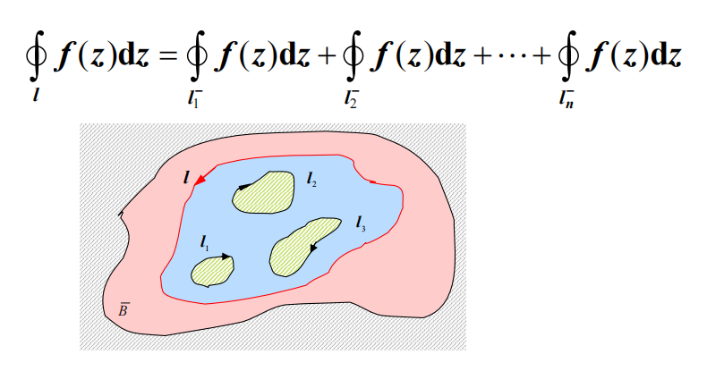
> - ==🔴闭路变形==
>   - 在 $f$ 的解析区域内，积分回路连续变形不改变积分值。

**证明：单连通域的柯西定理**
令 $f(z)=u(x,y)+\mathrm{i}v(x,y)$，$l=\partial B$ 取正向。把 $dz=dx+\mathrm{i}dy$ 代入，先分离实、虚部：
$$
\oint_l f(z)\,dz
=\oint_l(u\,dx-v\,dy)+\mathrm{i}\oint_l(v\,dx+u\,dy).
$$
对实部，令 $P=u,Q=-v$；对虚部，令 $P=v,Q=u$。因为 $u,v$ 的一阶偏导在 $B$ 内连续，Green 公式可以分别使用：
$$
\oint_l(u\,dx-v\,dy)=\iint_B(-v_x-u_y)\,dxdy,
\qquad
\oint_l(v\,dx+u\,dy)=\iint_B(u_x-v_y)\,dxdy.
$$
$f$ 在 $B$ 内解析，故 Cauchy--Riemann 条件逐点成立：
$$
u_x=v_y,\qquad u_y=-v_x.
$$
因而 $-v_x-u_y=0$，$u_x-v_y=0$。上面两个二重积分分别为零，代回实、虚部的分解式，便有
$$
\oint_lf(z)\,dz=0.
$$
这里必须有“曲线内部无奇点”的前提；例如 $1/z$ 在环域内解析，却不能在包围 $0$ 的圆盘上直接套用该结论。

**证明：多连通域的柯西定理**
先看只有一个孔洞的情形。设外边界 $l$ 取逆时针方向，内圆 $l_1$ 先按逆时针方向记。由外边界向内圆作一条不与其余边界相交的割线，并把割线两侧分别记为 $AB$ 与 $BA$；切开后所得区域为单连通域，其正向边界可依次写作
$$
AB+l_1+BA+l.
$$
在该切开区域内 $f$ 解析，故由单连通域柯西定理
$$
\int_{AB}f(z)\,dz+\oint_{l_1}f(z)\,dz
+\int_{BA}f(z)\,dz+\oint_lf(z)\,dz=0.
$$
两侧割线的方向相反，故
$$
\int_{AB}f(z)\,dz+\int_{BA}f(z)\,dz=0.
$$
注意：切开区域中内边界实际取顺时针方向；若仍把几何上的逆时针小圆记为 $l_1^+$，则该边界是 $(l_1^+)^-$。于是上式等价于
$$
\oint_lf(z)\,dz=\oint_{l_1^+}f(z)\,dz.
$$
对 $n$ 个孔洞逐一作割线，所有成对出现的割线积分仍相消，得到关于区域正向边界的形式
$$
0=\oint_lf(z)\,dz+\sum_{j=1}^n\oint_{l_j^-}f(z)\,dz,
$$
也就是当每条小边界都按逆时针记为 $l_j^+$ 时
$$
\oint_lf(z)\,dz=\sum_{j=1}^n\oint_{l_j^+}f(z)\,dz.
$$
这正是把任意包围 $a$ 的闭路缩到 $a$ 周围小圆的依据。

**[ 例题 ] 含奇点闭路上的基本积分**
设 $l$ 是包围点 $a$ 的任意正向简单闭路，计算 $\displaystyle\oint_l\frac{dz}{(z-a)^{n+1}}$，其中 $n$ 为整数且 $n\ge0$。
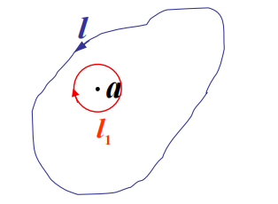

解
1. 在 $l$ 与以 $a$ 为圆心的小圆 $l_1$ 围成的环域内，$1/(z-a)^{n+1}$ 解析。由复连通域柯西定理，外回路 $l$ 的积分等于同向小圆 $l_1$ 的积分。
2. 设 $l_1:z=a+re^{\mathrm{i}\theta}\ (0\le\theta\le2\pi)$，则 $dz=\mathrm{i}re^{\mathrm{i}\theta}d\theta$。
3. 当 $n=0$ 时，$\frac{dz}{z-a}=\mathrm{i}\,d\theta$，故积分为 $\int_0^{2\pi}\mathrm{i}\,d\theta=2\pi\mathrm{i}$。
4. 当 $n\ne0$ 时，被积式化为 $\mathrm{i}r^{-n}e^{-\mathrm{i}n\theta}d\theta$；其在 $[0,2\pi]$ 上的积分为 $0$。

> [!knowledge]
> **结论：** $\displaystyle\oint_l\frac{dz}{(z-a)^{n+1}}=\begin{cases}2\pi\mathrm{i},&n=0,\\0,&n\ne0.\end{cases}$ 只要 $a$ 在回路内，路径不必是圆。

注意：使用柯西定理前必须核对函数在所用区域内解析；某一条闭路积分为 $0$ 不能反推出内部处处解析。

> [!knowledge]
>- ==🔴柯西定理小结==
>1. 闭单连通区域上的解析函数沿边界线的积分为零。
>2. 闭复连通区域上的解析函数沿所有内外境界线正方向的积分和为零$
\oint_l f(z)\,dz= 0$
>3. 闭复连通区域上的解析函数沿外境界线逆时针方向的积分等于沿所有内境界线逆时针方向的积分的和。
>4. 固定起点和终点，积分路径的连续形变不改变积分

### 2.3 原函数、不定积分与弧引理

#### 2.3.1 原函数与不定积分
> [!knowledge]
> - ==🔴原函数==
>   - 若 $f$ 在单连通域 $B$ 内处处解析，固定 $z_0\in B$，则 $F(z)=\int_{z_0}^{z}f(\zeta)\,d\zeta$ 在 $B$ 内解析，且 $F'(z)=f(z)$。
>   - **前提：** 柯西定理保证从 $z_0$ 到 $z$ 的积分与路径无关。
> - ==🔴不定积分与牛顿--莱布尼兹公式==
>   - 所有原函数的表达式 $F(z)+C$（$C$ 为任意复常数）称为 $f(z)$ 的不定积分，记为 $\int f(z)\,dz=F(z)+C$。
>   - 若 $F'=f$，则对域内任意两点 $z_1,z_2$，$\int_{z_1}^{z_2}f(z)\,dz=F(z_2)-F(z_1)$。

**证明：原函数定理**
固定 $z\in B$。先以 $z$ 为圆心取一个完全包含于 $B$ 的小圆 $C_R$；再取 $\Delta z$ 足够小，使 $z+\Delta z\in C_R$，且从 $z$ 到 $z+\Delta z$ 的线段仍在 $C_R$ 内。由
$$
F(w)=\int_{z_0}^{w}f(\zeta)\,d\zeta
$$
及路径无关性，可把从 $z_0$ 到 $z+\Delta z$ 的路径取为“先从 $z_0$ 到 $z$，再沿此线段到 $z+\Delta z$”。因此
$$
F(z+\Delta z)-F(z)=\int_z^{z+\Delta z}f(\zeta)\,d\zeta.
$$
又 $\int_z^{z+\Delta z}f(z)\,d\zeta=f(z)\Delta z$，故两式除以 $\Delta z$ 后相减：
$$
\frac{F(z+\Delta z)-F(z)}{\Delta z}-f(z)
=\frac1{\Delta z}\int_z^{z+\Delta z}[f(\zeta)-f(z)]\,d\zeta.
$$
由于 $f$ 解析，从而在 $B$ 内连续。给定 $\varepsilon>0$，存在 $\delta>0$，当 $|\zeta-z|<\delta$ 时有 $|f(\zeta)-f(z)|<\varepsilon$。取 $|\Delta z|<\delta$，则整条线段上均满足该不等式。由积分估值性质和线段长度 $|\Delta z|$，
$$
\left|\frac{F(z+\Delta z)-F(z)}{\Delta z}-f(z)\right|
\le\frac1{|\Delta z|}\int_z^{z+\Delta z}|f(\zeta)-f(z)|\,|d\zeta|
\le\frac{\varepsilon|\Delta z|}{|\Delta z|}=\varepsilon.
$$
所以当 $\Delta z\to0$ 时，差商趋于 $f(z)$，即 $F'(z)=f(z)$。

**证明：牛顿--莱布尼兹公式**

固定下端点 $z_1$，令
$$
G(z)=\int_{z_1}^{z}f(\zeta)\,d\zeta.
$$
由刚证明的原函数定理，$G'(z)=f(z)$；而 $F'(z)=f(z)$，所以 $(G-F)'=0$。在单连通域内，导数恒为零的解析函数为常数，故存在常数 $C$ 使
$$
G(z)=F(z)+C.
$$
令 $z=z_1$，左端是从 $z_1$ 到自身的积分，等于 $0$，因而 $C=-F(z_1)$。所以
$$
\int_{z_1}^{z}f(\zeta)\,d\zeta=F(z)-F(z_1).
$$
最后取 $z=z_2$，便得到
$$
\int_{z_1}^{z_2}f(\zeta)\,d\zeta=F(z_2)-F(z_1).
$$

**[ 例题 ] 用原函数计算积分**
用原函数计算：$\int_{z_0}^{z_1}z\,dz$，$\int_0^{\pi\mathrm{i}}z\cos(z^2)\,dz$，以及 $\int_0^{\mathrm{i}}z\cos z\,dz$。

解
1. $z$ 的原函数为 $F(z)=z^2/2$，故 $\int_{z_0}^{z_1}z\,dz=F(z_1)-F(z_0)=\frac12(z_1^2-z_0^2)$。
2. 对第二个积分，令 $u=z^2$ 或直接观察 $\bigl[\sin(z^2)\bigr]'=2z\cos(z^2)$，故原函数为 $\frac12\sin(z^2)$。代入端点后得到 $\frac12[\sin(-\pi^2)-0]$。
3. 对第三个积分分部积分：$\int z\cos z\,dz=z\sin z+\cos z$。于是积分为 $[z\sin z+\cos z]_0^{\mathrm{i}}=\mathrm{i}\sin\mathrm{i}+\cos\mathrm{i}-1$。
4. 利用 $\sin\mathrm{i}=\mathrm{i}\sinh1$、$\cos\mathrm{i}=\cosh1$，第 3 问化为 $-\sinh1+\cosh1-1=e^{-1}-1$。

**结论：** 三个积分依次为 $\frac12(z_1^2-z_0^2)$、$-\frac12\sin\pi^2$、$e^{-1}-1$。计算前先确认被积函数在所考察区域解析。

#### 2.3.2 小圆弧与大圆弧引理
> [!knowledge]
> - ==🔴小圆弧引理==
>   - 设 $f$ 在 $z=a$ 的邻域内连续。当 $\theta_1\le\arg(z-a)\le\theta_2$、$|z-a|\to0$ 时，若 $(z-a)f(z)\to k$，则以 $a$ 为圆心、半径 $\delta$、圆心角 $\theta_2-\theta_1$ 的圆弧 $C_\delta$ 满足 $\lim_{\delta\to0}\int_{C_\delta}f(z)\,dz=\mathrm{i}k(\theta_2-\theta_1)$。
>   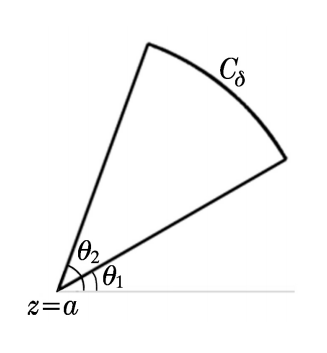
> - ==🔴大圆弧引理==
>   - $f(z)$ 在 $\infty$ 点的邻域内连续； 在扇形 $\theta_1\le\arg z\le\theta_2$ 内，当 $z\to\infty$ 时，$zf(z)\to K$。 $C_R$ 是以 $z=0$ 为圆心、$R$ 为半径、圆心角为 $\theta_2-\theta_1$ 的圆弧，取 $z=Re^{\mathrm{i}\theta}\ (\theta_1\le\theta\le\theta_2)$ 的正向。则：
>     $$
>     \lim_{R\to\infty}\int_{C_R}f(z)\,dz
>     =\mathrm{i}K(\theta_2-\theta_1).
>     $$
>   - 它用于控制无穷远处的积分；若 $K=0$，则对应的大圆弧积分趋于 $0$。
>   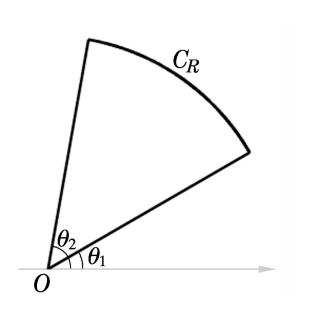
> - ==🔴Jordan（若当）不等式==
>   - **适用区间：** $0\le\theta\le\pi/2$。
>   - **重要公式：**
>     $$
>     \sin\theta\ge\frac{2\theta}{\pi}.
>     $$
>   - **等号：** 仅在 $\theta=0$ 或 $\theta=\pi/2$ 时成立；开区间内为严格大于。
>   - **用途：** 将 $e^{-mR\sin\theta}$ 估计为 $e^{-2mR\theta/\pi}$，是证明 Jordan 引理的关键一步。
> - ==🔴Jordan 引理==
>   - **条件：**
>     - 当 $z$ 在上半平面及实轴上趋于 $\infty$ 时，$f(z)$ 一致地趋于 $0$，即与辐角无关；
>     - $m>0$，$C_R$ 是以原点为圆心、$R$ 为半径的正向上半圆周。
>   - **结论：**
>     $$
>     \lim_{R\to\infty}\int_{C_R}f(z)e^{\mathrm{i}mz}\,dz=0.
>     $$
>   - **用途：** 它是上半平面大半圆积分的专门估计工具，为后续用留数定理计算实积分作准备。

**证明：小圆弧、大圆弧与 Jordan 引理**

先证小圆弧引理。令 $z=a+\delta e^{\mathrm{i}\theta}\ (\theta_1\le\theta\le\theta_2)$，则 $dz=\mathrm{i}\delta e^{\mathrm{i}\theta}d\theta$。令
$$
r(z)=(z-a)f(z)-k,
$$
则 $r(z)\to0$，并且 $f(z)=k/(z-a)+r(z)/(z-a)$。代入参数式：
$$
\int_{C_\delta}f(z)\,dz-\mathrm{i}k(\theta_2-\theta_1)
=\mathrm{i}\int_{\theta_1}^{\theta_2}r(a+\delta e^{\mathrm{i}\theta})\,d\theta.
$$
给定 $\varepsilon>0$，当 $\delta$ 足够小时，整段圆弧上 $|r(z)|<\varepsilon$，所以
$$
\left|\int_{C_\delta}f(z)\,dz-\mathrm{i}k(\theta_2-\theta_1)\right|
\le\int_{\theta_1}^{\theta_2}|r(a+\delta e^{\mathrm{i}\theta})|\,d\theta
<\varepsilon(\theta_2-\theta_1).
$$
令 $\delta\to0$，即得小圆弧的极限。

大圆弧的证明完全平行。令 $z=Re^{\mathrm{i}\theta}$，$dz=\mathrm{i}Re^{\mathrm{i}\theta}d\theta$，并记 $r_R(z)=zf(z)-K$。于是 $f(z)=K/z+r_R(z)/z$，从而
$$
\int_{C_R}f(z)\,dz-\mathrm{i}K(\theta_2-\theta_1)
=\mathrm{i}\int_{\theta_1}^{\theta_2}r_R(Re^{\mathrm{i}\theta})\,d\theta.
$$
当 $R$ 足够大时，$|r_R(z)|<\varepsilon$ 在整个扇形上一致成立，故右端模小于 $\varepsilon(\theta_2-\theta_1)$，于是 $\int_{C_R}f(z)\,dz\to\mathrm{i}K(\theta_2-\theta_1)$。

**[ 例题 ] 课件例 2：证明 Jordan（若当）不等式**

证明：当 $0\le\theta\le\pi/2$ 时，
$$
\sin\theta\ge\frac{2\theta}{\pi}.
$$

解
1. 课件比较直线 $y_1=2\theta/\pi$ 与曲线 $y_2=\sin\theta$ 在区间 $0\le\theta\le\pi/2$ 上的图像。在开区间 $0<\theta<\pi/2$ 内，正弦曲线位于弦 $y=2\theta/\pi$ 的上方，因而
$$
\sin\theta>\frac{2\theta}{\pi}.
$$
2. 在两个端点处，
$$
\sin0=0=\frac{2\cdot0}{\pi},
\qquad
\sin\frac\pi2=1=\frac{2(\pi/2)}{\pi}.
$$
3. 因此闭区间上取等号只可能在端点，得到所证不等式。

**结论：** $\displaystyle\sin\theta\ge2\theta/\pi\ (0\le\theta\le\pi/2)$；这是 Jordan 引理中指数项估计的关键。

**[ 例题 ] 课件例 3：证明 Jordan 引理**

设当 $z$ 在上半平面及实轴上趋于 $\infty$ 时，$f(z)$ 一致地趋于 $0$（与辐角无关）。证明当 $m>0$ 时，对以原点为圆心、半径为 $R$ 的正向上半圆周 $C_R$，
$$
\lim_{R\to\infty}\int_{C_R}f(z)e^{\mathrm{i}mz}\,dz=0.
$$

解
1. 在 $C_R$ 上令 $z=Re^{\mathrm{i}\theta}\ (0\le\theta\le\pi)$，则 $dz=\mathrm{i}Re^{\mathrm{i}\theta}d\theta$，$|dz|=R\,d\theta$，并且
$$
\left|e^{\mathrm{i}mz}\right|
=\left|e^{\mathrm{i}mR\cos\theta-mR\sin\theta}\right|
=e^{-mR\sin\theta}.
$$
2. 记 $M_R=\max_{z\in C_R}|f(z)|$。由复积分估值不等式，
$$
\left|\int_{C_R}f(z)e^{\mathrm{i}mz}\,dz\right|
\le RM_R\int_0^\pi e^{-mR\sin\theta}\,d\theta.
$$
3. 课件先将角度积分拆为 $[0,\pi/2]$ 与 $[\pi/2,\pi]$ 两段；对第二段作代换 $\theta=\pi-\varphi$。由于 $\sin(\pi-\varphi)=\sin\varphi$，两段相等，故
$$
\int_0^\pi e^{-mR\sin\theta}\,d\theta
=2\int_0^{\pi/2}e^{-mR\sin\theta}\,d\theta.
$$
4. 在 $[0,\pi/2]$ 上使用 Jordan（若当）不等式 $\sin\theta\ge2\theta/\pi$：
$$
\begin{aligned}
\left|\int_{C_R}f(z)e^{\mathrm{i}mz}\,dz\right|
&\le2RM_R\int_0^{\pi/2}e^{-2mR\theta/\pi}\,d\theta\\
&=\frac{\pi}{m}M_R\bigl(1-e^{-mR}\bigr)
\le\frac{\pi}{m}M_R.
\end{aligned}
$$
5. 题设的一致趋零保证 $M_R\to0$。夹逼可得原积分趋于 $0$。

**结论：** $\displaystyle\lim_{R\to\infty}\int_{C_R}f(z)e^{\mathrm{i}mz}\,dz=0$。

### 2.4 柯西积分公式与高阶导数

#### 2.4.1 有界单连通域的柯西积分公式

> [!knowledge]
> - ==🔴柯西积分公式==
>   - 若 $f$ 在闭单连通域 $B$ 上处处解析，$l$ 为 $B$ 的正向边界，$\alpha\in B$，则 $f(\alpha)=\frac{1}{2\pi\mathrm{i}}\oint_l\frac{f(z)}{z-\alpha}\,dz$。
>   - **适用条件：** $f$ 须在曲线及其内部解析，且 $\alpha$ 位于 $l$ 内；被积式的奇点只来自分母 $z-\alpha$。
> - ==🔴圆周平均值==
>   - ==在圆域中，解析函数圆心处的函数值等于其边界值的圆周平均==。
>   $$
>   f(\zeta)=\frac1{2\pi}\int_0^{2\pi}f(\zeta+Re^{\mathrm{i}\theta})\,d\theta.
>   $$

**证明：柯西积分公式**
取以 $\alpha$ 为圆心、半径 $r$ 的正向小圆 $C_r$，并使它及内部包含在 $B$ 中。在 $l$ 与 $C_r$ 所围的环域内，$f(z)/(z-\alpha)$ 解析。由复连通域的柯西定理，闭路可连续变形为小圆，故
$$
\oint_l\frac{f(z)}{z-\alpha}\,dz
=\oint_{C_r}\frac{f(z)}{z-\alpha}\,dz.
$$

令
$$
\varphi(z)=\frac{f(z)}{z-\alpha}.
$$
显然，$\varphi(z)$ 在 $\alpha$ 的去心邻域内连续。小圆弧引理中所需的极限为
$$
k=\lim_{z\to\alpha}(z-\alpha)\varphi(z)
=\lim_{z\to\alpha}(z-\alpha)\frac{f(z)}{z-\alpha}
=f(\alpha).
$$
对完整正向圆周，有 $\theta_1=0$、$\theta_2=2\pi$，因而 $\theta_2-\theta_1=2\pi$。将 $k=f(\alpha)$ 与此圆心角代入小圆弧引理，并使用上面的回路变形关系，得
$$
\begin{aligned}
\frac1{2\pi\mathrm{i}}\oint_l\frac{f(z)}{z-\alpha}\,dz
&=\frac1{2\pi\mathrm{i}}\lim_{r\to0}\oint_{C_r}\varphi(z)\,dz\\
&=\frac1{2\pi\mathrm{i}}\,\mathrm{i}k(\theta_2-\theta_1)\\
&=\frac1{2\pi\mathrm{i}}\,\mathrm{i}f(\alpha)\cdot2\pi
=f(\alpha).
\end{aligned}
$$
这正是单连通域的柯西积分公式。

**推导：圆周平均值公式**
在柯西积分公式中取 $l:|z-\zeta|=R$，并令 $z=\zeta+Re^{\mathrm{i}\theta}$，则 $dz=\mathrm{i}Re^{\mathrm{i}\theta}d\theta$，分母恰为 $Re^{\mathrm{i}\theta}$。因此
$$
f(\zeta)=\frac1{2\pi}\int_0^{2\pi}f(\zeta+Re^{\mathrm{i}\theta})\,d\theta.
$$
即解析函数在圆心处的值等于边界值的圆周平均；这里的平均是复数意义下的逐分量平均。

**[ 例题 ] 直接使用柯西积分公式**

用柯西积分公式计算：

1. $\displaystyle\oint_{|z|=2}\frac{e^z}{z-1}\,dz$；
2. $\displaystyle\oint_{|z-\mathrm{i}|=1/2}\frac{dz}{z(z^2+1)}$；
3. $l:x^2+y^2=2x$，求 $\displaystyle\oint_l\frac{dz}{z^4+1}$。

解
1. 第 1 问写成 $\oint_{|z|=2}\frac{f(z)}{z-1}dz$，其中 $f(z)=e^z$ 全平面解析，且 $1$ 在 $|z|=2$ 内。因此积分为 $2\pi\mathrm{i}f(1)=2\pi\mathrm{i}e$。
2. 第 2 问先分解 $z(z^2+1)=z(z-\mathrm{i})(z+\mathrm{i})$，故被积式为 $\frac{1}{z(z+\mathrm{i})}\frac1{z-\mathrm{i}}$。前因子在圆 $|z-\mathrm{i}|\le1/2$ 内解析，代入 $z=\mathrm{i}$ 得 $1/[\mathrm{i}(2\mathrm{i})]=-1/2$，积分为 $-\pi\mathrm{i}$。
3. 下面按课件完整计算第 3 问。先将积分回路配方：
$$
x^2+y^2=2x
\iff (x-1)^2+y^2=1.
$$
因而 $l$ 是圆心为 $(1,0)$、半径为 $1$ 的正向圆周。
4. 被积函数的奇点由 $z^4+1=0$ 决定：
$$
z_k=\exp\left[\frac{\mathrm{i}(\pi+2k\pi)}4\right],
\qquad k=0,1,2,3.
$$
依次记为 $z_1=e^{\mathrm{i}\pi/4}$、$z_2=e^{3\mathrm{i}\pi/4}$、$z_3=e^{5\mathrm{i}\pi/4}$、$z_4=e^{7\mathrm{i}\pi/4}$。其中仅 $z_1,z_4$ 位于 $l$ 内。
5. 作正向小圆周 $c_1,c_2$，分别只包围 $z_1,z_4$。在外边界 $l$ 与内边界 $c_1,c_2$ 围成的复连通域内，$1/(z^4+1)$ 解析。由复连通域的柯西定理，
$$
I=\oint_l\frac{dz}{z^4+1}
=\oint_{c_1}\frac{dz}{z^4+1}
+\oint_{c_2}\frac{dz}{z^4+1}.
$$
6. 因 $z^4+1=(z-z_1)(z-z_2)(z-z_3)(z-z_4)$，在 $c_1$ 上将 $z-z_1$ 作为柯西公式的分母；在 $c_2$ 上将 $z-z_4$ 作为分母：
$$
\begin{aligned}
I
&=\frac{2\pi\mathrm{i}}{(z_1-z_2)(z_1-z_3)(z_1-z_4)}
+\frac{2\pi\mathrm{i}}{(z_4-z_1)(z_4-z_2)(z_4-z_3)}\\
&=\frac{2\pi\mathrm{i}}4
\left(e^{-3\mathrm{i}\pi/4}+e^{-5\mathrm{i}\pi/4}\right)\\
&=\pi\mathrm{i}\cos\frac{3\pi}4
=-\frac{\pi\mathrm{i}}{\sqrt2}.
\end{aligned}
$$

**结论：** 三个积分分别为 $2\pi\mathrm{i}e$、$-\pi\mathrm{i}$ 与 $-\pi\mathrm{i}/\sqrt2$。核心检查是：==分母的零点是否在回路内==，以及其余因子是否解析。

**[ 例题 ] 由柯西公式确定函数及其导数**
设 $l:x^2+y^2=3$ 取正向，
$$
f(z)=\oint_l\frac{3\zeta^2+7\zeta+1}{\zeta-z}\,d\zeta.
$$
求 $f'(1+\mathrm{i})$。

解
1. 点 $1+\mathrm{i}$ 满足 $|1+\mathrm{i}|<\sqrt3$，在 $l$ 内；分子是整函数。
2. 由柯西积分公式，曲线内部有 $f(z)=2\pi\mathrm{i}(3z^2+7z+1)$。
3. 因此 $f'(z)=2\pi\mathrm{i}(6z+7)$，从而
$$
f'(1+\mathrm{i})=2\pi\mathrm{i}(13+6\mathrm{i})=2\pi(-6+13\mathrm{i}).
$$

**结论：** 此类题先把积分识别为“$2\pi\mathrm{i}$ 乘分子在内部点的值”，再求所需导数，而不是直接对路径积分求导。

**[ 例题 ] 同一被积式在不同圆周上的积分**
计算
$$
\oint_C\frac{\sin(\pi z/4)}{z^2-1}\,dz
$$
其中 $C$ 分别为 $|z+1|=1/2$、$|z-1|=1/2$、$|z|=2$，均取正向。

解
1. 在 $|z+1|=1/2$ 内只含 $z=-1$。写成 $\frac{\sin(\pi z/4)}{z-1}\cdot\frac1{z+1}$，代入 $z=-1$，积分为 $2\pi\mathrm{i}\cdot\frac{\sin(-\pi/4)}{-2}=\frac{\sqrt2}{2}\pi\mathrm{i}$。
2. 在 $|z-1|=1/2$ 内只含 $z=1$。写成 $\frac{\sin(\pi z/4)}{z+1}\cdot\frac1{z-1}$，其中前因子在圆内解析，且在 $z=1$ 的值为 $\frac{\sin(\pi/4)}2=\frac{\sqrt2}{4}$。由柯西积分公式，积分为 $2\pi\mathrm{i}\cdot\frac{\sqrt2}{4}=\frac{\sqrt2}{2}\pi\mathrm{i}$。
3. 在 $|z|=2$ 内同时含 $-1,1$，由复连通域观点或将前两项相加，积分为 $\sqrt2\pi\mathrm{i}$。

**结论：** 不是只看被积式，还要逐个判断路径围住了哪些分母零点。

#### 2.4.2 多连通域与无界区域
> [!knowledge]
> - ==🔴多连通域的柯西公式==
>   - 设 $l,C_1,\ldots,C_n$ 围成复连通域，复合边界 $\Gamma=l+C_1+\cdots+C_n$ 取关于区域的正向。若 $f(\zeta)$ 在区域内解析，则 $f(z)=\frac1{2\pi\mathrm{i}}\oint_\Gamma\frac{f(\zeta)}{\zeta-z}\,d\zeta$。
>   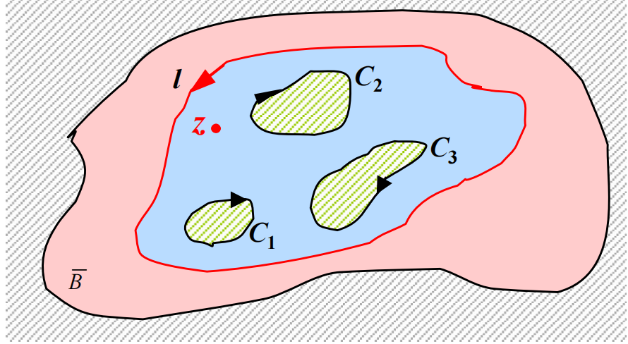
> - ==🔴无界区域的柯西公式==
>   - 若 $f(\zeta)$ 在闭曲线 $l$ 的外部解析，并在 $\zeta\to\infty$ 时有有限值 $f(\infty)$，则对外部点 $z$（$l$ 取顺时针方向），==$f(z)=\frac1{2\pi\mathrm{i}}\oint_l\frac{f(\zeta)}{\zeta-z}\,d\zeta+f(\infty)$==。
>   - 当 $f(\infty)=0$ 时，上式最后一项消失。

**[ 例题 ] 含参数的圆周积分**

设 $a\ne0$、$|a|\ne\rho$、$\rho>0$，计算 $\displaystyle I=\oint_{|z|=\rho}\frac{|dz|}{|z-a|^2}$。

解
1. 在圆周 $|z|=\rho$ 上，$\bar z=\rho^2/z$，且按逆时针参数化有 $|dz|=-\mathrm{i}\rho\,dz/z$。
2. 又 $|z-a|^2=(z-a)(\bar z-\bar a)=\frac{(z-a)(\rho^2-\bar a z)}{z}$，故

$\displaystyle I=-\mathrm{i}\rho\oint_{|z|=\rho}\frac{dz}{(z-a)(\rho^2-\bar a z)}$。

3. 被积式的候选奇点为 $z=a$ 与 $z=\rho^2/\bar a$，二者的模分别为 $|a|$ 与 $\rho^2/|a|$，恰有一个位于圆内。
4. 当 $|a|<\rho$ 时，$f_1(z)=1/(\rho^2-\bar a z)$ 在 $|z|\le\rho$ 内解析。因此
$$
I=-\mathrm{i}\rho(2\pi\mathrm{i})f_1(a)
=\frac{2\pi\rho}{\rho^2-|a|^2}.
$$
5. 当 $|a|>\rho$ 时，圆内奇点为 $b=\rho^2/\bar a$。将分母改写为
$$
(z-a)(\rho^2-\bar a z)=-\bar a(z-a)(z-b),
$$
故
$$
\begin{aligned}
I&=\frac{\mathrm{i}\rho}{\bar a}\oint_{|z|=\rho}\frac{1}{z-a}\frac{dz}{z-b}\\
&=\frac{\mathrm{i}\rho}{\bar a}(2\pi\mathrm{i})\frac1{b-a}\\
&=\frac{2\pi\rho}{|a|^2-\rho^2}.
\end{aligned}
$$
6. 两种情形合并后取绝对值。
**结论：** $\displaystyle I=\frac{2\pi\rho}{\bigl|\rho^2-|a|^2\bigr|}$。条件 $|a|\ne\rho$ 正是为了避免奇点落在积分路径上。

#### 2.4.3 高阶导数公式
> [!knowledge]
> - ==🔴高阶导数公式==
>   - 若 $f$ 在闭曲线 $l$ 及其内部解析，$l$ 正向围绕 $z$，则对 $n=1,2,\ldots$，
>   - ==$f^{(n)}(z)=\frac{n!}{2\pi\mathrm{i}}\oint_l\frac{f(\zeta)}{(\zeta-z)^{n+1}}\,d\zeta$==
> - **结论：** 解析函数的任意阶导数仍解析；该公式可将难积分化为已知函数的导数。

**证明：高阶导数公式**
先证一阶情形。令
$$
d=\min_{\zeta\in l}|\zeta-z|>0,
$$
并取 $|\Delta z|<d/2$，则 $z+\Delta z$ 仍在 $l$ 内，且对任意 $\zeta\in l$ 有 $|\zeta-z-\Delta z|\ge d/2$。分别对 $z$ 与 $z+\Delta z$ 使用柯西积分公式：
$$
f(z+\Delta z)-f(z)
=\frac1{2\pi\mathrm{i}}\oint_lf(\zeta)
\left(\frac1{\zeta-z-\Delta z}-\frac1{\zeta-z}\right)d\zeta.
$$
括号内通分为
$$
\frac1{\zeta-z-\Delta z}-\frac1{\zeta-z}
=\frac{\Delta z}{(\zeta-z-\Delta z)(\zeta-z)}
$$
，故
$$
\frac{f(z+\Delta z)-f(z)}{\Delta z}
=\frac1{2\pi\mathrm{i}}\oint_l
\frac{f(\zeta)}{(\zeta-z-\Delta z)(\zeta-z)}\,d\zeta.
$$
为说明极限可移入积分，设 $M=\max_{\zeta\in l}|f(\zeta)|$，$L$ 为 $l$ 的长度。两核之差满足
$$
\begin{aligned}
&\left|\frac1{(\zeta-z-\Delta z)(\zeta-z)}-\frac1{(\zeta-z)^2}\right|\\
&\qquad=\frac{|\Delta z|}{|\zeta-z-\Delta z|\,|\zeta-z|^2}
\le\frac{2|\Delta z|}{d^3}.
\end{aligned}
$$
故积分差的模不超过 $ML|\Delta z|/(\pi d^3)$，当 $\Delta z\to0$ 时趋于 $0$。由此严格得到
$$
f'(z)=\frac1{2\pi\mathrm{i}}\oint_l\frac{f(\zeta)}{(\zeta-z)^2}\,d\zeta.
$$
设对某个 $n\ge1$ 已有
$$
f^{(n)}(z)=\frac{n!}{2\pi\mathrm{i}}\oint_l\frac{f(\zeta)}{(\zeta-z)^{n+1}}\,d\zeta.
$$
对该式按同一差商估计求导，且
$$
\frac{d}{dz}(\zeta-z)^{-n-1}=(n+1)(\zeta-z)^{-n-2},
$$
于是
$$
f^{(n+1)}(z)=\frac{(n+1)!}{2\pi\mathrm{i}}\oint_l\frac{f(\zeta)}{(\zeta-z)^{n+2}}\,d\zeta.
$$
由数学归纳法，即得所有 $n\ge1$ 的公式。

**[ 例题 ] 课件例 1：高阶导数公式**

设 $l$ 正向围绕 $\mathrm{i}$ 一周，计算
$$
\oint_l\frac{\cos z}{(z-\mathrm{i})^3}\,dz.
$$

解
1. 分母可写成 $(z-\mathrm{i})^{2+1}$，故取 $f(z)=\cos z$、$n=2$，直接应用柯西高阶导数公式：
$$
\oint_l\frac{\cos z}{(z-\mathrm{i})^3}\,dz
=\frac{2\pi\mathrm{i}}{2!}\left.\frac{d^2}{dz^2}\cos z\right|_{z=\mathrm{i}}
=-\pi\mathrm{i}\cos\mathrm{i}.
$$
2. 由 $\cos\mathrm{i}=(e^{-1}+e)/2$，得到
$$
\oint_l\frac{\cos z}{(z-\mathrm{i})^3}\,dz
=-\frac{\pi\mathrm{i}}2\left(e^{-1}+e\right).
$$

**结论：** $\displaystyle\oint_l\frac{\cos z}{(z-\mathrm{i})^3}\,dz=-\pi\mathrm{i}\cos\mathrm{i}=-\frac{\pi\mathrm{i}}2(e^{-1}+e)$。

**[ 例题 ] 课件例 4：复连通域与高阶导数公式**

计算
$$
\oint_C\frac{e^z}{(z^2+1)^2}\,dz,
\qquad C:\ |z|=r>1,
$$
其中 $C$ 取正向。

解
1. 因
$$
(z^2+1)^2=(z-\mathrm{i})^2(z+\mathrm{i})^2,
$$
被积函数在 $C$ 内的 $z=\mathrm{i}$ 与 $z=-\mathrm{i}$ 处不解析。分别以 $\mathrm{i}$、$-\mathrm{i}$ 为中心作正向小圆周 $C_1,C_2$；函数在由 $C,C_1,C_2$ 围成的复连通域内解析，故
$$
\oint_C\frac{e^z}{(z^2+1)^2}\,dz
=\oint_{C_1}\frac{e^z}{(z^2+1)^2}\,dz
+\oint_{C_2}\frac{e^z}{(z^2+1)^2}\,dz.
$$
2. 对 $C_1$，将 $(z-\mathrm{i})^2$ 提出：
$$
\begin{aligned}
\oint_{C_1}\frac{e^z}{(z^2+1)^2}\,dz
&=\oint_{C_1}\frac{e^z/(z+\mathrm{i})^2}{(z-\mathrm{i})^2}\,dz\\
&=\left.2\pi\mathrm{i}\left[\frac{e^z}{(z+\mathrm{i})^2}\right]'\right|_{z=\mathrm{i}}\\
&=\frac{(1-\mathrm{i})e^{\mathrm{i}}}{2}\pi.
\end{aligned}
$$
3. 同样，对 $C_2$ 有
$$
\begin{aligned}
\oint_{C_2}\frac{e^z}{(z^2+1)^2}\,dz
&=\left.2\pi\mathrm{i}\left[\frac{e^z}{(z-\mathrm{i})^2}\right]'\right|_{z=-\mathrm{i}}\\
&=-\frac{(1+\mathrm{i})e^{-\mathrm{i}}}{2}\pi.
\end{aligned}
$$
4. 两项相加，并按课件的方式整理：
$$
\begin{aligned}
\oint_C\frac{e^z}{(z^2+1)^2}\,dz
&=\frac{\pi}{2}\left[(1-\mathrm{i})e^{\mathrm{i}}-(1+\mathrm{i})e^{-\mathrm{i}}\right]\\
&=\frac{\pi}{2}(1-\mathrm{i})\left(e^{\mathrm{i}}-\mathrm{i}e^{-\mathrm{i}}\right)\\
&=\mathrm{i}\pi(\sin1-\cos1).
\end{aligned}
$$

**结论：** $\displaystyle\oint_C\frac{e^z}{(z^2+1)^2}\,dz=\mathrm{i}\pi(\sin1-\cos1)$。多个奇点时，先以复连通域定理拆为各小圆积分，再分别使用高阶导数公式。

#### 2.4.4 本节附录结论

> [!knowledge]
> - ==🔴Morera 定理==
>   - 若 $f$ 在区域 $G$ 连续，且对 $G$ 内任何闭合围道 $l$ 都有 $\oint_lf(z)\,dz=0$，则 $f$ 在 $G$ 内解析。
> - ==🔴模数定理与 Liouville 定理==
>   - **模数定理：** $f$ 在某闭区域上解析时，$|f(z)|$ 只能在边界线上取极大值。
>   - **Liouville 定理：** 若 $f$ 在全平面解析且有界，则 $f$ 为复常数。
> - ==🔴柯西型积分==
>   - 若 $f$ 在光滑曲线 $l$ 上连续，$z$ 在 $l$ 外，则 $F(z)=\frac1{2\pi\mathrm{i}}\int_l\frac{f(\zeta)}{\zeta-z}\,d\zeta$ 在曲线外解析。
>   - 若 $l$ 为闭曲线且 $f$ 在曲线及内部解析，该积分退化为柯西积分公式中的 $f(z)$。

**证明要点：三个附录结论**

**Morera 定理：** 在 $G$ 内固定 $z_0$，令 $F(z)=\int_{z_0}^zf(\zeta)d\zeta$。闭路积分均为零保证该积分与路径无关；按原函数定理 $F'=f$，故 $f$ 解析。

**Liouville 定理：** 若全纯函数满足 $|f|\le N$，在任意以 $z$ 为中心、半径 $R$ 的圆上由柯西导数公式有
$$
|f'(z)|\le\frac{1!}{R}\max_{|\zeta-z|=R}|f(\zeta)|\le\frac NR.
$$
$R\to\infty$ 得 $f'(z)=0$，所以 $f$ 为常数。

**柯西型积分：** 当 $z$ 在 $l$ 外时，分母与 $0$ 有正距离，可在积分号内取极限，故
$$
F'(z)=\frac1{2\pi\mathrm{i}}\int_l\frac{f(\zeta)}{(\zeta-z)^2}\,d\zeta.
$$
因而 $F$ 在曲线外解析；只有当 $f$ 同时在闭曲线内部解析时，才可进一步把它识别为原函数值。

**[ 例题 ] 课件例 5：由柯西高阶导数公式导出 Hermite 形式**

已知
$$
y(t,q)=\exp(2tq-t^2),
$$
证明
$$
\left.\frac{\partial^ny(t,q)}{\partial t^n}\right|_{t=0}
=(-1)^ne^{q^2}\frac{d^n}{dq^n}e^{-q^2}.
$$

解
1. 将高阶导数公式中的自变量记作 $t$。因为 $y$ 同时依赖于 $t,q$，对 $t$ 求导应写为偏导数：
$$
\frac{\partial^ny(t,q)}{\partial t^n}
=\frac{n!}{2\pi\mathrm{i}}
\oint_L\frac{y(\xi,q)}{(\xi-t)^{n+1}}\,d\xi
=\frac{n!}{2\pi\mathrm{i}}
\oint_L\frac{e^{2\xi q-\xi^2}}{(\xi-t)^{n+1}}\,d\xi.
$$
2. 令 $t=0$，得到
$$
\left.\frac{\partial^ny(t,q)}{\partial t^n}\right|_{t=0}
=\frac{n!}{2\pi\mathrm{i}}
\oint_L\frac{e^{2\xi q-\xi^2}}{\xi^{n+1}}\,d\xi.
$$
3. 按课件作变量代换 $\xi=q-z$。此时
$$
\begin{aligned}
2\xi q-\xi^2
&=2(q-z)q-(q-z)^2\\
&=q^2-z^2,
\end{aligned}
$$
且 $d\xi=-dz$、$\xi^{n+1}=(q-z)^{n+1}$。将像曲线仍记为 $L$，有
$$
\begin{aligned}
\left.\frac{\partial^ny(t,q)}{\partial t^n}\right|_{t=0}
&=\frac{n!}{2\pi\mathrm{i}}\oint_L
\frac{e^{q^2-z^2}}{(q-z)^{n+1}}(-dz)\\
&=(-1)^ne^{q^2}\frac{n!}{2\pi\mathrm{i}}
\oint_L\frac{e^{-z^2}}{(z-q)^{n+1}}\,dz.
\end{aligned}
$$
4. 对函数 $e^{-z^2}$ 在点 $q$ 使用柯西高阶导数公式，最后一个积分为
$$
\frac{d^n}{dq^n}e^{-q^2}.
$$

**结论：** $\displaystyle\left.\frac{\partial^ny(t,q)}{\partial t^n}\right|_{t=0}=(-1)^ne^{q^2}\frac{d^n}{dq^n}e^{-q^2}$。

**[ 例题 ] 课件例 6：Cauchy 型积分**

计算
$$
f(z)=\frac1{2\pi\mathrm{i}}
\oint_{|\zeta|=1}\frac{\zeta^*}{\zeta-z}\,d\zeta,
\qquad |z|\ne1.
$$

解
1. 这是 Cauchy 型积分。虽然 $\zeta^*$ 在全平面内不解析，但在单位圆 $|\zeta|=1$ 上有 $\zeta^*=1/\zeta$，因此
$$
f(z)=\frac1{2\pi\mathrm{i}}
\oint_{|\zeta|=1}\frac{1}{\zeta(\zeta-z)}\,d\zeta.
$$
2. 当 $|z|>1$ 时，$\zeta-z$ 的零点在单位圆外。把被积式按课件分解为
$$
\frac1{\zeta(\zeta-z)}
=\frac1z\left(\frac1{\zeta-z}-\frac1\zeta\right).
$$
于是
$$
\begin{aligned}
f(z)
&=\frac1{2\pi\mathrm{i}z}
\left(\oint_{|\zeta|=1}\frac{d\zeta}{\zeta-z}
-\oint_{|\zeta|=1}\frac{d\zeta}{\zeta}\right)\\
&=\frac1{2\pi\mathrm{i}z}(0-2\pi\mathrm{i})
=-\frac1z.
\end{aligned}
$$
3. 当 $0<|z|<1$ 时，$0,z$ 都在单位圆内，故上式括号中的两个积分都等于 $2\pi\mathrm{i}$，从而
$$
f(z)=\frac1{2\pi\mathrm{i}z}(2\pi\mathrm{i}-2\pi\mathrm{i})=0.
$$
4. 当 $z=0$ 时，原积分化为
$$
f(0)=\frac1{2\pi\mathrm{i}}\oint_{|\zeta|=1}\frac{d\zeta}{\zeta^2}=0.
$$

**结论：**
$$
f(z)=
\begin{cases}
-\dfrac1z,&|z|>1,\\[4pt]
0,&|z|<1.
\end{cases}
$$
因而 $f$ 在 $|z|\ne1$ 的区域内解析；这也说明 Cauchy 型积分的核可在曲线上有定义，即使其边界数据未在全平面解析。

## 第 3 章：级数、解析延拓、奇点与特殊函数

### 3.1 复数项级数

#### 3.1.1 定义与收敛
> [!knowledge]
> - ==🔴复数项级数==
>   - 写作 $\sum_{k=0}^{\infty}w_k$，其中 $w_k=u_k+\mathrm{i}v_k$。
> - ==🔴收敛判定==
>   - **定义：** 部分和 $s_n=\sum_{k=0}^{n}w_k$ 的极限 $\lim_{n\to\infty}s_n$ 存在且有限。
>   - **实虚部判定：** 原级数收敛，当且仅当两个实数项级数 $\sum u_k$ 与 $\sum v_k$ 都收敛。

**[ 例题 ] 例 1：按部分和判别复数项级数**

判别 $\displaystyle\sum_{k=1}^{\infty}\frac{3\mathrm{i}}{2^k}$ 的敛散性。

解
1. 取前 $n$ 项部分和，先提出常数 $3\mathrm{i}$：
$$
s_n=3\mathrm{i}\sum_{k=1}^n\frac1{2^k}.
$$
2. 有限等比和为 $\sum_{k=1}^n2^{-k}=1-2^{-n}$，故
$$
s_n=3\mathrm{i}(1-2^{-n}).
$$
3. 当 $n\to\infty$，$2^{-n}\to0$，于是 $s_n\to3\mathrm{i}$。

**结论：** 该级数收敛，且和为 $3\mathrm{i}$。复数项级数的“和”同样由部分和的极限定义。

**[ 例题 ] 例 2：几何级数**

求几何级数 $\displaystyle\sum_{k=0}^{\infty}z^k$ 的和，并说明其收敛条件。

解
1. 先取前 $n+1$ 项部分和 $s_n=1+z+\cdots+z^n$。当 $z\ne1$ 时，用 $(1-z)s_n=1-z^{n+1}$ 得 $s_n=\frac{1-z^{n+1}}{1-z}$。
2. 若 $|z|<1$，则 $z^{n+1}\to0$，故部分和有有限极限。
3. 若 $|z|>1$，项 $z^n$ 不趋于 $0$；若 $|z|=1$，则 $|z^n|=1$，通项同样不趋于 $0$。两种情形都不满足级数收敛的必要条件。

**结论：** 当且仅当 $|z|<1$ 时，$\displaystyle\sum_{k=0}^{\infty}z^k=\frac1{1-z}$。

**[ 例题 ] 例 3：实虚部分开判定**

用“实部、虚部分别收敛”判别：

1. $\displaystyle\sum_{n=1}^{\infty}\frac{1}{n}\left(1+\frac{\mathrm{i}}{n}\right)$；
2. $\displaystyle\sum_{n=1}^{\infty}\frac{1}{n^2}\left(1+\frac{\mathrm{i}}{n}\right)$。

解
1. 第 1 个级数的实部为 $\sum1/n$，虚部为 $\sum1/n^2$。虽然虚部级数收敛，但调和级数 $\sum1/n$ 发散。
2. 因复数项级数收敛要求实、虚部级数==同时==收敛，第 1 个复级数发散。
3. 第 2 个级数的实部为 $\sum1/n^2$，虚部为 $\sum1/n^3$；二者都是 $p$ 级数且 $p>1$。
4. 因此第 2 个复级数收敛。

**结论：** 第 1 个级数发散，第 2 个级数收敛。不能只检查模或只检查其中一个分量。

#### 3.1.2 柯西判据与绝对收敛
> [!knowledge]
> - ==🔴柯西判据==
>   - 对任意 $\varepsilon>0$，存在 $N$，使 $n>N$ 时 $|s_{n+p}-s_n|=|\sum_{k=n+1}^{n+p}w_k|<\varepsilon$，其中 $p$ 为任意正整数。
>   - **必要条件：** $\lim_{n\to\infty}w_n=0$。
> - ==🔴绝对收敛==
>   - 当 $\sum|w_k|$ 收敛时，称 $\sum w_k$ 绝对收敛；这等价于 $\sum u_k$ 与 $\sum v_k$ 都绝对收敛。
>   - **性质：** 绝对收敛 $\Rightarrow$ 收敛；允许重排、拆成子级数，且和与积仍绝对收敛。
> - ==🔴柯西乘积==
>   - 若 $A=\sum p_k$、$B=\sum q_l$，则 $AB=\sum_{n=0}^{\infty}c_n$，其中 $c_n=\sum_{k=0}^{n}p_kq_{\,n-k}$。
>   - **记忆：** 按 $k+l=n$ 的对角线求和；绝对收敛时可按任意顺序求和。

#### 3.1.3 绝对收敛判别法
> [!knowledge]
> - ==🔴绝对收敛的判别思路==
>   - $\sum\vert u_n\vert$ 的每一项都是正实数，因此绝对收敛问题可化为正项级数判别。
>
> | 方法 | 判据量 | 绝对收敛 | 发散 |
> | --- | --- | --- | --- |
> | 比值法 | 存在 $\rho<1$，使充分大 $n$ 时 $\left\vert u_{n+1}/u_n\right\vert\le\rho$ | $\sum u_n$ 绝对收敛 | 若充分大 $n$ 时 $\left\vert u_{n+1}/u_n\right\vert\ge\rho>1$，则发散 |
> | 达朗贝尔法 | $\overline{\lim}\left\vert u_{n+1}/u_n\right\vert$ | 上极限 $<1$ 时绝对收敛 | 下极限 $>1$ 时 $\sum\vert u_n\vert$ 发散 |
> | 柯西根值法 | $\overline{\lim}\vert u_n\vert^{1/n}$ | 小于 $1$ 时绝对收敛 | 大于 $1$ 时发散 |
>
> - ==🔴选法提示==
>   - 比值式常比 $u_n$ 本身简单；根值法适合含 $n$ 次幂或阶乘的通项；判据量等于 $1$ 时三者通常失效。

#### 3.1.4 函数项级数与一致收敛
> [!knowledge]
> - ==🔴函数项级数==
>   - $w_k(z)$ 定义在区域 $B$ 上，$\sum w_k(z)$ 为函数项级数；选定 $z$ 后即化为数项级数。
> - ==🔴逐点收敛与一致收敛==
>   - **逐点收敛：** $B$ 内每一点都收敛时，和函数 $S(z)$ 在 $B$ 内单值，全部收敛点构成收敛域。
>   - **一致收敛：** 对任意 $\varepsilon>0$，存在与 $z$ 无关的 $N(\varepsilon)$，使 $n>N(\varepsilon)$ 时 $|S(z)-\sum_{k=1}^{n}w_k(z)|<\varepsilon$ 对 $B$ 内一切 $z$ 成立。
>   - **区别：** 普通收敛中的 $N(z,\varepsilon)$ 可以随 $z$ 改变。

> [!knowledge]
> - ==🔴一致收敛保留的性质==
>   - **连续性：** $w_k(z)$ 在 $B$ 内连续且级数一致收敛，则和函数连续，可逐项求极限。
>   - **逐项积分：** $w_k$ 在分段光滑曲线 $l$ 上连续且级数在 $l$ 上一致收敛，则可沿 $l$ 逐项积分。
>   - **解析性：** $w_k$ 在闭区域 $B$ 内单值解析且一致收敛，则和函数单值解析，各阶导数可逐项求导；导级数在任意闭区域上一致收敛。

> [!knowledge]
> - ==🔴魏尔斯特拉斯 M 判别法==
>   - 若对区域内每个 $z$ 都有 $|w_k(z)|\le M_k$，且正项级数 $\sum M_k$ 收敛，则 $\sum w_k(z)$ 绝对一致收敛。

**[ 例题 ] 例 4：几何级数的一致收敛**

讨论 $\sum_{k=0}^{\infty}z^k$ 的收敛性，以及它在闭圆 $|z|\le r\ (r<1)$ 上的一致收敛性。

解
1. 固定任意 $z$。当 $|z|<1$ 时，$\sum|z|^k$ 是收敛的实几何级数，因此原级数绝对收敛，和为 $1/(1-z)$。
2. 现在把 $z$ 限制在闭圆 $|z|\le r$。对所有 $z$ 及任意 $k$，均有 $|z^k|\le r^k$。
3. 因 $r<1$，控制级数 $\sum r^k$ 收敛；其上界与 $z$ 无关。
4. 由 M 判别法，原级数在该闭圆上绝对一致收敛。

**结论：** 几何级数在开单位圆内逐点绝对收敛；在任意严格包含于开单位圆的闭圆上==绝对一致收敛==。

#### 3.1.5 含参量反常积分的解析性

> [!knowledge]
> - ==🔴含参量反常积分的解析性==
>   - 对 $F(z)=\int_a^\infty f(t,z)\,dt$，若满足下列条件，则 $F$ 保持解析性。
>   - **条件：**
>     1. $f(t,z)$ 是 $t$ 和 $z$ 的连续函数，$t>a$，$z\in\overline{G}$。
>     2. 对每个 $t\ge a$，$f(t,z)$ 是 $\overline{G}$ 上的单值解析函数。
>     3. $\int_a^{\infty}f(t,z)\,dt$ 在 $\overline{G}$ 上一致收敛。
>   - **结论：** $F(z)$ 在 $G$ 内解析，且 $F'(z)=\int_a^{\infty}\frac{\partial f(t,z)}{\partial z}\,dt$。

**证明思路**

1. **分段：** 取无界序列 $a=a_0<a_1<\cdots\to\infty$，令 $u_n(z)=\int_{a_n}^{a_{n+1}}f(t,z)\,dt$；由含参量定积分定理，$u_n$ 在 $G$ 内单值解析。
2. **合并：** $F(z)=\sum_{n=0}^{\infty}u_n(z)$ 在 $\overline{G}$ 上一致收敛，故由魏尔斯特拉斯定理，$F$ 在 $G$ 内解析且可逐项求导。

### 3.2 幂级数

#### 3.2.1 阿贝尔定理与收敛圆

> [!knowledge]
> - ==🔴幂级数==
>   - 形式为 $\sum_{n=0}^{\infty}a_n(z-a)^n$。
> - ==🔴阿贝尔第一定理==
>   - 若级数在 $z_0$ 点收敛，则在圆 $|z-a|<|z_0-a|$ 内绝对收敛。
>   - 若 $|z-a|\le r<|z_0-a|$，则该闭圆内一致收敛。
> - ==🔴收敛圆==
>   - 一部分点收敛、另一部分点发散时，分界线一定是圆。
>   - **注意：** 圆周上的敛散性必须逐点讨论。

**证明：阿贝尔定理与收敛圆**

若级数在 $z_0$ 收敛，则其通项 $a_n(z_0-a)^n$ 趋于 $0$，从而数列 $|a_n(z_0-a)^n|$ 有界。设对所有 $n$ 都有
$$
|a_n(z_0-a)^n|\le M.
$$
对任意 $|z-a|\le r<|z_0-a|$，令 $q=r/|z_0-a|<1$，则逐项有
$$
\begin{aligned}
|a_n(z-a)^n|
&=|a_n(z_0-a)^n|\left|\frac{z-a}{z_0-a}\right|^n\\
&\le M\left(\frac r{|z_0-a|}\right)^n=Mq^n.
\end{aligned}
$$
由于正项几何级数 $\sum_{n=0}^{\infty}Mq^n$ 收敛，M 判别法说明原幂级数在 $|z-a|\le r$ 上绝对一致收敛；特别地，它在 $|z-a|<|z_0-a|$ 内绝对收敛。

再设级数在 $z_1$ 发散，并反设存在一点 $z$ 满足 $|z-a|>|z_1-a|$ 而级数在 $z$ 收敛。把刚才的结论用于这个收敛点 $z$，就会推出它在圆 $|w-a|<|z-a|$ 内绝对收敛；但 $z_1$ 位于该圆内，这与 $z_1$ 处发散矛盾。因此对一切 $|z-a|>|z_1-a|$，级数均发散。由“某个收敛点以内全收敛”与“某个发散点以外全发散”共同确定了以 $a$ 为中心的收敛圆；圆周本身不由该论证决定，必须逐点另查。

#### 3.2.2 收敛半径的求法

> [!knowledge]
> - ==🔴比值法==
>   - 若 $\lim_{k\to\infty}|a_{k+1}/a_k|=\lambda$，则 $R=1/\lambda$；约定 $\lambda=0$ 时 $R=\infty$，$\lambda=\infty$ 时 $R=0$。
> - ==🔴根值法（柯西--Hadamard）==
>   - $\displaystyle R=\frac1{\limsup_{k\to\infty}\sqrt[k]{|a_k|}}$；根值极限存在时，取该极限的倒数即可。
> - ==🔴边界判断==
>   - 上述判据只决定 $|z-a|<R$ 与 $|z-a|>R$；在 $|z-a|=R$ 上仍须逐点检查。

**[ 例题 ] 例 1：求收敛半径**

求幂级数 $\displaystyle\sum_{k=0}^{\infty}(\cos\mathrm{i}k)z^k$ 的收敛半径。

解
1. 系数为 $a_k=\cos(\mathrm{i}k)=\cosh k=\frac12(e^k+e^{-k})$。
2. 计算相邻系数比：$\left|\frac{a_{k+1}}{a_k}\right|=\frac{e^{k+1}+e^{-k-1}}{e^k+e^{-k}}\to e$。
3. 因该极限存在且非零，按比值法收敛半径为其倒数。

**结论：** $R=1/e$，故级数在 $|z|<1/e$ 内收敛。

**[ 例题 ] 例 1–例 2：直接计算与代换**

求 $1+t+t^2+\cdots$（$t$ 为复数）与 $1-z^2+z^4-z^6+\cdots$ 的收敛圆。

解
1. 对第一个级数，各系数均为 $1$，故 $R_t=\lim|a_k/a_{k+1}|=1$；也可直接识别为几何级数。
2. 对第二个级数令 $t=z^2$，得到 $1-t+t^2-t^3+\cdots$，这是以 $-t$ 为公比的几何级数。
3. 该 $t$ 级数的收敛条件为 $|t|<1$，即 $|z|^2<1$，所以 $|z|<1$。
4. 在此范围内，它的和为 $1/(1+t)=1/(1+z^2)$。

**结论：** 两个级数的收敛半径均为 $1$；代换后必须把收敛条件==换回原变量==。

**[ 例题 ] 例 3：复系数幂级数**

求复系数幂级数 $\displaystyle\sum_{n=0}^{\infty}(1+\mathrm{i})^nz^n$ 的收敛半径。

解
1. 写成极坐标形式：$1+\mathrm{i}=\sqrt2\,e^{\mathrm{i}\pi/4}$，故 $a_n=(\sqrt2)^ne^{\mathrm{i}n\pi/4}$。
2. 直接计算模的比值：$\left|a_{n+1}/a_n\right|=|1+\mathrm{i}|=\sqrt2$。
3. 按比值法，收敛半径为该极限的倒数。

**结论：** $R=1/\sqrt2=\sqrt2/2$。

**[ 例题 ] 例 7：极限失效时拆分奇偶项**

讨论 $\displaystyle\sum_{k=1}^{\infty}[2+(-1)^k]^kz^k$ 的收敛半径。

解
1. 系数随奇偶 $k$ 交替取不同形式，直接计算相邻系数比或根值极限会失效，因此不能机械套用比值法、根值法。
2. 将偶数项与奇数项分开。偶数项给出 $\sum_{n=0}^{\infty}3^{2n}z^{2n}=\sum_{n=0}^{\infty}(9z^2)^n$；奇数项给出 $\sum_{n=0}^{\infty}z^{2n+1}=z\sum_{n=0}^{\infty}(z^2)^n$。
3. 第一子级数要求 $|9z^2|<1$，即 $|z|<1/3$；第二子级数只要求 $|z|<1$。
4. 原级数必须让两个子级数同时收敛，故取两者的公共区域。

**结论：** 收敛圆为 $|z|<1/3$，即 $R=1/3$。极限判据失效时，拆分结构往往比硬算极限更可靠。

#### 3.2.3 收敛圆内的性质

> [!knowledge]
> - ==🔴收敛圆内的基本性质==
>   - 幂级数在收敛圆内绝对收敛，并在任意严格包含于收敛圆内的闭圆上一致收敛。
>   - **逐项积分与求导：** 在收敛圆内可任意逐项积分、逐项求导。
>   - **相乘：** 两级数在公共收敛域内绝对收敛，故可作 Cauchy 乘积。
> - ==🔴系数的积分表示==
>   - 若 $w(z)=\sum_{k=0}^\infty a_k(z-z_0)^k$，任取完全落在收敛圆内并围绕 $z_0$ 的正向闭曲线 $l$，则 $a_k=\frac1{2\pi\mathrm{i}}\oint_l\frac{w(\zeta)}{(\zeta-z_0)^{k+1}}\,d\zeta$。
>   - 它与 $a_k=w^{(k)}(z_0)/k!$ 等价，说明系数可由边界积分恢复。

**[ 例题 ] 例 4：级数的回路积分**

计算 $\displaystyle\oint_l\left(\sum_{n=-1}^{\infty}z^n\right)dz$，其中 $l:|z|=1/2$ 取正向。

解
1. 在 $|z|=1/2<1$ 上，$\sum_{n=0}^{\infty}z^n$ 一致收敛，因此可先求其和再积分。
2. 和函数为 $w(z)=z^{-1}+\sum_{n=0}^{\infty}z^n=\frac1z+\frac1{1-z}=\frac1z-\frac1{z-1}$。
3. 回路包围 $z=0$，但不包围 $z=1$。所以 $\oint_l\frac{dz}{z}=2\pi\mathrm{i}$，而 $\oint_l\frac{dz}{z-1}=0$。
4. 将两项相减即可。

**结论：** $\displaystyle I=2\pi\mathrm{i}$。逐项积分前，应先核对级数在积分曲线上的一致收敛。

#### 3.2.4 思考与检查

> [!knowledge]
> - ==🔴收敛圆周的判断==
>   - 若 $\sum\alpha_k$ 与 $\sum\beta_k$ 均发散，$\sum(\alpha_k\pm\beta_k)$ 不一定发散。
>   - 对幂级数，圆周上 $|z-z_0|=R$ 已固定；应把每个边界点代入，按复数项级数的敛散性逐点讨论。

### 3.3 泰勒级数展开

#### 3.3.1 泰勒定理与唯一性
> [!knowledge]
> - ==🔴泰勒展开定理==
>   - 设 $d$ 为 $z_0$ 到区域 $B$ 边界各点的最短距离。若 $f(z)$ 在 $B$ 内解析，则在 $|z-z_0|<d$ 内有 $f(z)=\sum_{n=0}^{\infty}\frac{f^{(n)}(z_0)}{n!}(z-z_0)^n$。
>   - $z_0=0$ 时称为麦克劳林（Maclaurin）级数。
> - ==🔴说明==
>   - 函数是解析函数，可以保证无限次求导；
>   - 同一展开中心（$z_0$）下的幂级数表示唯一，换中心则可能得到不同的泰勒级数。

**证明：泰勒定理**
任取 $0<R<d$，令 $C_R:|\zeta-z_0|=R$ 取正向。圆周及其内部全在 $B$ 中。对任意满足 $|z-z_0|<R$ 的点，由柯西积分公式
$$
f(z)=\frac1{2\pi\mathrm{i}}\oint_{C_R}\frac{f(\zeta)}{\zeta-z}\,d\zeta.
$$
现在展开积分核。因为 $\zeta-z=(\zeta-z_0)-(z-z_0)$，
$$
\frac1{\zeta-z}
=\frac1{\zeta-z_0}\frac1{1-\frac{z-z_0}{\zeta-z_0}}.
$$
又在圆周上
$$
\left|\frac{z-z_0}{\zeta-z_0}\right|=\frac{|z-z_0|}{R}<1,
$$
所以几何级数给出
$$
\begin{aligned}
\frac1{\zeta-z}
&=\frac1{\zeta-z_0}\left[1+\frac{z-z_0}{\zeta-z_0}+\left(\frac{z-z_0}{\zeta-z_0}\right)^2+\cdots\right]\\
&=\sum_{n=0}^\infty\frac{(z-z_0)^n}{(\zeta-z_0)^{n+1}}.
\end{aligned}
$$
比值的模恒为 $|z-z_0|/R$，故该级数在 $C_R$ 上一致收敛，可以逐项积分。代入柯西公式：
$$
\begin{aligned}
f(z)
&=\frac1{2\pi\mathrm{i}}\oint_{C_R}\sum_{n=0}^{\infty}
\frac{f(\zeta)}{(\zeta-z_0)^{n+1}}(z-z_0)^n\,d\zeta\\
&=\sum_{n=0}^{\infty}\left[\frac1{2\pi\mathrm{i}}\oint_{C_R}
\frac{f(\zeta)}{(\zeta-z_0)^{n+1}}\,d\zeta\right](z-z_0)^n.
\end{aligned}
$$
由柯西高阶导数公式，方括号内恰为 $f^{(n)}(z_0)/n!$，于是
$$
f(z)=\sum_{n=0}^{\infty}\frac{f^{(n)}(z_0)}{n!}(z-z_0)^n.
$$
由于 $R<d$ 可以任意接近 $d$，该式对全部 $|z-z_0|<d$ 成立。若另有幂级数 $\sum b_n(z-z_0)^n$ 表示同一函数，则逐次求导并令 $z=z_0$ 得 $n!b_n=f^{(n)}(z_0)$，故 $b_n=f^{(n)}(z_0)/n!$；这证明了系数唯一性。

#### 3.3.2 将函数泰勒展开
> [!knowledge]
> - ==🔴泰勒展开的方法==
>
> | 方法 | 从哪里出发 | 适合的情形 |
> | --- | --- | --- |
> | **直接法** | 用泰勒定理逐阶求导以计算系数 | 导数形式简单、需要精确系数 |
> | **间接法** | 从已知展开式出发，结合代换、逐项求导或积分 | 变形方便时通常更简洁 |
>
> - ==🔴半径判断==
>   - 收敛半径等于展开中心到最近奇点的距离。

#### 3.3.3 常见函数的泰勒展开式
> [!knowledge]
> - ==🔴常用泰勒展开==
>   - 使用前先确认收敛范围，再作代换、求导或积分。
>
> | 函数 | 泰勒展开式 | 收敛范围 |
> | --- | --- | --- |
> | $e^z$ | $\sum_{k=0}^{\infty}\frac{z^k}{k!}$ | $\vert z\vert<\infty$ |
> | $\frac{1}{1-z}$ | $\sum_{k=0}^{\infty}z^k$ | $\vert z\vert<1$ |
> | $\frac{1}{1+z}$ | $\sum_{k=0}^{\infty}(-1)^kz^k$ | $\vert z\vert<1$ |
> | $\sin z$ | $\sum_{k=0}^{\infty}(-1)^k\frac{z^{2k+1}}{(2k+1)!}$ | $\vert z\vert<\infty$ |
> | $\cos z$ | $\sum_{k=0}^{\infty}(-1)^k\frac{z^{2k}}{(2k)!}$ | $\vert z\vert<\infty$ |
> | $\ln(1+z)$ | $\sum_{k=0}^{\infty}(-1)^k\frac{z^{k+1}}{k+1}$ | $\vert z\vert<1$ |
> | $(1+z)^{\alpha}$ | $\sum_{k=0}^{\infty}\frac{\alpha(\alpha-1)\cdots(\alpha-k+1)}{k!}z^k$ | $\vert z\vert<1$ |

**[ 例题 ] 课件例 1：直接法展开 $e^z$**

求 $e^z$ 在 $z=0$ 的泰勒展开，并说明收敛半径。

解
1. 对任意 $k=0,1,2,\ldots$，指数函数满足
$$
\bigl(e^z\bigr)^{(k)}=e^z.
$$
因而在展开中心 $z=0$，有 $\bigl(e^z\bigr)^{(k)}\big|_{z=0}=1$。
2. 泰勒系数为 $a_k=\bigl(e^z\bigr)^{(k)}\big|_{z=0}/k!=1/k!$。逐项代入泰勒级数：
$$
e^z=1+z+\frac{z^2}{2!}+\cdots+\frac{z^k}{k!}+\cdots
=\sum_{k=0}^{\infty}\frac{z^k}{k!}.
$$
3. $e^z$ 在整个复平面解析，没有有限奇点；等价地，系数比值满足
$$
\left|\frac{a_k}{a_{k+1}}\right|=k+1\longrightarrow\infty.
$$

**结论：** $\displaystyle e^z=\sum_{k=0}^{\infty}z^k/k!$，收敛半径为 $R=\infty$。

**[ 例题 ] 课件例 2：间接法展开 $\sin z$**

利用 $e^z$ 的展开求 $\sin z$ 在 $z=0$ 的泰勒展开。

解
1. 从恒等式 $\sin z=(e^{\mathrm{i}z}-e^{-\mathrm{i}z})/(2\mathrm{i})$ 出发，分别代入指数函数级数：
$$
\sin z=\frac1{2\mathrm{i}}\left[
\sum_{k=0}^{\infty}\frac{(\mathrm{i}z)^k}{k!}
-\sum_{k=0}^{\infty}\frac{(-\mathrm{i}z)^k}{k!}\right].
$$
2. 偶数次项在方括号内相消；令 $k=2n+1$，奇数次项满足
$$
\frac{(\mathrm{i}z)^{2n+1}-(-\mathrm{i}z)^{2n+1}}{2\mathrm{i}(2n+1)!}
=\frac{(-1)^nz^{2n+1}}{(2n+1)!}.
$$
3. 因此
$$
\sin z=\sum_{n=0}^{\infty}(-1)^n\frac{z^{2n+1}}{(2n+1)!}
=z-\frac{z^3}{3!}+\frac{z^5}{5!}-\cdots.
$$
4. $\sin z$ 也是整函数，故收敛半径 $R=\infty$。

**结论：** 间接法把已知的指数函数级数代入恒等式，再按偶、奇幂收集；整个过程在复平面上成立。

**[ 例题 ] 例 5：==对数主值的展开==**
在 $z=0$ 处展开主值 $\ln(1+z)$，并说明区域。
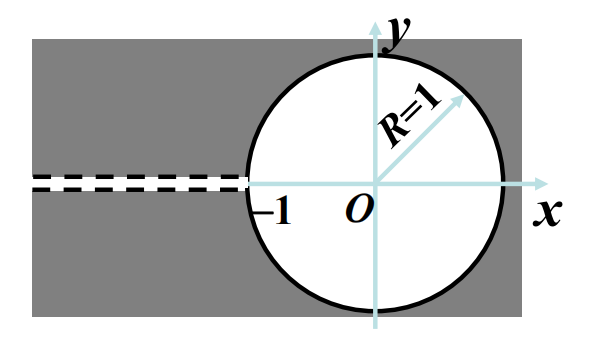
解
1. 主值 $\ln(1+z)$ 在从 $-1$ 向左沿负实轴剪开的平面内解析，$z=-1$ 是离 $0$ 最近的奇点，故收敛半径为 $1$。
2. 在 $|z|<1$ 内，$[\ln(1+z)]'=1/(1+z)=\sum_{k=0}^\infty(-1)^kz^k$。
3. 沿从 $0$ 到 $z$ 的任意曲线逐项积分，并用 $\ln(1+0)=0$ 确定常数：
$$
\ln(1+z)=\sum_{k=0}^\infty\frac{(-1)^k}{k+1}z^{k+1},\qquad |z|<1.
$$
**结论：** 逐项积分后必须用展开中心处的函数值确定积分常数；这里的“主值”决定了所选解析分支。

**补充知识**
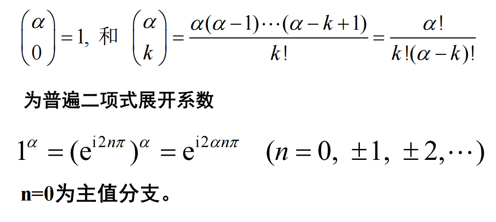

**[ 例题 ] 例 6--例 7：==广义二项式与反正切展开==**
求 $(1+z)^\alpha$ 与 $\arctan z$ 在 $z=0$ 的展开（$\alpha$ 为复数）。(求导法、积分法)
解
1. 对 $f(z)=(1+z)^\alpha$ 逐阶求导，有
$$
f^{(k)}(0)=\alpha(\alpha-1)\cdots(\alpha-k+1).
$$
因而
$$
(1+z)^\alpha=\sum_{k=0}^\infty\binom\alpha k z^k,
\qquad
\binom\alpha k=\frac{\alpha(\alpha-1)\cdots(\alpha-k+1)}{k!},\quad |z|<1.
$$
2. 对反正切，先在 $|z|<1$ 内展开 $1/(1+z^2)=\sum_{k=0}^\infty(-1)^kz^{2k}$，再由 $\arctan z=\int_0^z(1+\zeta^2)^{-1}d\zeta$ 得
$$
\arctan z=\sum_{k=0}^\infty\frac{(-1)^k}{2k+1}z^{2k+1},\qquad |z|<1.
$$
**结论：** 两题都由“先确定最近奇点和收敛域，再允许逐项积分/求导”完成；级数形式正确不等于可以忽略其收敛范围。

#### 3.3.4 例题：逐项求导与级数乘法

**[ 例题 ] 例 3：逐项求导**

把 $\displaystyle\frac{1}{(1+z)^2}$ 展开成 $z$ 的幂级数。

解
1. 最近奇点为 $z=-1$，距展开中心 $0$ 的距离为 $1$，因此展开区域先确定为 $|z|<1$。
2. 从几何级数 $\frac1{1+z}=1-z+z^2-z^3+\cdots=\sum_{k=0}^{\infty}(-1)^kz^k$ 出发。
3. 在收敛圆内可逐项求导：$-\frac1{(1+z)^2}=-1+2z-3z^2+\cdots$。
4. 两边同乘 $-1$，得到目标展开式。

**结论：** $\displaystyle\frac{1}{(1+z)^2}=\sum_{k=0}^{\infty}(-1)^k(k+1)z^k=1-2z+3z^2-\cdots\quad(|z|<1)$。

> [!knowledge]
> - ==🔴幂级数的乘法==
>    若 $F(z)=f(z)g(z)$，$f(z)=\sum_{k=0}^{\infty}a_k(z-z_0)^k$，$g(z)=\sum_{l=0}^{\infty}b_l(z-z_0)^l$，令 $k+l=n$，则 $f(z)g(z)=\sum_{n=0}^{\infty}\sum_{l=0}^{n}a_{\,n-l}b_l(z-z_0)^n$。

**[ 例题 ] 例 4：==级数乘法==**

把 $\displaystyle\frac{1}{1-3z+2z^2}$ 展开成 $z$ 的幂级数。

解
1. 先因式分解：$1-3z+2z^2=(1-z)(1-2z)$，故原函数为 $\frac1{1-z}\cdot\frac1{1-2z}$。
2. 分别用几何级数：$\frac1{1-z}=\sum_{k=0}^{\infty}z^k$（$|z|<1$），$\frac1{1-2z}=\sum_{l=0}^{\infty}2^lz^l$（$|z|<1/2$）。
3. 公共收敛域为 $|z|<1/2$。在其中相乘并按 $k+l=n$ 收集 $z^n$ 的系数，系数为 $\sum_{l=0}^{n}2^l=2^{n+1}-1$。

**结论：** $\displaystyle\frac{1}{1-3z+2z^2}=\sum_{n=0}^{\infty}(2^{n+1}-1)z^n\quad(|z|<1/2)$。

**[ 例题 ] 指数函数除以一次式的麦克劳林展开**

在 $|z|<1$ 内把 $\displaystyle\frac{e^z}{1+z}$ 展开为幂级数。

解
1. 设 $f(z)=e^z/(1+z)=\sum_{n=0}^\infty a_nz^n$。由 $(1+z)f(z)=e^z$ 比较系数，得到
$$
a_0=1,\qquad a_n+a_{n-1}=\frac1{n!}\quad(n\ge1).
$$
2. 递推展开为 $a_n=\sum_{k=0}^n(-1)^{n-k}/k!=(-1)^n\sum_{k=0}^n(-1)^k/k!$。
3. 也可直接将 $e^z=\sum z^k/k!$ 与 $(1+z)^{-1}=\sum(-1)^lz^l$ 相乘，得到同一 Cauchy 乘积。

**结论：**
$$
\frac{e^z}{1+z}=\sum_{n=0}^\infty\left(\sum_{k=0}^n\frac{(-1)^{n-k}}{k!}\right)z^n,\qquad |z|<1.
$$

#### 3.3.5 无穷远点邻域内的泰勒展开

> [!knowledge]
> - ==🔴无穷远点邻域内的泰勒展开==
>   - 若 $f(z)$ 在 $z=\infty$ 点解析，则 $f(1/t)$ 在 $t=0$ 点解析。令 $z=1/t$，有 $f(1/t)=\varphi(t)=a_0+a_1t+a_2t^2+\cdots$，其中 $|t|<r$。
>   - 注意：一个解析函数在$z_0$，则存在一个以 $z_0$​ 为中心的开圆盘区域，里面处处解析
>   - **结论：** 在无穷远点邻域内，$f(z)=a_0+\frac{a_1}{z}+\frac{a_2}{z^2}+\cdots$，且 $|z|>1/r$。

### 3.4 解析函数的唯一性

#### 3.4.1 解析函数的零点与 $m$ 阶零点

> [!knowledge]
> - ==🔴零点的定义==
>   - 若 $f(z)$ 在 $a$ 点及其邻域内解析，且 $f(a)=0$，则称 $z=a$ 为 $f(z)$ 的==零点==。
> - ==🔴$m$ 阶零点==
> 	- 因为 $f(z)$ 在 $a$ 点及其邻域内解析，当 $|z-a|$ 充分小时，
>$$
> f(z)=\sum_{n=0}^{\infty}a_n(z-a)^n.
>$$
>   - 若 $z=a$ 是零点，则存在确定的正整数 $m$，使
>$$
> a_0=a_1=\cdots=a_{m-1}=0,\qquad a_m\ne0.
>$$
>   - 等价地，
>$$
> f(a)=f'(a)=\cdots=f^{(m-1)}(a)=0,\qquad f^{(m)}(a)\ne0.
>$$
>   - 此时称 $z=a$ 为 $f(z)$ 的 $m$ 阶零点。
>   - **注意：** 零点的阶数只能是确定的正整数；在函数的解析区域内，不可能有分数次的零点。

#### 3.4.2 零点孤立性定理
> [!knowledge]
> - ==🔴零点孤立性定理==
>   - 若 $f(z)$ 不恒等于零，且在包含 $z=a$ 的区域内解析，则存在 $\rho>0$，使圆 $|z-a|<\rho$ 内除 $z=a$ 外无其他零点。
>   - **记忆：** 非零解析函数的零点必孤立。

#### 3.4.3 解析函数的唯一性及其推论
> [!knowledge]
> - ==🔴推论 1：零点列有内聚点==
>   - 设 $f(z)$ 在圆域 $G:|z-a|<R$ 内解析。若在 $G$ 内存在 $f(z)$ 的无穷多个零点 $\{z_n\}$，且
>$$
> \lim_{n\to\infty}z_n=a,\qquad z_n\ne a,
>$$
>   - 则 $f(z)$ 在 $G$ 内恒为 $0$。
>   - 上述“$z_n\to a$”的条件可以减弱为：序列 $\{z_n\}$ 的一个极限点位于 $G$ 内。
> - ==🔴推论 2：圆域内一段弧或一个子区域上恒为零==
>   - 仍设 $f(z)$ 在 $G:|z-a|<R$ 内解析。若 $G$ 内存在过 $a$ 点的一段弧 $l$，或存在含 $a$ 点的一个子区域 $g$，并且在 $l$ 上或 $g$ 内 $f(z)\equiv0$，则在整个 $G$ 内 $f(z)\equiv0$。
> - ==🔴推论 3：一般区域内一段弧或一个子区域上恒为零==
> 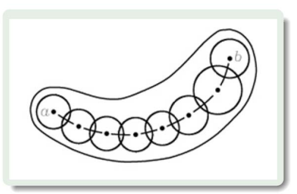
>   - 设 $f(z)$ 在区域 $G$ 内解析。若 $G$ 内存在一点 $z=a$ 及过 $a$ 点的一段弧 $l$，或含有 $a$ 点的一个子区域 $g$，并且在 $l$ 上或 $g$ 内 $f(z)\equiv0$，则在整个区域 $G$ 内 $f(z)\equiv0$。

> [!knowledge]
> - ==🔴解析函数的唯一性定理（推论 1 的改写）==
>   - 设区域 $G$ 内有两个解析函数 $f_1(z)$ 和 $f_2(z)$。若 $G$ 内存在序列 $\{z_n\}$，使 $f_1(z_n)=f_2(z_n)$，且 $\{z_n\}$ 的一个极限点 $z=a$（$a\ne z_n$）也落在 $G$ 内，则在 $G$ 内
>$$
> f_1(z)\equiv f_2(z).
>$$
> - ==🔴推论 4：在一段弧或一个子区域内相等==
>   - 设 $f_1(z)$ 和 $f_2(z)$ 都在区域 $G$ 内解析。若在 $G$ 内的一段弧或一个子区域内 $f_1(z)=f_2(z)$，则在 $G$ 内 $f_1(z)\equiv f_2(z)$。
> - ==🔴推论 5：实轴恒等式的复平面延续==
>   - 在实轴上成立的恒等式，在 $z$ 平面上仍然成立；条件是恒等式两端的函数在 $z$ 平面上都解析。

### 3.5 解析延拓

#### 3.5.1 定义、用途与唯一性
> [!knowledge]
> - ==🔴解析延拓的定义==
>   - $f_1(z)$ 在区域 $B_1$ 内解析。若 $f_2(z)$ 在区域 $B_2$ 内解析，且二者在重叠部分 $b$（可为一段曲线）满足 $f_1(z)=f_2(z)$，则称 $f_2$ 为 $f_1$ 在 $B_2$ 内的解析延拓；该关系是相互的。
>   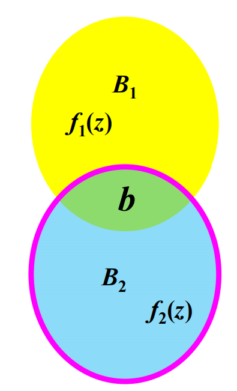
> - ==🔴用途==
>   1. 将由级数、积分或其他表达式给出的解析函数扩大到更大的定义域。
>   2. 从某个子区域内有效的解表达式，推得同一解在其他子区域的表达式。
> - ==🔴解析延拓的内唯一性定理==
>   - 设 $f_1(z)$ 和 $f_2(z)$ 在区域 $G$ 中均解析。若在 $G$ 的任一子区域 $g$ 中 $f_1(z)\equiv f_2(z)$，则在整个区域 $G$ 中必有 $f_1(z)\equiv f_2(z)$。
>   - 因而，解析延拓一旦存在便唯一。
> - ==🔴实函数对复解析函数的唯一确定==
>   - 解析函数 $e^z$、$\sin z$、$\cos z$ 分别由实函数 $e^x$、$\sin x$、$\cos x$ 唯一确定：只要这些函数解析，且在实轴上分别取这些值，它们在整个复平面上只能是第 1.2 节给出的定义。
> - ==🔴实变量恒等式的复变量形式==
>   - 熟知的初等函数恒等式，只要等式两端在复平面上都解析，在复变量中也成立。

**[ 例子 ] 正弦二倍角公式的复变量形式**

实轴上有 $\sin 2x=2\sin x\cos x$，因此
$$
\sin 2z=2\sin z\cos z.
$$
这是因为 $\sin 2z$ 与 $2\sin z\cos z$ 都是解析函数，且它们在实轴上相等；由内唯一性定理，它们在整个复平面上恒等。

#### 3.5.2 用泰勒级数作解析延拓
> [!knowledge]
> - ==🔴用泰勒级数作解析延拓==
>   1. 在原定义域 $B_1$ 内选一点 $z_0$，把 $f_1(z)$ 在 $z_0$ 邻域展开为泰勒级数。
>   2. 将其收敛圆记为 $B_2$；若 $B_2$ 越出 $B_1$，便利用重叠部分的相等性。
>   3. 所得级数和函数就是 $f_1$ 在 $B_2$ 内的解析延拓。
> - ==🔴继续延拓==
>   - 重复该过程得到解析元素 $\{B_n,f_n(z)\}$；它们定义域的并集上按各元素取值所定义的函数，称为由 $f_1$ 产生的完全解析函数。

**[ 例题 ] 幂级数的延拓**

已知 $f_1(z)=1+z+z^2+\cdots=1/(1-z)$ 在 $|z|<1$ 内成立。以 $z_0=\mathrm{i}/2$ 为新中心作泰勒展开，并说明它如何构成解析延拓。
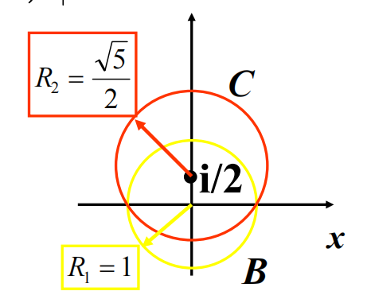
解
1. 把原级数的和函数看作 $f(z)=1/(1-z)$。它除 $z=1$ 外解析，因此可以在 $z_0=\mathrm{i}/2$ 的邻域内展开。
2. 先算前几阶导数：
$$
f'(z)=\frac1{(1-z)^2},\qquad
f''(z)=\frac{2!}{(1-z)^3},\qquad\cdots,
\qquad f^{(k)}(z)=\frac{k!}{(1-z)^{k+1}}.
$$
所以 $f^{(k)}(\mathrm{i}/2)=k!/(1-\mathrm{i}/2)^{k+1}$。
3. 代入泰勒公式中的每一个系数：
$$
\begin{aligned}
f_2(z)
&=\sum_{k=0}^{\infty}\frac{f^{(k)}(\mathrm{i}/2)}{k!}(z-\mathrm{i}/2)^k\\
&=\frac1{1-\mathrm{i}/2}
+\frac{z-\mathrm{i}/2}{(1-\mathrm{i}/2)^2}
+\frac{(z-\mathrm{i}/2)^2}{(1-\mathrm{i}/2)^3}+\cdots\\
&=\sum_{k=0}^{\infty}\frac{(z-\mathrm{i}/2)^k}{(1-\mathrm{i}/2)^{k+1}}.
\end{aligned}
$$
4. 把它改写成几何级数形式：
$$
f_2(z)=\frac1{1-\mathrm{i}/2}\sum_{k=0}^{\infty}
\left(\frac{z-\mathrm{i}/2}{1-\mathrm{i}/2}\right)^k.
$$
因而收敛条件是 $|z-\mathrm{i}/2|<|1-\mathrm{i}/2|=\sqrt5/2$。该圆与原单位圆有重叠，且重叠处两式都等于 $1/(1-z)$。

**结论：** $f_2$ 是 $f_1$ 的解析延拓；其定义区域越出 $|z|<1$，但不跨越奇点 $z=1$。

### 3.6 洛朗级数展开

#### 3.6.1 问题引入与双边幂级数
> [!knowledge]
> - ==🔴洛朗级数的适用情形==
>   - 若 $f(z)$ 在圆心 $z_0$ 处不解析，它不能在 $z_0$ 处展开成幂级数；但当 $f(z)$ 在环域 $R_2<|z-z_0|<R_1$ 内解析时，仍可使用允许负幂项的洛朗（Laurent）级数。
> - ==🔴形式与组成==
>   - $f(z)=\sum_{k=-\infty}^{\infty}a_k(z-z_0)^k=\sum_{k=0}^{\infty}a_k(z-z_0)^k+\sum_{k=1}^{\infty}a_{-k}(z-z_0)^{-k}$。
>   - 正幂项部分是关于 $z-z_0$ 的普通幂级数，称为==解析部分==；负幂项部分称为==主要部分==。

**[ 例题 ] 去心邻域中的几何级数**
在环域 $0<|z|<1$ 内，将 $\displaystyle f(z)=\frac{1}{z(1-z)}$ 展开为洛朗级数。

解
1. 区域条件 $|z|<1$ 允许使用几何级数 $\frac1{1-z}=\sum_{n=0}^{\infty}z^n$。
2. 原函数多出一个因子 $1/z$，故直接相乘：$f(z)=\frac1z\sum_{n=0}^{\infty}z^n$。
3. 将每一项的幂次减一，得到 $f(z)=z^{-1}+1+z+z^2+\cdots$。
4. 下界 $|z|>0$ 说明环心本身不能代入；这正是负幂项出现的原因。

**结论：** $\displaystyle\frac1{z(1-z)}=\frac1z+1+z+z^2+\cdots\quad(0<|z|<1)$。

**[ 例题 ] 例 1：以 $z=1$ 为中心的展开**
在圆环域 $0<|z-1|<1$ 内，将 $\displaystyle f(z)=\frac1{z(1-z)}$ 展开为洛朗级数。

解
1. 该环域内 $|1-z|<1$，并且 $z=1-(1-z)$，故
$$
f(z)=\frac1{1-z}\cdot\frac1{1-(1-z)}.
$$
2. 对几何级数 $\frac1{1-(1-z)}=1+(1-z)+(1-z)^2+\cdots$，逐项相乘，得到
$$
\frac1{z(1-z)}=(1-z)^{-1}+1+(1-z)+(1-z)^2+\cdots.
$$
3. 因为 $1-z=-(z-1)$，上式以 $z=1$ 为中心时含有负幂项；这正说明环域内的解析函数需要双边幂级数描述。

**结论：** 同一函数在不同的环域、以不同圆心展开时，级数的形式和收敛域都可能不同。

> [!knowledge]
> - ==🔴双边幂级数收敛域==
>   - 记正幂项部分为 $f_1(z)$、负幂项部分为 $f_2(z)$，则双边幂级数的和为 $f(z)=f_1(z)+f_2(z)$。
> 	  - 正幂项部分 $\sum_{k=0}^{\infty}a_k(z-z_0)^k$ 的收敛半径为 $R_1$，收敛域为 $|z-z_0|<R_1$。
> 	  - 对负幂项部分令 $\zeta=(z-z_0)^{-1}$，则 $\sum_{k=1}^{\infty}a_{-k}(z-z_0)^{-k}=\sum_{k=1}^{\infty}a_{-k}\zeta^k$。若其关于 $\zeta$ 的收敛半径为 $r$，则 $|\zeta|<r$ 等价于 $|z-z_0|>1/r=R_2$。
>   - 两部分必须同时收敛：只有 $R_2<R_1$ 时才有公共部分 $D$，即 $R_2<|z-z_0|<R_1$；若 $R_2>R_1$，则两收敛域没有公共部分。
>   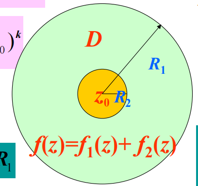

> [!knowledge]
> - ==🔴双边幂级数的收敛域==
>   - 双边幂级数 $\sum_{k=-\infty}^{\infty}a_k(z-z_0)^k$ 的收敛区域是圆环域
>$$
> R_2<|z-z_0|<R_1.
>$$
> - ==🔴常见的特殊圆环域==
>   1. 去心圆域：$0<|z-z_0|<R_1$。
>   2. 圆外域：$R_2<|z-z_0|<\infty$。
>   3. 去心全平面：$0<|z-z_0|<\infty$。
>   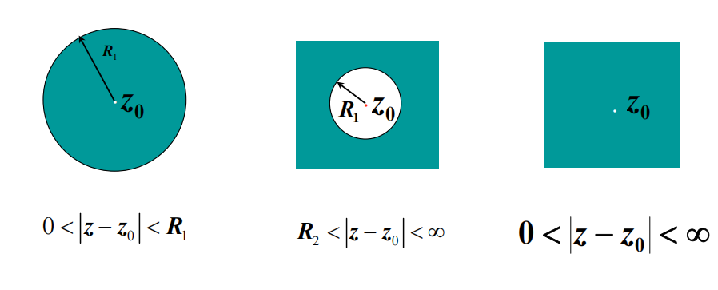

#### 3.6.2 洛朗展开定理
> [!knowledge]
> - ==🔴洛朗展开定理==
>   - 若 $f(z)$ 在环域 $R_2<|z-z_0|<R_1$ 内解析，则它在该环域内可唯一展开为 $f(z)=\sum_{k=-\infty}^{\infty}a_k(z-z_0)^k$。
> - ==🔴系数公式==
>   - 对环域内绕 $z_0$ 的任意正向简单闭曲线 $C$，$a_k=\frac{1}{2\pi \mathrm{i}}\oint_C\frac{f(\zeta)}{(\zeta-z_0)^{k+1}}\,d\zeta$，其中 $k=0,\pm1,\pm2,\ldots$。
> - ==🔴系数公式的曲线条件==
>   - $C$ 是环域内绕 $z_0$ 的任意正向简单闭曲线；系数公式与所选的这条曲线无关。
>   - 证明时在位于给定环域内的两个圆之间应用复连通域的柯西积分公式；无需要求 $C$ 的整个内部都不含 $f$ 的奇点。

> [!note] 待插图
> 来源：课件 p.95；内容：环域中的内外圆、点 $z$、积分变量 $\zeta$ 与闭曲线；用途：理解将柯西积分公式拆为正幂与负幂两部分的几何条件。
> 裁剪建议：保留两条圆周、$z_0,z,\zeta$ 和半径标注。

**证明：洛朗展开定理**

固定环域内一点 $z$，取两个圆 $C_{R_1'}:|\zeta-z_0|=R_1'$、$C_{R_2'}:|\zeta-z_0|=R_2'$，使
$$
R_2<R_2'<|z-z_0|<R_1'<R_1.
$$
在两个圆围成的闭环域内，$f$ 解析。由复连通域的柯西积分公式（两圆均以逆时针方向书写）
$$
f(z)=\frac1{2\pi\mathrm{i}}\oint_{C_{R_1'}}\frac{f(\zeta)}{\zeta-z}\,d\zeta
-\frac1{2\pi\mathrm{i}}\oint_{C_{R_2'}}\frac{f(\zeta)}{\zeta-z}\,d\zeta.
$$

先处理外圆部分。由于 $|z-z_0|<|\zeta-z_0|=R_1'$，
$$
\begin{aligned}
\frac1{\zeta-z}
&=\frac1{(\zeta-z_0)-(z-z_0)}\\
&=\frac1{\zeta-z_0}\frac1{1-\frac{z-z_0}{\zeta-z_0}}\\
&=\sum_{k=0}^{\infty}\frac{(z-z_0)^k}{(\zeta-z_0)^{k+1}}.
\end{aligned}
$$
几何级数在 $C_{R_1'}$ 上一致收敛，故
$$
\frac1{2\pi\mathrm{i}}\oint_{C_{R_1'}}\frac{f(\zeta)}{\zeta-z}\,d\zeta
=\sum_{k=0}^{\infty}\left[\frac1{2\pi\mathrm{i}}\oint_{C_{R_1'}}
\frac{f(\zeta)}{(\zeta-z_0)^{k+1}}\,d\zeta\right](z-z_0)^k.
$$

再处理内圆部分。此时 $|\zeta-z_0|=R_2'<|z-z_0|$，故
$$
\begin{aligned}
\frac1{\zeta-z}
&=\frac1{(\zeta-z_0)-(z-z_0)}\\
&=-\frac1{z-z_0}\frac1{1-\frac{\zeta-z_0}{z-z_0}}\\
&=-\sum_{l=0}^{\infty}\frac{(\zeta-z_0)^l}{(z-z_0)^{l+1}}.
\end{aligned}
$$
同样逐项积分，并注意原公式在内圆积分前本来带负号，得到
$$
\begin{aligned}
-\frac1{2\pi\mathrm{i}}\oint_{C_{R_2'}}\frac{f(\zeta)}{\zeta-z}\,d\zeta
&=\sum_{l=0}^{\infty}\frac1{(z-z_0)^{l+1}}
\left[\frac1{2\pi\mathrm{i}}\oint_{C_{R_2'}}(\zeta-z_0)^lf(\zeta)\,d\zeta\right]\\
&=\sum_{k=1}^{\infty}a_{-k}(z-z_0)^{-k},
\end{aligned}
$$
其中
$$
a_{-k}=\frac1{2\pi\mathrm{i}}\oint_{C_{R_2'}}
\frac{f(\zeta)}{(\zeta-z_0)^{-k+1}}\,d\zeta\qquad(k\ge1).
$$
把外圆给出的正幂部分和内圆给出的负幂部分相加，便有
$$
f(z)=\sum_{k=0}^{\infty}a_k(z-z_0)^k
+\sum_{k=1}^{\infty}a_{-k}(z-z_0)^{-k}
=\sum_{k=-\infty}^{\infty}a_k(z-z_0)^k.
$$
对任意环域内绕 $z_0$ 的正向简单闭曲线 $C$，同样的复连通域变形表明
$$
a_k=\frac1{2\pi\mathrm{i}}\oint_C\frac{f(\zeta)}{(\zeta-z_0)^{k+1}}\,d\zeta
\qquad(k=0,\pm1,\pm2,\ldots).
$$
这既说明系数与所选曲线无关，也说明内圆部分为何恰好产生负幂。

#### 3.6.3 展开方法与典型结果

> [!knowledge]
> - ==🔴洛朗展开的方法==
>
> | 方法 | 操作 | 常用场景 |
> | --- | --- | --- |
> | **直接法** | 用洛朗系数积分公式逐个计算 $a_k$ | 系数积分容易计算 |
> | **间接法** | 对已知泰勒级数作代数运算、代换、逐项求导或积分 | 有理函数先作部分分式分解通常更方便 |
>
> - ==🔴区域优先==
>   - 同一函数、同一中心在不同环域内可以有不同展开式；这不违背唯一性，因为各式的收敛域不同。
>   - 泰勒展开式是洛朗展开式的特例。

**[ 例题 ] $\frac{e^z}{z^2}$ 的展开**

在 $0<|z|<\infty$ 内，将 $\displaystyle\frac{e^z}{z^2}$ 展开为洛朗级数，并判断 $z=0$ 的性质。

解
1. 先按课件的直接法验证系数。以 $0$ 为中心，设 $e^z/z^2=\sum_{k=-\infty}^{\infty}a_kz^k$。洛朗系数为
$$
a_k=\frac1{2\pi\mathrm{i}}\oint_C\frac{e^\zeta}{\zeta^{k+3}}\,d\zeta.
$$
当 $k\ge-2$ 时，令 $F(\zeta)=e^\zeta$，由柯西高阶导数公式
$$
a_k=\frac{F^{(k+2)}(0)}{(k+2)!}=\frac1{(k+2)!},
$$
因为 $F^{(j)}(0)=1$。当 $k<-2$ 时，$e^\zeta/\zeta^{k+3}=e^\zeta\zeta^{-k-3}$ 在 $0$ 处解析，闭路积分为 $0$，故 $a_k=0$。
2. 因而直接法给出
$$
\frac{e^z}{z^2}=\sum_{k=-2}^{\infty}\frac{z^k}{(k+2)!}.
$$
3. 间接法从整函数的麦克劳林级数 $e^z=1+z+z^2/2!+z^3/3!+\cdots$ 出发；两边除以 $z^2$，每一项幂次减 $2$：
$$
\frac{e^z}{z^2}=z^{-2}+z^{-1}+\frac1{2!}+\frac z{3!}+\frac {z^2}{4!}+\cdots.
$$
4. 两种方法得到同一展开。主要部分只有 $z^{-2}$ 与 $z^{-1}$ 两项，其中最高负幂为 $z^{-2}$。

**结论：** $\displaystyle\frac{e^z}{z^2}=\frac1{z^2}+\frac1z+\frac12+\frac z6+\cdots$，且 $z=0$ 是==二阶极点==。

**[ 例题 ] 在外圆环展开 $\frac1{z^2-1}$**

在环域 $1<|z|<\infty$ 内，将 $\displaystyle f(z)=\frac1{z^2-1}$ 展开为洛朗级数。

解
1. 题设区域满足 $|1/z^2|<1$，应把分母按 $1/z$ 的幂改写，而不能使用 $|z|<1$ 时的展开。
2. 提出 $z^2$：$\frac1{z^2-1}=\frac1{z^2}\frac1{1-z^{-2}}$。
3. 对 $z^{-2}$ 使用几何级数，得到 $\frac1{1-z^{-2}}=\sum_{n=0}^{\infty}z^{-2n}$。

**结论：** $\displaystyle\frac1{z^2-1}=\sum_{n=0}^{\infty}z^{-2n-2}=\frac1{z^2}+\frac1{z^4}+\frac1{z^6}+\cdots$，收敛域为 $|z|>1$。

**[ 例题 ] 在 $z_0=1$ 的邻域展开 $\frac1{z^2-1}$**

以 $z_0=1$ 为中心，将 $\displaystyle f(z)=\frac1{z^2-1}$ 展开为洛朗级数，并写明收敛域。

解
1. 令 $w=z-1$，则 $z+1=w+2$，从而 $f(z)=1/[w(w+2)]$。
2. 邻近 $w=0$ 时，$|w/2|<1$，故
$$
\frac1{w(w+2)}=\frac1{2w}\frac1{1+w/2}
=\frac1{2w}\sum_{n=0}^{\infty}\left(-\frac w2\right)^n.
$$
3. 展开中心本身是奇点，另一奇点 $z=-1$ 到中心 $1$ 的距离为 $2$，所以内外边界分别为 $0$ 与 $2$。

**结论：** $\displaystyle\frac1{z^2-1}=\sum_{n=0}^{\infty}\frac{(-1)^n}{2^{n+1}}(z-1)^{n-1}$，收敛域为 $0<|z-1|<2$。

**[ 例题 ] $\frac{1}{(z-1)(z-2)}$ 在三个环域内的展开**

以 $z=0$ 为中心，分别在 $|z|<1$、$1<|z|<2$、$2<|z|<\infty$ 内将 $\displaystyle\frac1{(z-1)(z-2)}$ 展开为洛朗级数。

解
1. 先作部分分式分解：$\frac1{(z-1)(z-2)}=\frac1{z-2}-\frac1{z-1}$。随后必须按==环域==选择不同的几何级数形式。
2. 当 $|z|<1$ 时，$\frac1{z-2}=-\frac12\frac1{1-z/2}=-\sum_{n=0}^{\infty}\frac{z^n}{2^{n+1}}$，$-\frac1{z-1}=\frac1{1-z}=\sum_{n=0}^{\infty}z^n$。相加得 $\sum_{n=0}^{\infty}(1-2^{-n-1})z^n$。
3. 当 $1<|z|<2$ 时，$-\frac1{z-1}=-\frac1z\frac1{1-1/z}=-\sum_{n=0}^{\infty}z^{-n-1}$；第一项仍按 $|z/2|<1$ 展开。因此得到 $-\sum_{n=0}^{\infty}z^{-n-1}-\sum_{n=0}^{\infty}z^n/2^{n+1}$。
4. 当 $|z|>2$ 时，两项都按 $1/z$ 展开：$\frac1{z-2}=\sum_{n=0}^{\infty}2^nz^{-n-1}$，$-\frac1{z-1}=-\sum_{n=0}^{\infty}z^{-n-1}$，相减后系数为 $2^n-1$。

**结论：** 同一函数在三个环域有三种不同展开式；这并不矛盾，因为每个展开式的==收敛域不同==。

**[ 例题 ] $e^{1/z}$ 在去心邻域内的展开**

在 $z_0=0$ 的去心邻域内，将 $f(z)=e^{1/z}$ 展开为洛朗级数。

解
1. 从指数函数在全平面的麦克劳林级数 $e^w=\sum_{n=0}^{\infty}w^n/n!$ 出发。
2. 令 $w=1/z$；对任意 $z\ne0$，该代换后的级数仍收敛。
3. 逐项代入得 $e^{1/z}=1+z^{-1}+(2!z^2)^{-1}+\cdots+(n!z^n)^{-1}+\cdots$。

**结论：** $\displaystyle e^{1/z}=\sum_{n=0}^{\infty}\frac1{n!z^n}$，收敛域为 $0<|z|<\infty$；其主要部分含无穷多项。

#### 3.6.4 与特殊函数的联系

> [!knowledge]
> - ==🔴贝塞尔函数的生成函数==
>   - $e^{\frac{x}{2}(z-z^{-1})}=\sum_{m=-\infty}^{\infty}J_m(x)z^m$。
> - ==🔴系数公式==
>   - 对 $m\ge0$，$J_m(x)=\sum_{n=0}^{\infty}\frac{(-1)^n}{n!(n+m)!}\left(\frac{x}{2}\right)^{2n+m}$。
>   - 对 $m\ge1$，负指标满足 $J_{-m}(x)=(-1)^mJ_m(x)$。

**[ 例题 ] 由生成函数得到贝塞尔函数系数**

在 $z_0=0$ 处将 $\displaystyle f(z)=e^{\frac{x}{2}(z-z^{-1})}$ 展开为洛朗级数，并写出正、负幂的系数关系。

解
1. 将指数拆开，并分别使用指数函数的幂级数：
$$
e^{\frac{x}{2}(z-z^{-1})}
=\left(\sum_{p=0}^\infty\frac1{p!}\left(\frac{xz}{2}\right)^p\right)
\left(\sum_{q=0}^\infty\frac{(-1)^q}{q!}\left(\frac{x}{2z}\right)^q\right).
$$
2. 取 $z^m\ (m\ge0)$ 的项时须有 $p-q=m$。令 $q=n$、$p=n+m$，其系数为
$$
J_m(x)=\sum_{n=0}^\infty\frac{(-1)^n}{n!(n+m)!}\left(\frac{x}{2}\right)^{2n+m}.
$$
3. 取 $z^{-m}\ (m\ge1)$ 的项时须有 $q-p=m$。令 $p=n$、$q=n+m$，可得其系数为 $(-1)^mJ_m(x)$，即 $J_{-m}(x)=(-1)^mJ_m(x)$。
4. 将正、负指标统一记为 $J_m(x)$，便得到双边展开。

**结论：** $\displaystyle e^{\frac{x}{2}(z-z^{-1})}=\sum_{m=-\infty}^{\infty}J_m(x)z^m$，收敛域为 $0<|z|<\infty$。

**[ 例题 ] $\frac{\sin z}{z}$ 的洛朗展开**

在 $z_0=0$ 的去心邻域内，将 $\displaystyle f(z)=\frac{\sin z}{z}$ 展开为洛朗级数。

解
1. 使用 $\sin z=z-z^3/3!+z^5/5!-\cdots$。
2. 逐项除以 $z$，得到 $\frac{\sin z}{z}=1-z^2/3!+z^4/5!-\cdots$。
3. 展开式不含负幂，说明洛朗级数可以退化为普通泰勒级数；补定义 $f(0)=1$ 后，和函数在 $0$ 处解析。

**结论：** $\displaystyle\frac{\sin z}{z}=\sum_{n=0}^{\infty}\frac{(-1)^nz^{2n}}{(2n+1)!}$，在 $0<|z|<\infty$ 内成立。

#### 3.6.5 易混结论

> [!knowledge]
> - ==🔴洛朗系数不能直接套用泰勒系数==
>   - 虽然积分公式相似，但一般不能写成 $a_k=f^{(k)}(z_0)/k!$：环心可能是奇点；即使环心不是奇点，积分区域内也可能有其他奇点。
> - ==🔴负幂项的含义==
>   - 洛朗级数含负幂项，不表示环心必为原函数的奇点；仍须判断整个级数的和函数。
> - ==🔴孤立奇点邻域内的洛朗展开==
>   - 若只有环心 $z_0$ 是 $f(z)$ 的奇点，则内圆半径可无限缩小，$z$ 可无限接近 $z_0$。
>   - 此时 $f(z)=\sum_{k=-\infty}^{\infty}a_k(z-z_0)^k$ 称为 $f(z)$ 在孤立奇点 $z_0$ 邻域上的洛朗展开式，可用于研究 $f(z)$ 在该孤立奇点附近的性质。

### 3.7 孤立奇点的分类

#### 3.7.1 孤立奇点与非孤立奇点

> [!knowledge]
> - ==🔴孤立奇点==
>   - $f(z)$ 在 $z_0$ 处不解析或未定义，但在某个去心邻域 $0<|z-z_0|<R$ 内解析。
> - ==🔴非孤立奇点==
>   - 任意小的 $z_0$ 邻域内，都含有除 $z_0$ 外的不可导点。
>   - **对照：** $z=0$ 是 $e^{1/z}$ 的孤立奇点，$z=-1$ 是 $1/(1+z)$ 的孤立奇点；而 $f(z)=\frac{z^2}{\sin(1/z)}$ 的奇点 $z_k=1/(k\pi)$ 聚于 $0$，故 $0$ 是非孤立奇点。

#### 3.7.2 由洛朗级数分类

> [!knowledge]
> - ==🔴由洛朗级数分类孤立奇点==
>   - 设 $z_0$ 是孤立奇点，且 $f(z)=\sum_{k=-\infty}^{\infty}a_k(z-z_0)^k$ 在其去心邻域内成立；只需观察主要部分。
>
> | 主要部分的负幂项 | $z_0$ 的类型 |
> | --- | --- |
> | 没有 | **可去奇点** |
> | 恰有 $m$ 个，最高负幂为 $(z-z_0)^{-m}$ | **$m$ 阶极点** |
> | 有无穷多个 | **本性奇点** |

#### 3.7.3 可去奇点

> [!knowledge]
> - ==🔴可去奇点==
>   - 洛朗展开没有负幂项时，$z_0$ 为可去奇点；其和函数可写为普通幂级数。
> - ==🔴补充定义与判别==
>   - 若 $\lim_{z\to z_0}f(z)=a_0$ 存在且有限，令 $F(z_0)=a_0$、$F(z)=f(z)$（$z\ne z_0$），则 $F$ 在 $z_0$ 解析。
>   - 无负幂项，或极限存在且有限，均可判定为可去奇点。

**[ 例题 ] 通过补充定义去除奇点**

判断 $\sin z/z$ 与 $(e^z-1)/z$ 在 $z=0$ 的奇点类型，并给出可去时的补充定义。

解
1. 由 $\sin z=z-z^3/3!+z^5/5!-\cdots$，除以 $z$ 得 $\sin z/z=1-z^2/3!+z^4/5!-\cdots$，不含负幂项。
2. 因此 $z=0$ 是 $\sin z/z$ 的可去奇点，且极限为 $1$；定义函数在 $0$ 处取值 $1$ 后，它在 $0$ 解析。
3. 对 $(e^z-1)/z$，由 $e^z=1+z+z^2/2!+z^3/3!+\cdots$ 先减去常数项 $1$，再逐项除以 $z$，得 $(e^z-1)/z=1+z/2!+z^2/3!+\cdots$。
4. 该展开同样没有负幂项，且 $z\to0$ 时极限为常数项 $1$。

**结论：** 两个函数在 $0$ 都有可去奇点；将其在 $0$ 处补定义为 $1$ 后，均成为解析函数。

#### 3.7.4 极点

> [!knowledge]
> - ==🔴极点及其阶数==
>   - 主要部分只有有限项，且 $(z-z_0)^{-m}$ 的系数非零时，$z_0$ 是 $m$ 阶极点。
> - ==🔴等价判别==
>   - 存在在 $z_0$ 邻域内解析、且 $g(z_0)\ne0$ 的函数 $g$，使 $f(z)=\frac{g(z)}{(z-z_0)^m}$。
>   - 在孤立奇点的前提下，$\lim_{z\to z_0}f(z)=\infty$ 时该点为极点；阶数由最高负幂或上式中的 $m$ 确定。

**[ 例题 ] 有理函数的极点**

判断 $\displaystyle f(z)=\frac{3z+2}{z^2(z+2)}$ 的极点及阶数。

解
1. 分母为零的候选点是 $z=0$ 与 $z=-2$。分子在这两点的值分别为 $2$ 和 $-4$，均不为零，因此没有约因子导致降阶。
2. 在 $z=0$ 附近，可写 $f(z)=\frac{g(z)}{z^2}$，其中 $g(z)=(3z+2)/(z+2)$ 在 $0$ 解析且 $g(0)\ne0$。
3. 在 $z=-2$ 附近，可写 $f(z)=\frac{h(z)}{z+2}$，其中 $h(z)=(3z+2)/z^2$ 在 $-2$ 解析且 $h(-2)\ne0$。

**结论：** $z=0$ 是二阶极点，$z=-2$ 是一阶极点。

#### 3.7.5 本性奇点

> [!knowledge]
> - ==🔴本性奇点==
>   - 洛朗主要部分含无穷多个负幂项。
>   - **典型例子：** $e^{1/z}=1+\frac1z+\frac1{2!z^2}+\cdots$；$z=0$ 为本性奇点，且 $z\to0$ 时没有唯一极限。

**说明：$e^{1/z}$ 的三条趋近路径**

令 $z\to0$。沿正实轴 $z=x\downarrow0$，$e^{1/z}=e^{1/x}\to\infty$；沿负实轴 $z=-x$，$e^{1/z}=e^{-1/x}\to0$；沿虚轴 $z=\mathrm{i}y$，$e^{1/z}=e^{-\mathrm{i}/y}$ 振荡，可取 $y_n=1/(2\pi n)$ 得值为 $1$。这三个行为不可能来自可去奇点或极点，因此与“主要部分有无穷项”给出的本性奇点判别一致。

#### 3.7.6 无穷远点的分类

> [!knowledge]
> - ==🔴无穷远点的分类方法==
>   - 若 $f(z)$ 在 $R<|z|<\infty$ 内解析，把 $z=\infty$ 视为孤立奇点；令 $t=1/z$、$\varphi(t)=f(1/t)$，转化为研究 $t=0$。
> - ==🔴按正幂项判断==
>   1. 不含正幂项 $\Rightarrow$ $\infty$ 为可去奇点。
>   2. 含有限多个正幂项且最高为 $z^m$ $\Rightarrow$ $\infty$ 为 $m$ 阶极点。
>   3. 含无穷多个正幂项 $\Rightarrow$ $\infty$ 为本性奇点。
> - ==🔴极限对应==
>   - $\lim_{z\to\infty}f(z)$ 有限、趋于 $\infty$、或不存在且不趋于 $\infty$，分别对应上述三类。
> - ==🔴课件中的典型对照==
>
> | $z=\infty$ 的类型 | 典型函数 | 从无穷远处展开观察 |
> | --- | --- | --- |
> | 可去奇点 | $z\sin(1/z)$，$z-\cot(1/z)$ | 不含正幂项，极限有限 |
> | 一阶或二阶极点 | $z-\sin(1/z)$，$z^2\cos(1/z)$ | 最高正幂分别为 $z$、$z^2$ |
> | 本性奇点 | $e^z,\sin z,\cos z$ | 含无穷多个正幂项 |

**[ 例题 ] 无穷远点的判断**

判断 $z/(z+1)$、$z+1/z$、$\sin z$ 在 $z=\infty$ 的类型。

解
1. $\frac z{z+1}=1-z^{-1}+z^{-2}-z^{-3}+\cdots$（$|z|>1$），不含正幂项；等价地 $f(1/t)=1/(1+t)$ 在 $t=0$ 解析。
2. $z+1/z$ 的无穷远邻域展开含有限个正幂项，最高为 $z$；等价地 $f(1/t)=1/t+t$ 在 $0$ 是一阶极点。
3. $\sin z=z-z^3/3!+z^5/5!-\cdots$ 含无穷多个正幂项；等价地 $\sin(1/t)$ 在 $0$ 有无穷多个负幂项。

**结论：** 三者在 $\infty$ 依次为可去奇点、一阶极点、本性奇点。

#### 3.7.7 综合判定

**[ 例题 ] 扩充复平面内的奇点分类**

设
$$
f(z)=\frac{(z^2-1)(z-2)^3}{(\sin\pi z)^3}.
$$
判断 $f$ 在扩充复平面内有哪些类型的奇点；若为极点，指出其阶数。

解
1. $\sin\pi z$ 的零点为全部整数 $n\in\mathbb Z$。由于 $(\sin\pi z)'=\pi\cos\pi z$ 在整数点不为 $0$，这些零点均为一阶零点，故分母在每个整数点原本都有三阶零点。
2. 分子 $z^2-1=(z-1)(z+1)$ 在 $z=1,-1$ 各有一阶零点，$(z-2)^3$ 在 $z=2$ 有三阶零点。因此在整数点 $n\ne-1,1,2$，分子不为 $0$，$n$ 是三阶极点；在 $z=\pm1$，抵消一阶后留下二阶极点。
3. 在 $z=2$，分子、分母的三阶零点完全抵消，并且
$$
\lim_{z\to2}f(z)
=\lim_{z\to2}(z^2-1)\left(\frac{z-2}{\sin\pi z}\right)^3
=\frac3{\pi^3}.
$$
因而 $z=2$ 是可去奇点，补定义为 $3/\pi^3$ 后可解析延拓。
4. 令 $\zeta=1/z$。当 $n\to\infty$ 时，$f(1/\zeta)$ 的奇点 $\zeta_n=1/n$ 聚于 $\zeta=0$；删除有限个因约去而消失的点不改变这种聚集。因此 $\zeta=0$ 不是孤立奇点，$z=\infty$ 也不是 $f$ 的孤立奇点。

**结论：** $z=\pm1$ 是二阶极点，$z=2$ 是可去奇点，其余整数是三阶极点；$z=\infty$ 是非孤立奇点。

**[ 例题 ] 思考题：判断六阶极点**

判断 $\displaystyle f(z)=\frac1{z^3(e^{z^3}-1)}$ 在 $z=0$ 的孤立奇点类型。

解
1. 在 $z=0$ 附近，$e^{z^3}-1=z^3+z^6/2!+\cdots=z^3[1+z^3/2!+\cdots]$。
2. 因此分母为 $z^6[1+z^3/2!+\cdots]$，方括号内的解析函数在 $z=0$ 取值为 $1$，不为 $0$。
3. 原函数可写为 $f(z)=z^{-6}g(z)$，其中 $g$ 在 $0$ 的邻域内解析且 $g(0)=1$。

**结论：** $z=0$ 是 $f(z)$ 的六阶极点。

### 3.8 特殊函数

#### 3.8.1 Γ 函数的定义与解析性

> [!knowledge]
> - ==🔴Γ 函数的定义==
>   - $\Gamma(z)=\int_0^{\infty}e^{-t}t^{z-1}\,dt$，初始定义域为 $\operatorname{Re}z>0$；该积分又称第二类 Euler 积分。
>   - 积分区间无界；当 $\operatorname{Re}z<1$ 时，$t=0$ 还是被积函数的奇点，因此解析性证明必须同时控制 $0$ 与 $\infty$ 两端。
> - ==🔴解析性与导数==
>   - 将积分拆作 $\gamma(z,1)=\int_0^1e^{-t}t^{z-1}\,dt$ 与 $\Gamma(z,1)=\int_1^{\infty}e^{-t}t^{z-1}\,dt$；前者在右半平面解析，后者在全平面解析，故 $\Gamma(z)$ 在右半平面解析。
>   - $\Gamma^{(n)}(z)=\int_0^{\infty}e^{-t}t^{z-1}(\ln t)^n\,dt$。
> - ==🔴递推公式==
>   - $\Gamma(z+1)=z\Gamma(z)$，且 $\Gamma(1)=1$；因此 $\Gamma(n+1)=n!$（$n$ 为正整数）。
>   - 课件给出的阶乘渐近主项为 $\ln n!\sim n\ln n-n$。
> - ==🔴常用积分变形==
>   - 令 $t=y^2$，得 $\Gamma(z)=2\int_0^{\infty}y^{2z-1}e^{-y^2}\,dy$。
>   - 对 $p>0$ 令 $t=py$，得 $\Gamma(z)=p^z\int_0^{\infty}y^{z-1}e^{-py}\,dy$，即 $\int_0^{\infty}y^{z-1}e^{-py}\,dy=\Gamma(z)/p^z$。

**证明：Γ 函数在右半平面的解析性**

将积分拆为 $\gamma(z,1)=\int_0^1e^{-t}t^{z-1}dt$ 与 $\Gamma(z,1)=\int_1^\infty e^{-t}t^{z-1}dt$。对右半平面内任一紧集，可取 $\operatorname{Re}z\ge\delta>0$；当 $0<t\le1$ 时
$$
|e^{-t}t^{z-1}|\le t^{\delta-1},
$$
而右端在 $(0,1]$ 可积，所以 $\gamma(z,1)$ 在右半平面解析。

对全平面内任一紧集，可取 $\operatorname{Re}z\le x_0$。任选整数 $N>x_0$，由 $e^t>t^N/N!$ 得 $e^{-t}<N!/t^N$，于是当 $t\ge1$ 时
$$
|e^{-t}t^{z-1}|\le N!t^{x_0-N-1}.
$$
右端在 $[1,\infty)$ 可积，故 $\Gamma(z,1)$ 在全平面解析。两部分相加证明 $\Gamma(z)$ 在 $\operatorname{Re}z>0$ 解析；同样的控制也允许逐次对 $z$ 求导，得到含 $(\ln t)^n$ 的公式。

**推导：Γ 函数的递推公式**

当 $\operatorname{Re}z>0$ 时，取 $u=t^z$、$dv=e^{-t}dt$，边界项 $[-e^{-t}t^z]_0^\infty=0$，故
$$
\Gamma(z+1)=\int_0^\infty e^{-t}t^zdt
=z\int_0^\infty e^{-t}t^{z-1}dt=z\Gamma(z).
$$
令 $z=1$ 得 $\Gamma(1)=1$，再递推即有 $\Gamma(n+1)=n!$。

#### 3.8.2 Γ 函数的解析延拓与常用公式

> [!knowledge]
> - ==🔴解析延拓==
>   - $\Gamma(z)=\frac{\Gamma(z+1)}{z}$ 将定义域从 $\operatorname{Re}z>0$ 延拓到 $\operatorname{Re}z>-1$（排除 $z=0$）；继续递推可逐步延拓。
>   - 另一表达式为 $\Gamma(z)=\int_1^{\infty}e^{-t}t^{z-1}\,dt+\sum_{n=0}^{\infty}\frac{(-1)^n}{n!(n+z)}$，适用于 $z\ne0,-1,-2,\ldots$。
> - ==🔴互余宗量与倍乘公式==
>   - $\Gamma(z)\Gamma(1-z)=\frac{\pi}{\sin\pi z}$；因此 $\Gamma(1/2)=\sqrt{\pi}$，且 Γ 函数无零点。
>   - $\Gamma(2z)=2^{2z-1}\pi^{-1/2}\Gamma(z)\Gamma(z+1/2)$。

> [!note] 待插图
> 来源：课件 p.160；内容：实变量 $x$ 上的 $\Gamma(x)$ 图像；用途：观察非正整数处的极点、各区间上的符号变化以及正半轴上的函数走势。
> 裁剪建议：保留坐标轴、非正整数极点和曲线分支，删除页面其余空白。

**推导：Γ 函数的级数表示与延拓**

在 $0<t<1$ 将 $e^{-t}=\sum_{n=0}^\infty(-1)^nt^n/n!$ 逐项积分，得到
$$
\gamma(z,1)=\sum_{n=0}^\infty\frac{(-1)^n}{n!(n+z)}.
$$
因而
$$
\Gamma(z)=\Gamma(z,1)+\sum_{n=0}^\infty\frac{(-1)^n}{n!(n+z)},
\qquad z\ne0,-1,-2,\ldots.
$$
这与递推式 $\Gamma(z)=\Gamma(z+1)/z$ 共同说明：Γ 函数可延拓到全平面，且 $0,-1,-2,\ldots$ 是简单极点；其余点均解析。Γ 函数无零点这一结论可结合下面的互余宗量公式得到。

**[ 例题 ] 半整数处的 Γ 函数值**

利用递推公式与 $\Gamma(1/2)=\sqrt\pi$，求 $\Gamma(5/2)$、$\Gamma(-5/2)$，并给出 $\Gamma(1/2+n)$ 与 $\Gamma(1/2-n)$ 的一般式。

解
1. 递推公式为 $\Gamma(z+1)=z\Gamma(z)$。取 $z=1/2$、$3/2$，有 $\Gamma(3/2)=\frac12\sqrt\pi$，$\Gamma(5/2)=\frac32\Gamma(3/2)=\frac34\sqrt\pi$。
2. 对负半整数反向使用递推式：$\Gamma(-1/2)=\Gamma(1/2)/(-1/2)=-2\sqrt\pi$，再得 $\Gamma(-3/2)=\Gamma(-1/2)/(-3/2)=\frac43\sqrt\pi$。
3. 继续一步：$\Gamma(-5/2)=\Gamma(-3/2)/(-5/2)=-\frac8{15}\sqrt\pi$。
4. 对 $n\ge0$，重复正向递推并整理双阶乘，得到 $\Gamma(n+1/2)=\frac{(2n)!}{4^n n!}\sqrt\pi$。

**结论：** $\displaystyle\Gamma(5/2)=\frac34\sqrt\pi$，$\displaystyle\Gamma(-5/2)=-\frac8{15}\sqrt\pi$；并且
$$
\Gamma\left(n+\frac12\right)=\frac{(2n-1)!!}{2^n}\sqrt\pi,
\qquad
\Gamma\left(\frac12-n\right)=\frac{(-1)^n2^n}{(2n-1)!!}\sqrt\pi
\quad(n\ge1).
$$
递推时须特别检查参数不能落在 $0,-1,-2,\ldots$。

#### 3.8.3 B 函数及其与 Γ 函数的关系

> [!knowledge]
> - ==🔴B 函数的定义==
>   - $B(p,q)=\int_0^1t^{p-1}(1-t)^{q-1}\,dt$，其中 $\operatorname{Re}p>0$、$\operatorname{Re}q>0$；该积分又称第一类 Euler 积分。
> - ==🔴常用变换==
>   - $s=1-t$ 给出对称性 $B(p,q)=B(q,p)$。
>   - $t=\sin^2\theta$ 给出 $B(p,q)=2\int_0^{\pi/2}\sin^{2p-1}\theta\cos^{2q-1}\theta\,d\theta$。
> - ==🔴Γ 与 B 的关系==
>   - $B(p,q)=\frac{\Gamma(p)\Gamma(q)}{\Gamma(p+q)}$；初始定义域内可由第一象限二重积分和极坐标变换证明，并可借此把 $B$ 函数解析延拓到等式两边有意义的点。

**证明：Γ 与 B 的关系**

先令 $\operatorname{Re}p>0,\operatorname{Re}q>0$，并在 Γ 函数积分中作 $t=x^2$、$s=y^2$，得到
$$
\Gamma(p)\Gamma(q)
=4\int_0^\infty\!\int_0^\infty e^{-(x^2+y^2)}x^{2p-1}y^{2q-1}\,dxdy.
$$
在第一象限使用极坐标 $x=r\cos\theta,\ y=r\sin\theta$，其 Jacobian 为 $r$，所以
$$
\Gamma(p)\Gamma(q)
=4\left[\int_0^\infty e^{-r^2}r^{2(p+q)-1}dr\right]
\left[\int_0^{\pi/2}\cos^{2p-1}\theta\sin^{2q-1}\theta\,d\theta\right].
$$
第一括号令 $u=r^2$ 后等于 $\frac12\Gamma(p+q)$；第二括号令 $t=\sin^2\theta$ 后等于 $\frac12B(q,p)=\frac12B(p,q)$。于是
$$
\Gamma(p)\Gamma(q)=\Gamma(p+q)B(p,q).
$$

#### 3.8.4 公式间的联系

> [!knowledge]
> - ==🔴互余宗量公式的联系==
>   - 在 $0<\operatorname{Re}z<1$ 内，$B(z,1-z)=\int_0^{\infty}\frac{x^{z-1}}{1+x}\,dx=\frac{\pi}{\sin\pi z}$；结合 Γ--B 关系即得到互余宗量公式，并可按解析延拓推广。
> - ==🔴倍乘公式的联系==
>   - 对积分 $I=\int_{-1}^{1}(1-x^2)^{z-1}\,dx$，分别作 $t=x^2$ 与线性代换，可导出倍乘公式；课件中的推导先要求 $\operatorname{Re}z>0$，再用解析延拓扩大适用范围。

**推导：互余宗量公式**

由 $x=t/(1-t)$（即 $t=x/(1+x)$）可把 $B(z,1-z)$ 化为
$$
B(z,1-z)=\int_0^\infty\frac{x^{z-1}}{1+x}\,dx,\qquad 0<\operatorname{Re}z<1.
$$
课件给出的该广义积分值为 $\pi/\sin\pi z$，再与 $B(z,1-z)=\Gamma(z)\Gamma(1-z)$ 合并，便有
$$
\Gamma(z)\Gamma(1-z)=\frac\pi{\sin\pi z}.
$$
先令 $z=1/2$ 得 $\Gamma(1/2)^2=\pi$；Γ 函数在正实轴上积分为正，故 $\Gamma(1/2)=\sqrt\pi$。右端在非整数点不为 $0$，结合递推关系可得 Γ 函数无零点。

**推导：倍乘公式**

设 $\operatorname{Re}z>0$，考察 $I=\int_{-1}^1(1-x^2)^{z-1}dx$。被积函数为偶函数，令 $t=x^2$，有
$$
I=B\left(\frac12,z\right)=\frac{\Gamma(1/2)\Gamma(z)}{\Gamma(z+1/2)}.
$$
另一方面令 $x=2t-1$，则 $1-x^2=4t(1-t)$，从而
$$
I=2^{2z-1}B(z,z)=2^{2z-1}\frac{\Gamma(z)^2}{\Gamma(2z)}.
$$
代入 $\Gamma(1/2)=\sqrt\pi$ 并消去一项 $\Gamma(z)$，即得
$$
\Gamma(2z)=2^{2z-1}\pi^{-1/2}\Gamma(z)\Gamma\left(z+\frac12\right).
$$
两边在初始半平面相等后，可由解析延拓把恒等式推广到两边都有意义的点。

### 3.9 本章小结

> [!abstract] 本章小结
> 1. **复级数化实虚部：** 收敛、绝对收敛都化为两个实级数；绝对收敛则收敛，可重排、相乘。
> 2. **三判别法：** 比值、达朗贝尔上下极限、柯西根值上极限；同一上极限断绝对收敛。
> 3. **一致收敛保性质：** 连续、逐项积分、魏尔斯特拉斯解析（逐项求导任意阶）；M 判别得绝对一致收敛。
> 4. **幂级数：** 分界线必为收敛圆；圆内绝对且一致；逐项求导积分任意次；$R$ 为展开中心到最近奇点的距离；圆周上按复数项级数逐点讨论。
> 5. **泰勒与唯一性：** 解析即保证无限次可导，展开唯一；熟记常见展开；零点列有内极限点则函数恒零，实轴恒等式延拓到复平面。
> 6. **解析延拓与洛朗级数：** 延拓由重叠区的恒等性保证唯一；环域内解析的函数唯一展开为洛朗级数，展开式随环域而变。
> 7. **孤立奇点：** ==主要部分==决定可去奇点、极点或本性奇点；无穷远点经 $t=1/z$ 化为有限点问题。
> 8. **特殊函数：** Γ 函数用递推公式解析延拓，B 函数由 Γ 函数表示；互余宗量与倍乘公式是半整数值和积分计算的关键。

## 待处理清单

- **待插图：** 3.4 p.78 圆链示意图（见 3.4.3 占位）。
- **待插图：** 3.5 p.85 两个收敛圆示意图（见 3.5.2 占位）。
- **待插图：** 3.6 p.95 环域与积分曲线示意图（见 3.6.2 占位）。
