# 第一章：数字系统设计导论

## 1.1 数字系统的形成

数字系统（digital system）是以数字逻辑（digital logic）为基础、用离散符号表示和处理信息的系统。现代数字系统的发展建立在布尔代数（Boolean algebra）、电子器件与集成电路（integrated circuit, IC）三个基础上。

| 时期            | 课件给出的代表性事件                        |
| ------------- | --------------------------------- |
| 1642 年        | Pascal 制成机械加法器。                   |
| 1671 年        | Leibniz 制成可进行乘、除运算的机械计算器。         |
| 1854 年        | Boole 提出布尔代数。                     |
| 1944 年        | EDVAC 的设计采用二进制数制。                 |
| 1904 年、1947 年 | 真空三极管和晶体管相继出现。                    |
| 1960 年后       | 集成电路、微处理器、大规模与超大规模集成电路推动数字系统快速发展。 |

## 1.2 模拟量（analog quantity）与数字量（digital quantity）

> [!knowledge]
> 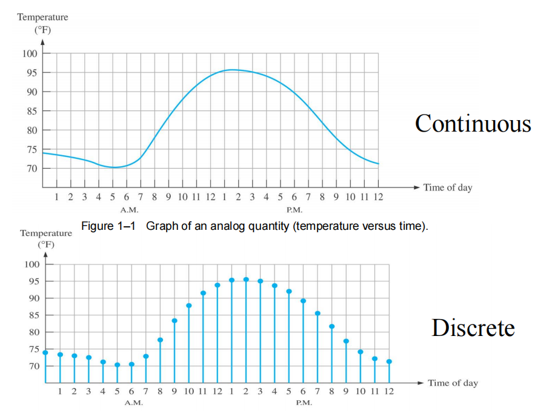
> - ==🔴模拟量与数字量==
> 	- ==模拟量==用连续变化的物理量表示信息，例如温度、压力、时间、速度和声音。
> 	- ==数字量==由有限个离散取值表示信息；二进制数字系统通常只区分 0 和 1。
> 	- 转换链为==采样 → 量化 → 编码==；量化会带来有限分辨率。

数字化并不意味着所有物理量均能精确表示。例如数值 $1/3$ 的二进制小数是无限循环的，有限位存储时仍须近似。

> [!knowledge]
> - ==🔴数字化的优势==
> 	- ==图像质量==由每个像素的位数和图像中的像素数共同决定。
> 	- ==数字音频==由数字存储/处理、数模转换器和扬声器等模拟输出部分共同构成。
> 	- ==数字存储==只需可靠地区分 0 和 1；复制时可再生相同代码，较少累积失真。
> 	- ==数字处理==可在可预测的精度下完成复杂运算，且数字信号抗噪声能力较强。

## 1.3 二进制位、逻辑电平（logic level）与数字波形（digital waveform）

> [!knowledge]
> - ==🔴比特与逻辑约定==
> 	- ==比特（bit）==是二进制数字系统的信息基本单位。
> 	- ==正逻辑==规定高电平表示 1、低电平表示 0；==负逻辑==的对应关系相反。
> 	- 多个比特组成的==比特组==可按约定表示数值、字符或其他代码。

| 数制 | 基数 | 数码 | 课件示例 |
| --- | --- | --- | --- |
| 十进制 | 10 | 0–9 | $(1032)_{10}$ |
| 二进制 | 2 | 0、1 | $(1011)_2=(11)_{10}$ |
| 十六进制 | 16 | 0–9、A–F | $(2A5)_{16}=(677)_{10}$ |

> [!knowledge]
> - ==🔴逻辑电平的判定==
> 	- 以 5 V CMOS 逻辑为例：==$0\sim0.8$ V== 属于可识别的低电平，==$2\sim3.3$ V== 属于可识别的高电平。
> 	- 二者之间为==不允许的输入范围==，因此逻辑 0/1 不是简单的“有电/无电”。

> [!knowledge]
> 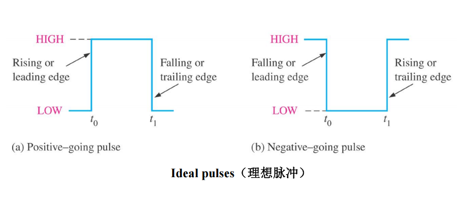
> 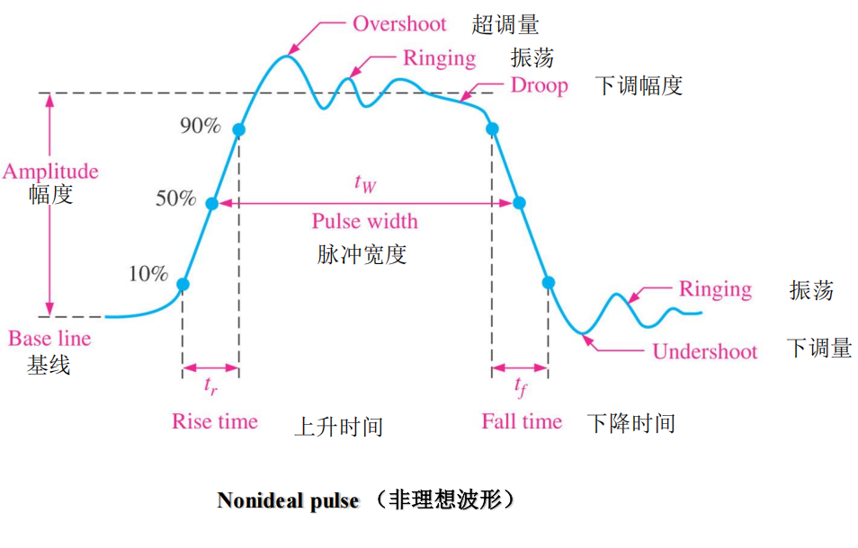
> - ==🔴数字波形的必记参数==
> 	- ==周期与频率==满足 $f=1/T$。
> 	- ==占空比==为 $D=100\%\,t_w/T$，其中 $t_w$ 为脉冲宽度。
> 	- 实际波形还要关注==幅度、基线、上升/下降时间、过冲、下冲与振铃==。

## 1.4 数字系统的基本功能模块

> [!knowledge]
> - ==🔴基本功能模块==
> 	- ==逻辑运算==：非门、与门、或门实现基本逻辑运算。
> 	- ==运算与比较==：比较器比较二进制数大小；加法器完成二进制加法。
> 	- ==代码转换==：编码器与译码器在不同代码形式之间转换。
> 	- ==时序与存储==：计数器按时钟脉冲计数；存储器保存二进制信息。
> 	- ==数据选择==：多路选择器从多路输入中选择一路送往输出。

## 1.5 集成电路、可编程器件与常用仪器

> [!knowledge]
> - ==🔴固定功能与可编程器件==
> 	- ==固定功能 IC==的功能在制造时确定，用户不能改变内部逻辑连接。
> 	- ==可编程逻辑器件（PLD）==允许用户按设计要求配置内部逻辑；课件列举 SPLD、CPLD 与 FPGA。
> 	- ==集成规模==按等效门数粗略划分：SSI 少于 10，MSI 为 10–100，LSI 为 100–10 000，VLSI 为 10 000–100 000，ULSI 超过 1 000 000。

| 逻辑系列 | 主要器件基础 |
| --- | --- |
| CMOS（Complementary Metal-Oxide-Semiconductor） | 金属氧化物半导体场效应管（metal-oxide-semiconductor field-effect transistor, MOSFET） |
| TTL（Transistor-Transistor Logic） | 双极型结型晶体管（bipolar junction transistor, BJT） |
| BiCMOS（Bipolar CMOS） | CMOS 与双极型器件结合 |

常见封装包括 SIP、DIP、SOIC、PLCC、LCCC、SSOP、TSSOP、TVSOP 与 BGA。芯片的缺口、圆点或斜边等标记用于定位 1 脚。

> [!knowledge]
> - ==🔴常用实验仪器==
> 	- ==直流电源==提供稳定供电；==信号发生器==产生测试用时钟或波形。
> 	- ==示波器==观察电压随时间变化的波形；==数字万用表==测量电压、电流、电阻等基本量。

# 第二章：数制、运算与代码
## 2.1 位置计数制（positional number system）
> [!knowledge]
> - ==🔴位置计数制的规则==
> 	- 一个数码的数值由==数码本身==及其所在位置的==权值==共同决定。
> 	- 基数为 $r$ 的数制中，各位权值为==$r^i$==；数制的基数用下标标明。
> 	- 二进制的基数为 ==2==；十六进制的基数为 ==16==，数码 A–F 对应十进制 10–15。

## 2.2 二进制（binary）、十进制（decimal）与十六进制（hexadecimal）转换

> [!knowledge]
> - ==🔴数制转换的方向口诀==
> 	- 二进制转十进制：==按位权展开求和==。
> 	- 十进制整数转二进制：==连续除以 2，倒取余数==。
> 	- 十进制小数转二进制：==连续乘以 2，顺取整数部分==。
> 	- 二进制与十六进制互转：从小数点向两侧==每 4 位分组==。

**[ 例题 ] 二进制小数转十进制**
将 $(101011.11)_2$ 转换为十进制数。

> 解
> 1. 整数部分为 $1\times2^5+1\times2^3+1\times2+1=43$。
> 2. 小数部分为 $1\times2^{-1}+1\times2^{-2}=0.75$。
> 3. 因此 $(101011.11)_2=(43.75)_{10}$。

**[ 例题 ] 十进制数转二进制**
将 $(173.8125)_{10}$ 转换为二进制数。

> 解
> 1. 整数部分连续除以 2：$173\div2$ 的余数依次为 $1,0,1,1,0,1,0,1$，倒取后为 $10101101_2$
> 2. 小数部分连续乘以 2：$0.8125\times2=1.625$，$0.625\times2=1.25$，$0.25\times2=0.5$，$0.5\times2=1.0$，顺取整数部分为 $.1101_2$
> 3. 因此 $(173.8125)_{10}=(10101101.1101)_2$

**[ 例题 ] 二进制与十六进制互换**
将 $(0101111010110010)_2$ 化为十六进制，并将 $(8FAC6)_{16}$ 化为二进制。

> 解
> 1. 前者每 4 位分组为 $0101\ 1110\ 1011\ 0010$，对应 $(5EB2)_{16}$
> 2. 后者逐个十六进制数码展开：$8\to1000$，$F\to1111$，$A\to1010$，$C\to1100$，$6\to0110$
> 3. 因此 $(8FAC6)_{16}=(10001111101011000110)_2$

## 2.3 无符号（unsigned）二进制运算

> [!knowledge]
> - ==🔴无符号运算与位宽==
> 	- 二进制加法遵循 $0+0=0$、$0+1=1$、$1+0=1$、$1+1=10$。
> 	- 两个 $k$ 位无符号数相加，完整结果最多需要 ==$k+1$ 位==；若丢弃最高进位会发生==回绕==。
> 	- 二进制减法、乘法和除法分别对应十进制的==借位、部分积和长除法==过程。

**[ 例题 ] 无符号加法的位宽**
用 6 位二进制数计算 $45+44$，并说明结果的位数。
> 解
> 1. $(45)_{10}=(101101)_2$，$(44)_{10}=(101100)_2$。
> 2. 相加得 $101101+101100=1011001_2$。
> 3. $(1011001)_2=(89)_{10}$，结果需要 7 位，正是两个 6 位数相加的最高可能位数。

**[ 例题 ] 位宽不足时的回绕**
在仅有 4 位的无符号寄存器中计算 $15+1$。
> 解
> 1. $(15)_{10}=1111_2$，$(1)_{10}=0001_2$。
> 2. 完整和为 $10000_2$。
> 3. 若寄存器只保留低 4 位，存储结果为 $0000_2$；被丢弃的最终进位表明位宽不足。

**[ 例题 ] 二进制减法与乘法**
分别计算 $(101)_2-(011)_2$ 与 $(101)_2\times(111)_2$。
> 解
> 1. 减法按位借位：$101_2-011_2=010_2$。
> 2. 乘法的被乘数依次左移并按乘数位相加：$101_2\times111_2=100011_2$。
> 3. 十进制核对：$5-3=2$，$5\times7=35$，与二进制结果一致。

> [!knowledge]
> - ==🔴反码与补码的构造==
> 	- ==反码==：各位 0、1 互换，例如 $11001010\to00110101$。
> 	- ==补码==：反码加 1，例如 $11001010$ 的补码为 $00110110$。

## 2.4 有符号（signed）二进制数

### 2.4.1 原码（sign-magnitude representation）
> [!knowledge]
> - ==🔴原码的优缺点==
> 	- 最高位是==符号位==：0 表示正，1 表示负；其余位表示绝对值。
> 	- 原码有 ==$+0$ 与 $-0$== 两种零表示。
> 	- 同号数可直接相加绝对值；异号数需比较绝对值并相减，==硬件处理不统一==。

**[ 例题 ] 5 位原码的加法**
用 5 位原码计算 $+3+(+4)$、$-3+(-4)$、$+5+(-3)$ 和 $+2+(-5)$。
> 解
> 1. $+3+(+4)=+7$，两个正数的绝对值相加。
> 2. $-3+(-4)=-7$，两个负数的绝对值相加并保留负号。
> 3. $+5+(-3)=+2$，异号时做 $5-3$，符号取绝对值较大的加数的符号。
> 4. $+2+(-5)=-3$，异号时做 $5-2$，符号为负。

### 2.4.2 反码（one's complement）
> [!knowledge]
> - ==🔴反码的优缺点==
> 	- 正数反码与原码相同；负数保留符号位、其余数值位取反。
> 	- 加法可共用一个加法器，但产生最高位进位时必须做==循环进位相加==。
> 	- 反码仍有==$+0$ 与 $-0$==两种零表示。

**[ 例题 ] 反码中的异号相加**
用 4 位反码计算 $+5+(-3)$。
> 解
> 1. $+5$ 的反码为 $0101$；$-3$ 的原码为 $1011$，反码为 $1100$。
> 2. 相加得 $0101+1100=10001$。
> 3. 将最高位进位 1 循环加到低位：$0001+1=0010$。
> 4. $0010$ 表示 $+2$，故结果为 $+2$。

### 2.4.3 补码（two's complement）
> [!knowledge]
> - ==🔴补码：统一加减法==
> 	- 正数补码与原码相同；
> 	- 负数补码为==反码加 1==。（或写为整数的补码全部取反+1）
> 	- $k$ 位补码的最高位权值为 ==$-2^{k-1}$==，其余各位权值仍为正的 $2^i$。
> 	- ==符号扩展==：正数左侧补 0，负数左侧补 1。
> 	- **求相反数**为==全部位取反后加 1==；加法位操作与无符号加法相同，最终进位丢弃。
> 	- $n$ 位补码的范围为 ==$-2^{n-1}\sim2^{n-1}-1$==；8 位范围为 ==$-128\sim127$==。

**[ 例题 ] 8 位负数的补码**
写出 $-25$ 和 $-39$ 的 8 位补码。
> 解
> 1. $+25=00011001_2$，按位取反得 $11100110_2$，加 1 得 $-25=11100111_2$。
> 2. $+39=00100111_2$，按位取反得 $11011000_2$，加 1 得 $-39=11011001_2$。

**[ 例题 ] 8 位补码加法溢出**
用 8 位补码计算 $125+58$，判断是否溢出。
> 解
> 1. $125=01111101_2$，$58=00111010_2$。
> 2. 相加得 $10110111_2$。
> 3. 两个操作数均为正数，而结果符号位为 1，说明发生溢出。
> 4. **补码加法的溢出（overflow）判据**是：**两个同号数相加**而**结果符号**与**操作数符号**不同；异号相加不会产生这种溢出。

> [!knowledge]
> - ==🔴补码为何能统一减法==
> 	- 在 8 位系统中，所有位模式按==模 $256$==运算。
> 	- $-12\equiv244\pmod{256}$，因此“减去 12”等价于“加上 244”；244 正是 $-12$ 的 8 位补码所表达的无符号值。
> 	- 类比时钟的模 12 运算：==向后退 7 格等价于向前进 5 格==，因为 $-7\equiv5\pmod{12}$。

**[ 例题 ] 用补码计算减法**
在 8 位补码中计算 $12-34$，并验证 $12-12$ 的结果。
> 解
> 1. $+12=00001100_2$；$+34=00100010_2$，故 $-34$ 的补码为 $11011110_2$。
> 2. $00001100+11011110=11101010_2$。其取反加 1 为 $00010110_2=22$，故结果为 $-22$。
> 3. $-12$ 的补码为 $11110100_2$，$00001100+11110100=1\,00000000_2$。
> 4. 丢弃第 9 位进位后为 $00000000_2$，补码只有一个零表示。

### 2.4.4 浮点数（floating-point number）表示

> [!knowledge]
> - ==🔴浮点数==
> 	- 单精度的 32 个存储位依次写作 $S\mid E\mid F$：$S$ 占 1 位，$E$ 占 8 位，$F$ 占 23 位。
> 	- 以下统一约定：$F$ 指==尾数字段（fraction field）==，$E$ 指==存储指数位字段==；$M,e$ 分别指由它们还原出的有效数和实际指数。
>
>
> | 记号 | 它是什么 | 如何得到 | 在数值中的作用 |
> | --- | --- | --- | --- |
> | $S$ | 1 位符号字段 | 直接读取：$0$ 为正，$1$ 为负 | 给出因子 $(-1)^S$ |
> | $F$ | 23 位尾数字段 | 直接读取，例如 $1000\cdots$ | 不单独代入数值公式 |
> | $M$ | 还原后的有效数（课件所称尾数） | $M=(1.F)_2$ | 给出有效二进制数字 |
> | $E$ | 8 位存储指数 | 先把该位串按无符号二进制读成 $(E)_2$ | 不直接作为实际指数 |
> | $e$ | 实际指数（unbiased exponent） | $e=(E)_2-127$ | 决定二进制小数点移动的位数 |

> [!knowledge]
> - 统一写为：==$V=(-1)^S\times M\times2^e=(-1)^S\times(1.F)_2\times2^{(E)_2-127}$==
> 	- 采用规格化的二进制科学计数法，二进制小数点左侧的 ==$1$ 不存储==。因此若 $F=100011\cdots$，则 $M=(1.100011\cdots)_2$；
> 	- 指数存储采用==偏置127==：**存储时 ** $(E)_2=e+127$，**还原时 **$e=(E)_2-127$。
> 		- 偏置使 8 位指数能够以无符号形式存储正、负两种实际指数。

**[ 例题 ] 单精度浮点数的编码与还原**
按课件给出的 $1/8/23$ 位单精度格式完成下列两问：
1. 已知 $S=0$、实际指数 $e=12$、尾数字段 $F=01101001000100000000000$，写出存储字段 $E$，并求 $M$ 与 $V$。
2. 已知 $S=1$、$E=10010001$、$F=10001110001000000000000$，求 $M$、$e$ 与 $V$。

> 解
> 1. 第一问中，存储指数为 $E=e+127=12+127=139=(10001011)_2$。
> 2. $S=0$ 表示正数；补上不存储的整数位后，尾数为 $(1.01101001000100000000000)_2$。故该数为 $+(1.01101001000100000000000)_2\times2^{12}$。
> 3. 第二问中，$E=10010001_2=145$，所以实际指数为 $e=145-127=18$。
> 4. $S=1$ 表示负数；由 $F$ 补出尾数 $(1.10001110001000000000000)_2$。因此该数为 $-(1.10001110001000000000000)_2\times2^{18}=-(1100011100010000000)_2$。

## 2.5 BCD 码（Binary-Coded Decimal）
> [!knowledge]
> - ==🔴8421 BCD：==
> 	- BCD 码是用二进制代码表示==每一个十进制数字==的方法；8421 表示每组 4 位的权值依次为 $8,4,2,1$。
> 	- 因此十进制 $0\sim9$ 分别对应 $0000\sim1001$，这 10 种组合才是==有效 BCD 码==；$1010\sim1111$ 对应十进制 $10\sim15$，在单个十进制数位中没有含义。

> [!knowledge]
> - ==🔴BCD 加法：先做二进制加法，再校正回有效 BCD 码==
> 	- 从最低的 4 位组开始，先按普通二进制规则相加。
> 		- 若本组和不大于 $1001_2$（9）且无向高位进位，无需矫正
> 		- 若本组和==大于 $1001_2$ 或产生进位==，加校正码==$0110_2$（6）==。
> 			- 原理：越过 $1010\sim1111$ 的 6 个无效状态，回到下一有效 BCD 码。
> 	- 校正产生的进位加到高一组；每一组都按同一规则检查。

> [!knowledge]
> - ==🔴从 BCD 码读回十进制：==
> 	- 先每 4 位切成一组，每组按 $8,4,2,1$ 的权值还原一个十进制数字，再按原顺序拼接。
> 	- 也可按列权求和：例如 $1000\ 0011\ 0101\ 1001$ 的列权为 $8000,4000,2000,1000,800,400,200,100,80,40,20,10,8,4,2,1$。

**[ 例题 ] 十进制数的 BCD 编码**
将十进制数 2496 表示为 8421 BCD 码。

> 解
> 1. 先按十进制数位拆分为 $2,4,9,6$，不能把 2496 当成一个整体直接转二进制。
> 2. 各数位分别编码：$2\to0010$，$4\to0100$，$9\to1001$，$6\to0110$。
> 3. 按十进制数位顺序拼接，得 $(2496)_{10}$ 的 8421 BCD 码为 $0010\ 0100\ 1001\ 0110$。
> 4. 对比：$(2496)_{10}$ 的纯二进制表示为 $100111000000_2$，它不是 BCD 码，不能按 4 位组读成十进制数位。

**[ 例题 ] BCD 加法校正**
用 BCD 码计算 $16+15$。

> 解
> 1. $16$ 的 BCD 码为 $0001\ 0110$，$15$ 的 BCD 码为 $0001\ 0101$。
> 2. 个位组先按二进制相加：$0110+0101=1011_2$，即十进制 11；$1011$ 大于有效 BCD 码的最大值 $1001$，故必须校正。
> 3. 加校正码：$1011+0110=1\,0001$。低 4 位 $0001$ 表示个位 1，产生的进位 1 送到十位组。
> 4. 十位组计算为 $0001+0001+1=0011$，故结果为 $0011\ 0001$，即十进制 31。

**[ 例题 ] 从 BCD 码恢复十进制数**
求 BCD 码 $1000\ 0011\ 0101\ 1001$ 表示的十进制数。

> 解
> 1. 每 4 位分组：$1000\mid0011\mid0101\mid1001$，依次按 8421 权值读为 $8,3,5,9$。
> 2. 按原组顺序拼接，得到十进制数 $(8359)_{10}$；不能把整串 $1000001101011001$ 当作一个纯二进制整数来转换。
> 3. 用列权核对：$8000+200+100+40+10+8+1=8359$，与分组读数一致。

## 2.5.2 ASCII 码（American Standard Code for Information Interchange）

> [!knowledge]
> 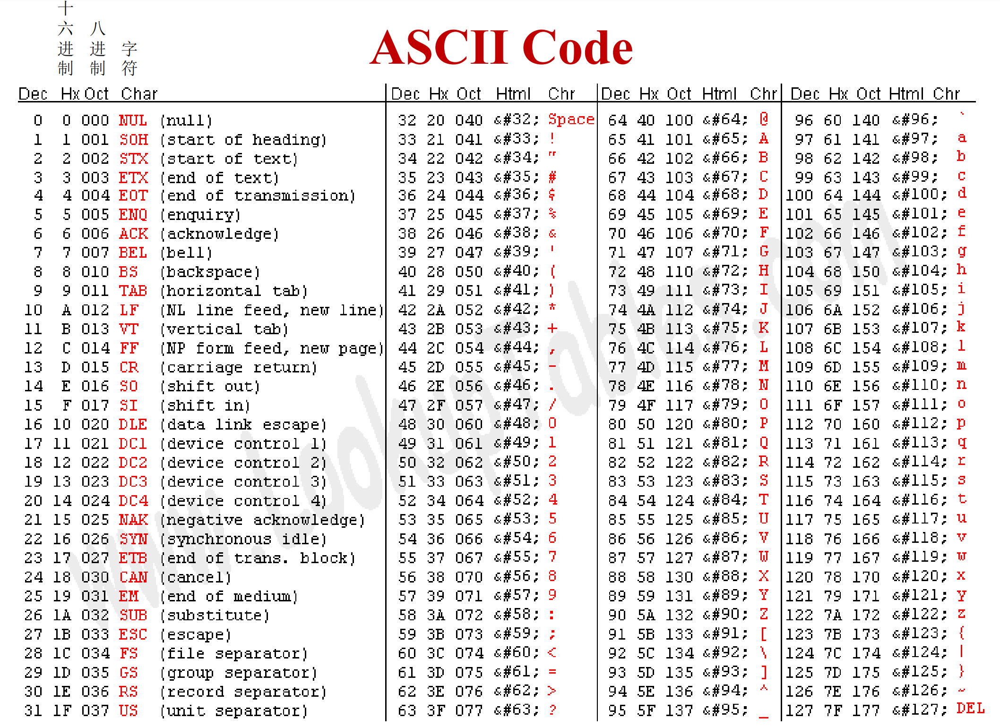
> - ==🔴ASCII 的位数与内容==
> 	- 标准 ASCII 码使用==7 位==；扩展 ASCII 码常使用==8 位==。
> 	- 除可显示字符外，还包含==Tab、LF、CR、BS、ESC==等控制字符。

**[ 例题 ] 单词 help 的 ASCII 十六进制表示**

将字符串 `help` 的各字符写成课件给出的 ASCII 二进制与十六进制表示。

> 解
> 1. `h`：$1101000_2=68_{16}$；`e`：$1100101_2=65_{16}$。
> 2. `l`：$1101100_2=6C_{16}$；`p`：课件印为 $1111000_2$，同时给出 $70_{16}$。
> 3. 字符串在存储时按字符顺序保存各代码。
## 2.6 数字代码（digital codes）

### 2.6.1 格雷码（Gray code）
> [!knowledge]
> - ==🔴格雷码：相邻仅变一位==
> 	- 格雷码是==非加权码==，不适合直接进行算术运算。
> 	- 相邻两个格雷码==只有一位变化==，可降低触点不同步造成的瞬时误码。
> 	- ==旋转编码器（rotary encoder）==
> 		- 码盘跨越相邻位置时，普通二进制码可能有多位同时改变；触点或传感器若未同时稳定，可能短暂读到错误的中间码。
> 		- 格雷码相邻码字仅改变一位，故切换瞬间最多只有该位不确定，可降低多位不同步引起的误读风险。
> - 二进制转格雷码：==最高位不变==，其余每位为相邻两个二进制位的异或。
> 	- 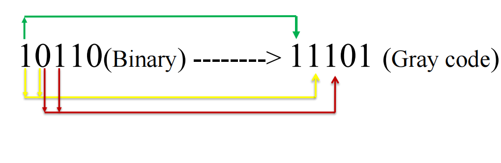
> - 格雷码转二进制：==最高位不变==，之后每位为前一位二进制位与当前格雷码位的异或。
> 	- 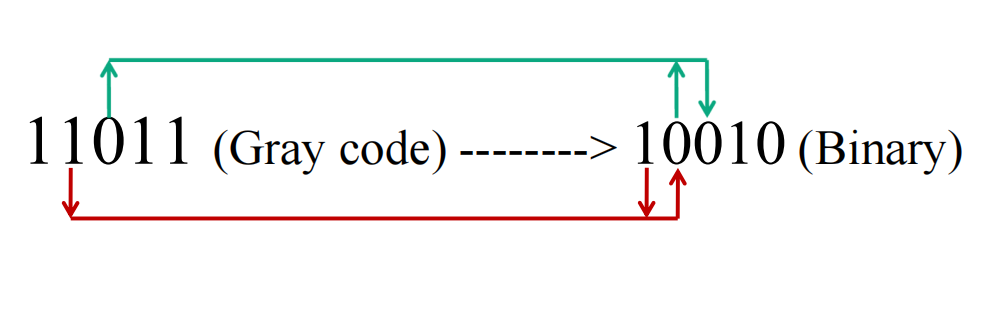

> [!knowledge]
> - ==🔴四位格雷码的顺序：必须按反射码表读==
> 	- 格雷码的数值顺序不能按普通二进制位权直接相加；应查表，或按转换规则逐位还原。
> 	- 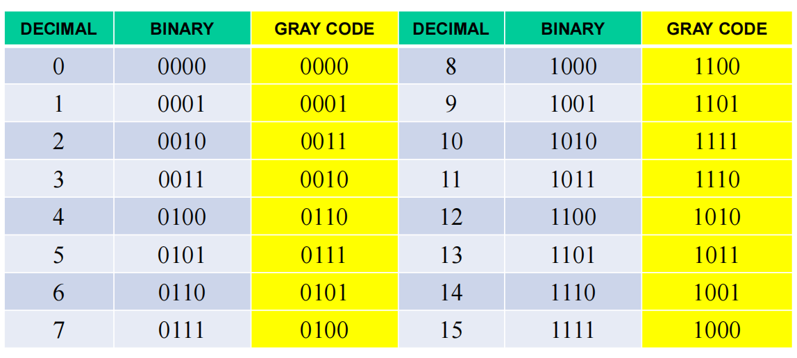
>

**[ 例题 ] 二进制与格雷码互换**
将二进制数 $10110_2$ 转为格雷码；将格雷码 $11011$ 转为二进制数。

> 解
> 1. $10110_2$ 的最高位保持为 1，随后逐位异或：$1\oplus0=1$、$0\oplus1=1$、$1\oplus1=0$、$1\oplus0=1$，故格雷码为 $11101$。
> 2. 格雷码 $11011$ 的最高位为 1；依次恢复二进制位：$1\oplus1=0$、$0\oplus0=0$、$0\oplus1=1$、$1\oplus1=0$。
> 3. 所以 $11011_{\text{Gray}}=10010_2$。

### 2.6.2 奇偶校验（parity check）

> [!knowledge]
> - ==🔴奇偶校验==
> 	- 在原数据前或后附加==一位校验位（parity bit）==，使整个字中 1 的个数为偶数（偶校验）或奇数（奇校验）。
> 	- 发送端先数原数据中的 1：偶校验要使总数为偶数，奇校验要使总数为奇数；接收端按同一规则再数一次总数。
> - 奇偶校验作用：
> 	- 一位翻转会改变 1 的总数奇偶性，因而能检出==单bit错误和任意奇数个bit错误==；
> 	- 偶数个比特同时翻转时奇偶性不变，不能保证检出
> 	- 也不能定位或纠正错误。

> [!knowledge]
> - ==BCD 码的一位奇偶校验：先看数据中 1 的个数==
>
> | BCD 数字 | 4 位 BCD | 偶校验位 | 奇校验位 |
> | --- | --- | --- | --- |
> | 0 | 0000 | 0 | 1 |
> | 1 | 0001 | 1 | 0 |
> | 2 | 0010 | 1 | 0 |
> | 3 | 0011 | 0 | 1 |
> | 4 | 0100 | 1 | 0 |
> | 5 | 0101 | 0 | 1 |
> | 6 | 0110 | 0 | 1 |
> | 7 | 0111 | 1 | 0 |
> | 8 | 1000 | 1 | 0 |
> | 9 | 1001 | 0 | 1 |

**[ 例题 ] 奇校验位的确定**
对 ASCII 字符 `a` 的 7 位码 $1100001$ 和字符 `A` 的 7 位码 $1000001$ 添加奇校验位。

> 解
> 1. `a` 的代码中有 3 个 1，已经是奇数个，因此奇校验位为 0。
> 2. `A` 的代码中有 2 个 1，为偶数个，因此奇校验位为 1。

### 2.6.3 循环冗余校验（Cyclic Redundancy Check, CRC）

> [!knowledge]
> - ==🔴CRC==：
> 	 - 用**生成码**构造**校验余数**，再用同一生成码检
> 	- CRC 是用于==较长数据块的多比特错误检测==方法。让发送端与接收端共享同一套生成和检验规则。
> - ==🔴基本名词==
> 	- ==原始数据 $D$==是实际要传输的比特串；本例为 $D=11010011$。
> 	- ==生成码（generator code）$G$==。本例 $G=1010$；它在模 2 除法中充当“除数”
> 	- ==校验余数 $R$==是发送端用 $G$ 处理补零数据后得到的结果；本例 $R=0100$。最终发送串==$D$ 后附 $R$==得到的 $D''=110100110100$。
> - ==🔴基本流程== 

> [!knowledge]
> - ==模 2 除法：==
> 	- 规则：
> 		- 每一步只做异或，不做普通借位或进位
> 		- 逐位运算规则为：$0\oplus0=0$、$0\oplus1=1$、$1\oplus0=1$、$1\oplus1=0$。
> 	- 从左端取与 $G$ 同样长的窗口；窗口首位为 1 时，与 $G$ 异或；窗口首位为 0 时，不与 $G$ 异或，直接移入下一位。
> 	- 重复到所有输入位均移入窗口。最后留下的比特串就是==余数 $R$==。

> [!knowledge]
> - ==校验的判断：接收端只检查收到的完整串==
> 	- 发送端先由 $D$ 和 $G$ 求出 $R$，再发送 $D''=D\,+\,R$。
> 	- 接收端用同一个 $G$ 除收到的完整比特串。
> 	- 课件的判据是：余数为 0，表示==未检测到错误==；余数非 0，表示==检测到错误==。

#### 发送端：用生成码得到校验余数

**[ 例题 ] 发送端生成 CRC 发送串**
已知数据 $D=11010011$、生成码 $G=1010$。按照模 2 除法过程求最终发送的 CRC 串，并验证其余数为 0。

> 解
> 1. 在 $D$ 后附 4 个 0：$D'=11010011\,0000$。
> 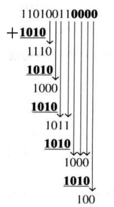
> 2. 从左端取 4 位，按“首位为 1 就异或、首位为 0 就移位”的规则连续处理：
> 	- $1101\oplus1010=0111$；移入下一个 $0$ 后，窗口为 $1110$。
> 	- $1110\oplus1010=0100$；移入下一个 $0$ 后，窗口为 $1000$。
> 	- $1000\oplus1010=0010$；移入下一个 $1$ 后，窗口为 $0101$。
> 	- $0101$ 首位为 0，不异或；移入下一个 $1$ 后，窗口为 $1011$。
> 	- $1011\oplus1010=0001$；移入下一个 $0$ 后，窗口为 $0010$。
> 	- $0010$ 首位为 0，移入下一个 $0$ 后为 $0100$；再移入下一个 $0$ 后为 $1000$。
> 	- $1000\oplus1010=0010$；移入最后一个 $0$ 后，得到余数 $R=0100$。
> 3. 将 $R$ 附在==原始数据 $D$==后：$D''=11010011\,0100$。
> 4. 课件验证：用 $G=1010$ 再除 $D''$，余数为 0；因此 $D''$ 是本例应发送的 CRC 串。

#### 接收端：用同一生成码检查收到的串

**[ 例题 ] 接收端检测错误**
接收端收到比特串 $100100110100$，仍使用生成码 $G=1010$。判断是否检测到传输错误。

> 解
> 1. 直接用 $G=1010$ 对收到的完整比特串作模 2 除法；
> 2. 课件 p.68 给出的余数为 $0100$。
> 3. 因为 $0100\ne0$，不满足“完整发送串除以 $G$ 余数为 0”的条件，故==检测到传输错误==。

> [!note] 待插图
> - 来源：第二章课件 pp. 66–68。
> - 用途：对应发送端的模 2 长除过程、余数 $0100$、发送串验证，以及接收端余数非 0 的错误判定。
> - 截图范围：p. 66 的逐窗异或过程，p. 67–68 的发送/接收验证图。

# 第三章：逻辑门（logic gate）与逻辑系列（logic family）

## 3.1 基本逻辑门（logic gates）

同一逻辑门可用==逻辑符号、真值表、时序图、逻辑表达式==描述。

| 门              | 逻辑关系                | 两输入时的输出规律 |
| -------------- | ------------------- | --------- |
| 非门（NOT）        | $X=\bar A$          | 输出与输入相反。  |
| 与门（AND）        | $X=AB$              | 全1才1      |
| 或门（OR）         | $X=A+B$             | 有1即1      |
| 与非门（NAND gate） | $X=\overline{AB}$   | 全1才0      |
| 或非门（NOR gate）  | $X=\overline{A+B}$  | 有1即1      |
| 异或门（XOR gate）  | $X=\bar AB+A\bar B$ | 不同则 1     |
| 同或门（XNOR gate） | $X=AB+\bar A\bar B$ | 相同则 1     |

> [!knowledge]
> - ==读逻辑门的统一方法：先写输出为 1 的条件==
> 	- ==真值表==列出所有输入组合；$n$ 个输入变量共有 $2^n$ 行。表达式中的上划线表示反，乘积表示“同时满足”，加号表示“满足其一”。
> 	- ==时序图==不改变门的逻辑关系：在每个输入跳变时刻把时间轴分段，再按该门的输出条件逐段确定输出。
### 3.1.1 非门（NOT gate）
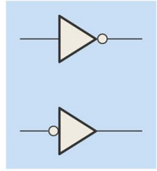

| $A$ | $X=\bar A$ |
| --- | ---------- |
| 0   | 1          |
| 1   | 0          |

### 3.1.2 与门（AND gate）
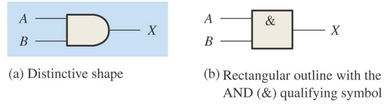

| $A$ | $B$ | $X=AB$ |
| --- | --- | --- |
| 0 | 0 | 0 |
| 0 | 1 | 0 |
| 1 | 0 | 0 |
| 1 | 1 | 1 |

与门的表达式为 $X=AB\cdots$

### 3.1.3 或门（OR gate）
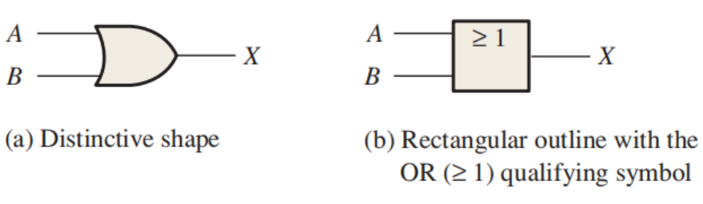

| $A$ | $B$ | $X=A+B$ |
| --- | --- | ------- |
| 0   | 0   | 0       |
| 0   | 1   | 1       |
| 1   | 0   | 1       |
| 1   | 1   | 1       |

### 3.1.4 与非门（NAND gate）和或非门（NOR gate）

> [!knowledge]
> - ==🔴与非、或非的负逻辑等效==
> 	- $\overline{AB}=\bar A+\bar B$：与非门在负逻辑观点下等效为==或门==。
> 	- $\overline{A+B}=\bar A\bar B$：或非门在负逻辑观点下等效为==与门==。
> - 与非门和或非门都是==通用门==，可构成与、或、非三类基本功能。

与非门：
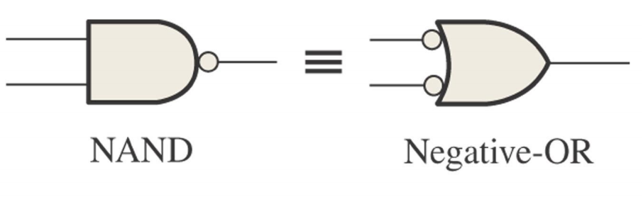
或非门：
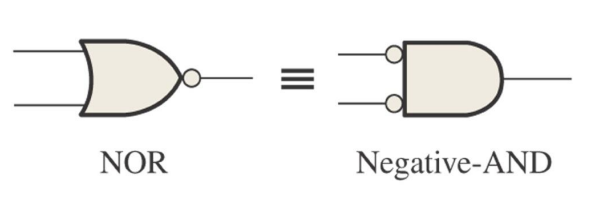

| $A$ | $B$ | $\overline{AB}$（与非） | $\overline{A+B}$（或非） |
| --- | --- | ------------------- | -------------------- |
| 0   | 0   | 1                   | 1                    |
| 0   | 1   | 1                   | 0                    |
| 1   | 0   | 1                   | 0                    |
| 1   | 1   | 0                   | 0                    |

### 3.1.5 异或门（XOR gate）和同或门（XNOR gate）
1. 异或门（XOR , Exclusive-OR）
- 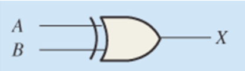

1. 同或门（异或非，XNOR, Exclusive-NOR）
- 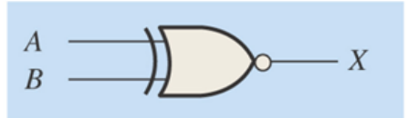

| $A$ | $B$ | $A\oplus B$（异或） | $A\odot B$（同或） |
| --- | --- | --------------- | -------------- |
| 0   | 0   | 0               | 1              |
| 0   | 1   | 1               | 0              |
| 1   | 0   | 1               | 0              |
| 1   | 1   | 0               | 1              |

## 3.2 数字集成电路的性能指标

### 3.2.1 逻辑电平与噪声容限（noise margin）
> [!knowledge]
> - ==🔴逻辑电平==
> 	- 输入阈值：$V_{IL(\max)}$ 是可识别低电平的最大输入电压；$V_{IH(\min)}$ 是可识别高电平的最小输入电压。
> 	- 输出边界：$V_{OL(\max)}$ 是低电平输出的最大电压；$V_{OH(\min)}$ 是高电平输出的最小电压。
> - ==🔴噪声容限==
> 	- 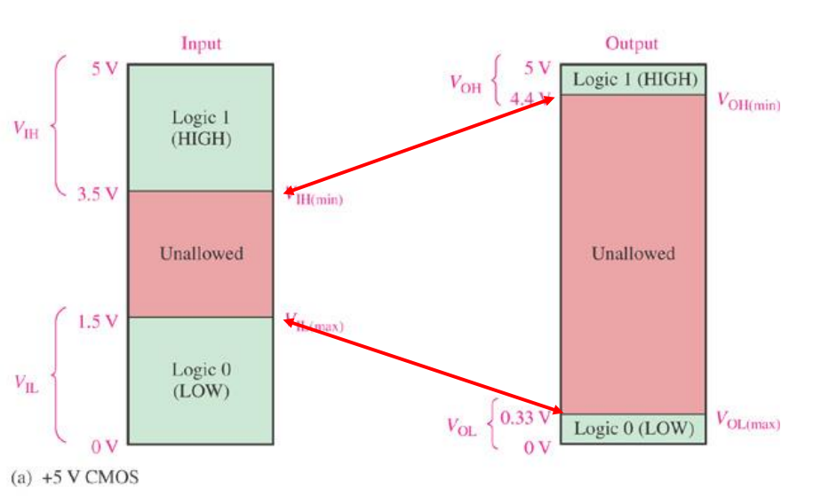
> 	- ==$V_{NL}=V_{IL(\max)}-V_{OL(\max)}$==，==$V_{NH}=V_{OH(\min)}-V_{IH(\min)}$==。

+5V CMOS：
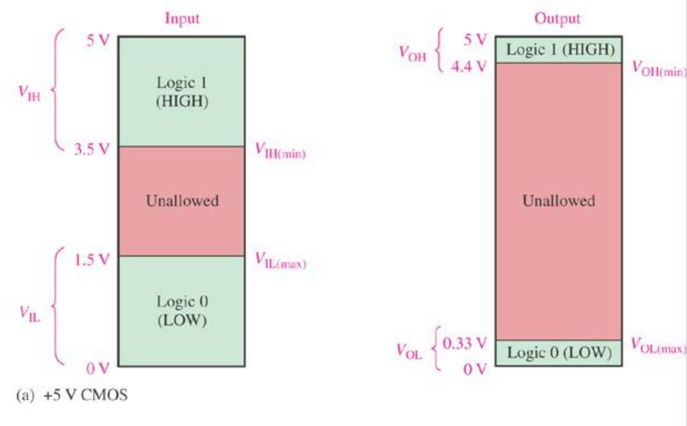
+3.3V CMOS:
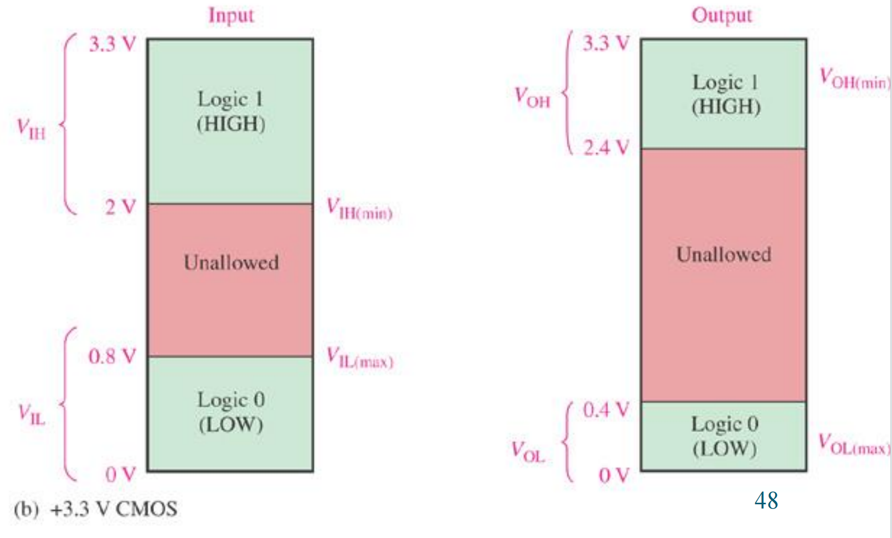
+5V TTL
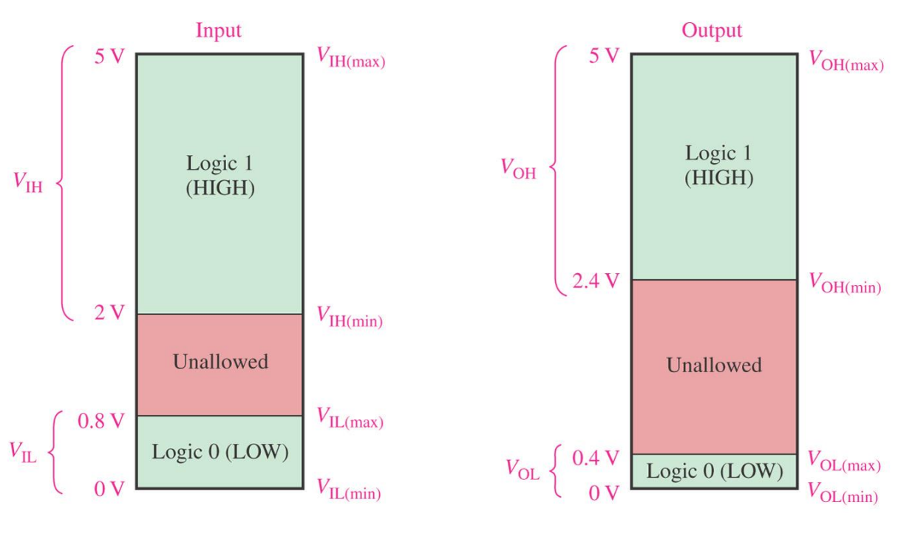

**[ 例题 ] 按课件参数计算噪声容限**
按上图中给出的 CMOS 与 TTL 逻辑电平参数，计算各自的高、低电平噪声容限。

> 解
> 1. CMOS：$V_{NL}=1.5-0.33=1.17$ V，$V_{NH}=4.4-3.5=0.9$ V。
> 2. TTL：$V_{NL}=0.8-0.4=0.4$ V，$V_{NH}=2.4-2.0=0.4$ V。
> 3. 噪声容限越大，逻辑状态对噪声扰动的容忍能力越强。

### 3.2.2 功耗（power dissipation）、速度与扇出（fan-out）

> [!knowledge]
> - ==🔴功耗、速度==
> 	- ==平均功耗：== $P_D=V_{CC}(I_{CCH}+I_{CCL})/2$（用逻辑门输出高、低输出状态的电源电流给出）
> 	- ==传播延迟==（propagation delay）是输入变化到输出稳定之间的时间。
> 		- 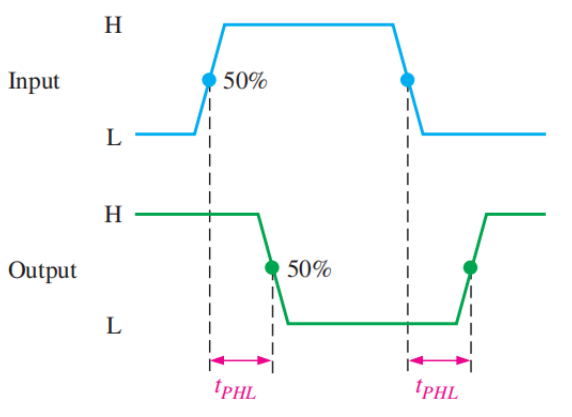
> 		- $t_{PLH}$ 量低到高的输出延迟
> 		- $t_{PHL}$ 量高到低的输出延迟
> 		- 常用**$t_p=(t_{PLH}+t_{PHL})/2$**表示。
> 	- ==速度—功耗积（speed-power product, SPP）==
> 		- $SPP=t_pP_D$；
> 		- 它把“快”和“省电”放在同一指标下比较，数值越小越有利。

> [!knowledge]
> - ==🔴扇出==
> 	- ==扇出（fan-out）==是一个门的输出端连接了多少个同类门的输入端。
> 	- TTL 要分别核对低电平灌电流与高电平拉电流，取两者允许负载数中较小者；
> 	- CMOS 虽然直流输入电流很小，输入电容仍会在负载增多时拉慢边沿。
> 		- CMOS 门电路的**工作频率与扇出**有关
>	   - 扇出越大 → 电容越大 → 频率越低

> [!knowledge]
> - ==🔴负载==
> 	- $Unit Loads（单位负载）= I_{OL} / I_{IL}$
> 	 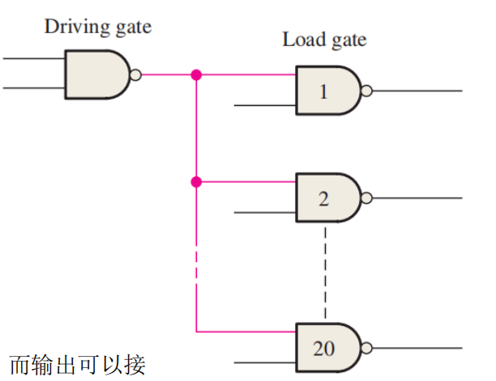
> 	- ==CMOS 负载==：
> 	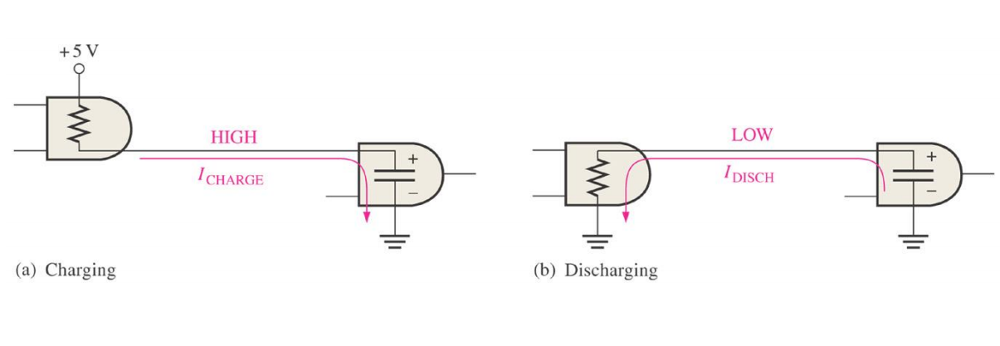
> 	- ==TTL 负载==：
> 	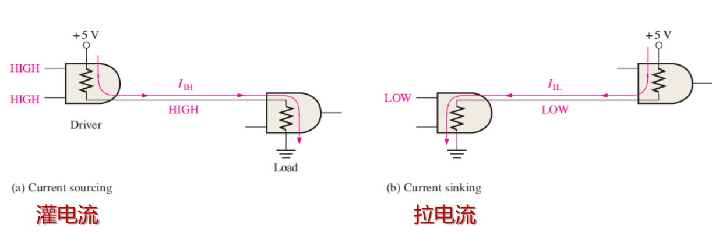
> 	 - ==TTL 多负载==：
> 		 - 灌电流：扇出 ↑  源电流 ↑  内部压降 ↑  $V_{OH}$​ ↓ 直到 >$V_{OHmin}$ → 错误  噪声容限 ↓  功耗 ↑
> 	  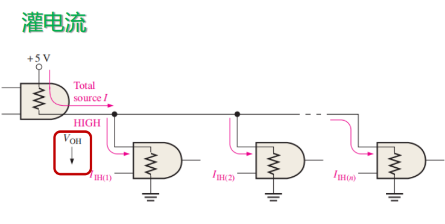
> 		 - 拉电流：扇出 ↑  吸入电流 ↑  内部压降 ↑  $V_{OL}$​ ↑ 直到 >$V_{OLmax}$ → 错误  噪声容限 ↓  功耗 ↑
> 	  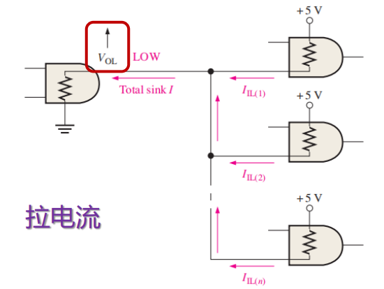

**[ 例题 ] TTL 低电平扇出**
一个 TTL 门在低电平时最大灌电流（输出可以接收的低电平电流）为 8 mA，每个同系列 TTL 输入在低电平时需要 0.4 mA。求该输出的低电平扇出。

> 解
> 1. 扇出由可提供的输出电流除以每个输入所需电流确定。
> 2. $\text{fan-out}=8\text{ mA}/0.4\text{ mA}=20$。
> 3. 因而该输出最多可驱动 20 个这种单位负载

## 3.3 CMOS（Complementary Metal-Oxide-Semiconductor）逻辑电路

> [!knowledge]
> - ==🔴CMOS组成==
> 	- CMOS由**N 型 MOSFET**和**P 型 MOSFET**互补组成。
> - ==🔴MOS管理想开关==
> 	- NMOS：栅极为 $+5\,\text{V}$ 时导通，等效为闭合开关；栅极为 $0\,\text{V}$ 时截止，等效为断开开关。
> 		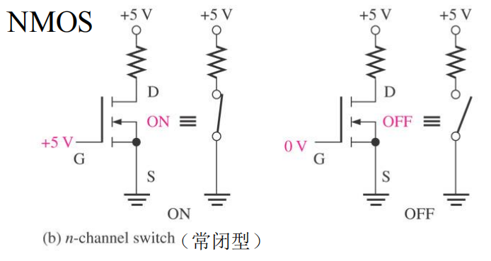
> 	- PMOS：栅极为 $0\,\text{V}$ 时导通，等效为闭合开关；栅极为 $+5\,\text{V}$ 时截止，等效为断开开关。
> 		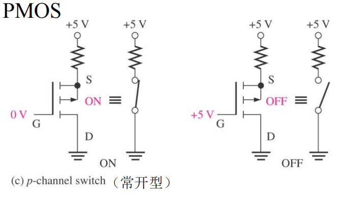

> [!knowledge]
> - ==🔴CMOS 反相器的连接方式==
> 	- 上管 $Q_1$  PMOS，源极接 $+V_{DD}$；下管 $Q_2$  NMOS，源极接地。两管栅极共接输入，两管漏极共接输出。
> 	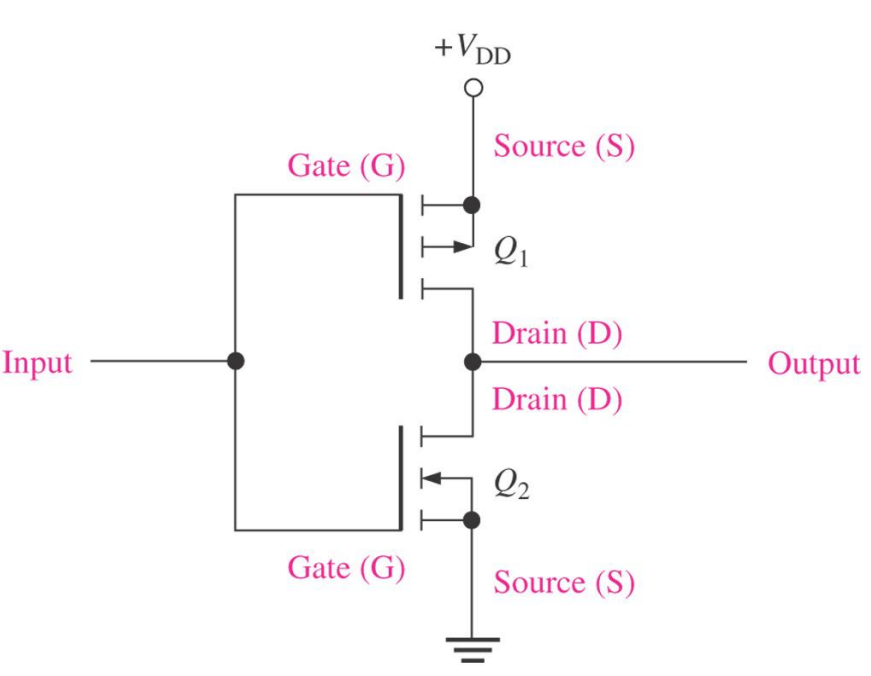
> - ==🔴CMOS 反相器的两种状态==
> 	- 输入高电平时，$Q_1$ 截止、$Q_2$ 导通，输出被接到低电平端
> 	- 输入低电平时，$Q_1$ 导通、$Q_2$ 截止，输出被接到 $+V_{DD}$

> [!knowledge]
> - ==🔴CMOS NAND（与非门)==
> 	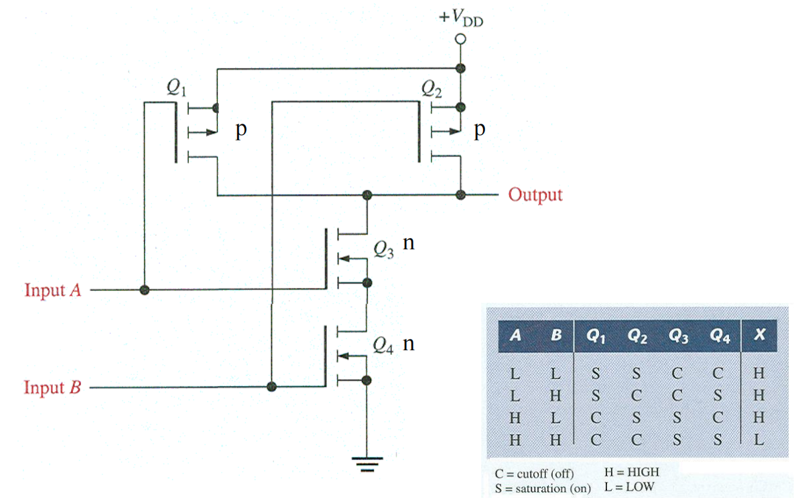
> 	- NAND 门的上拉 PMOS $Q_1,Q_2$ 为==并联==，下拉 NMOS $Q_3,Q_4$ 为==串联==。因此仅当 $A,B$ 都为高电平时，下拉通路完整且输出为低电平。
> 	- 表中 $S$ 表示饱和（ON），$C$ 表示截止（OFF），$H/L$ 分别表示高/低电平。
> 		

> [!knowledge]
> - ==🔴CMOS NOR （或非门）==
>  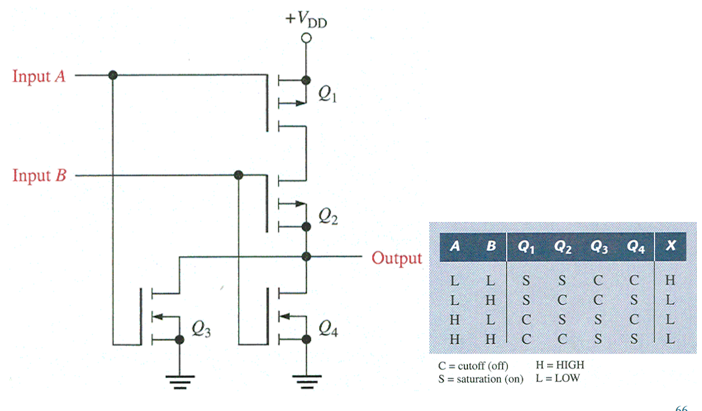
> 	- NOR 门的上拉 PMOS $Q_1,Q_2$ 为==串联==，下拉 NMOS $Q_3,Q_4$ 为==并联==。因此只有 $A,B$ 都为低电平时，上拉通路完整且输出为高电平。
>

> [!knowledge]
> - ==🔴CMOS开漏输出（open-drain）==
> 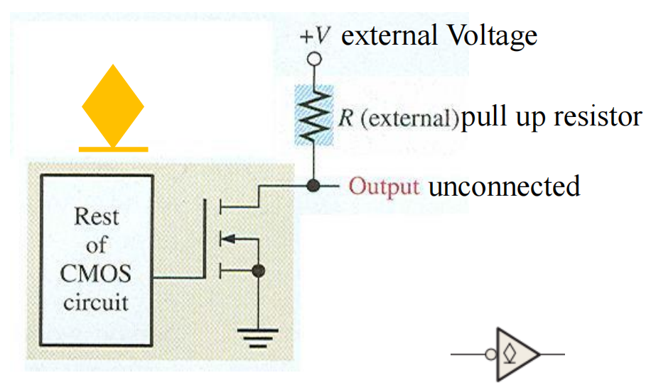
> 	- NMOS 导通时，输出被拉到低电平；NMOS 截止时，输出端呈开路，必须通过**外接电源与上拉电阻**得到高电平。

> [!knowledge]
> - ==🔴CMOS三态门==
> 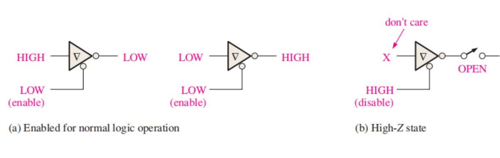
> 	- 图中的三态 CMOS 反相器使用低有效使能端：使能端为低电平时，按普通反相器工作。
> 	- 使能端为高电平时，输出端断开并进入**高阻态（high-Z）**；此时输入 $X$ 为无关项（don't care），输出既不是 0 也不是 1。

## 3.4 TTL（Transistor-Transistor Logic）逻辑电路

> [!knowledge]
> - ==🔴BJT理想开关==
> 	- BJT 正常工作时，基极-发射极结正偏，基极-集电极结反向偏置。
> 	- 作开关使用时，晶体管**饱和**对应导通的闭合开关，集电极电流可从 $V_{CC}$ 经负载流向地；输入为 $0\,\text{V}$ 时晶体管**截止**，对应断开的开关。
> 		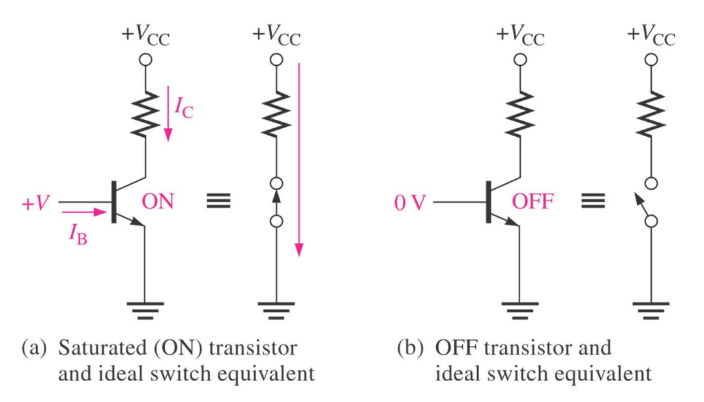

> [!knowledge]
> - ==🔴标准 TTL **反相器**==
> 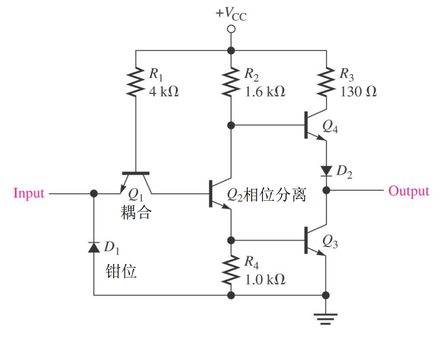
> 	- 电路由输入级 $Q_1$、钳位二极管 $D_1$、相位分离级 $Q_2$ 以及输出级构成；$Q_2$ 的作用是把控制信号分给上、下两条输出支路。
> 	- 输出级中的 $Q_4$ 为上拉支路，$Q_3$ 为下拉支路，二者形成**图腾柱（totem-pole）** 输出；$D_2$ 位于上拉支路。
> - ==🔴工作原理==
> 	- 输入为高电平时，$Q_1$ 输入结反向偏置，$Q_2$、$Q_3$ 导通而 $Q_4$ 截止，输出为低电平。
> 	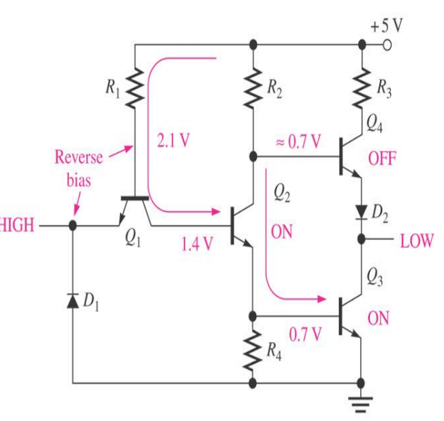
> 	- 输入为低电平（$0\,\text{V}$）时，$Q_2$、$Q_3$ 截止而 $Q_4$ 导通，输出为高电平；这就是“输入 0 输出 1、输入 1 输出 0”。
> 	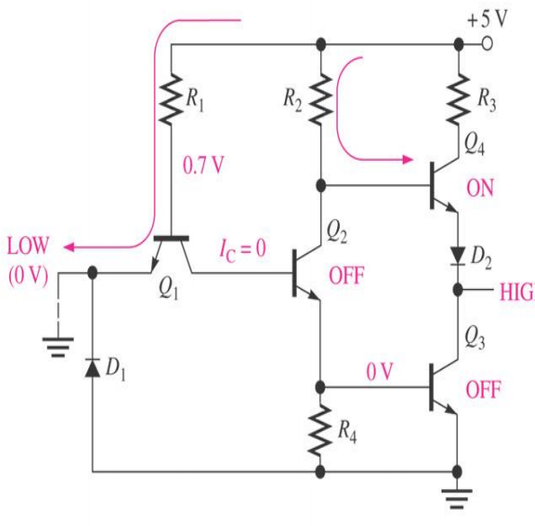

> [!knowledge]
> - ==🔴TTL **与非门（NAND）**==
> 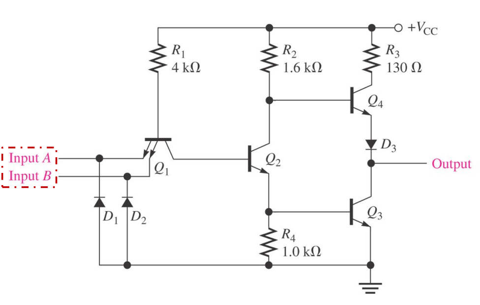
> 	-  对比TTL的反相器电路，NAND门的差别仅在输入级使用了**多发射极晶体管** $Q_1$
> 	- 多输入TTL与非门满足：**任一输入为 0，输出为 1；全部输入为 1，输出为 0**。

> [!knowledge]
> - ==🔴开集电极（open-collector）==反相器的输出取自下拉晶体管集电极，内部没有主动上拉支路；要获得高电平，需要接**外部上拉电阻**。
> 	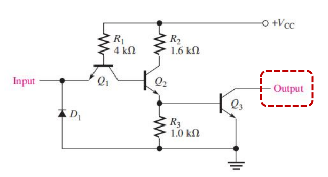

> [!knowledge]
> - ==🔴三态反相器：==
> 	- $EN=0$时**按反相器工作**，$EN=1$时输出为**高阻态**（high-impedance）。
> 	- 工作原理：
> 		-  Enable = 1：Q2 导通，使 Q3 截止；同时通过 D1 使 Q4 截止，Q5 也截止，输出为高阻态 Z。
> 		- Enable = 0，Input = 0：Q2 截止，Q1 将 Q3 基极拉低，Q3 截止，Q4 导通，Q5 截止，输出高电平 1。
> 		- Enable = 0，Input = 1：Q2 截止，Q1 向 Q3 提供基极电流，Q3 导通，Q4 截止，Q5 导通，输出低电平 0。
> 	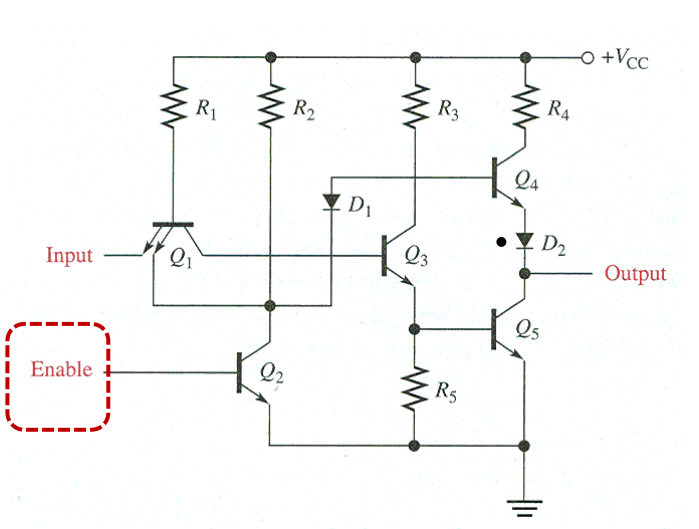

> [!knowledge]
> - ==🔴速度特点==： 肖特基 TTL（Schottky TTL）==是开关速度较快的一类 TTL。

## 3.5 TTL 逻辑门的连接与使用

> [!knowledge]
> - ==🔴输出为高、低时的电流作用==
> 	- 图腾柱输出为高电平时，上拉支路向外部负载提供电流，称为**电流拉出**（current sourcing）； $I_{IH}=40\,\mu\text{A}$。
> 	 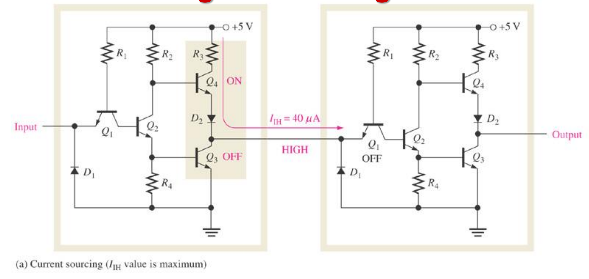
> 	- 图腾柱输出为低电平时，下拉支路把电流引向地，称为**电流灌入**（current sinking）； $I_{IL}=1.6\,\text{mA}$。
> 	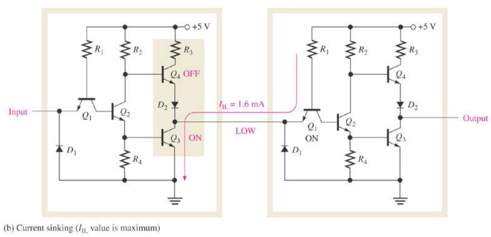
> 	- 可见灌电流通常远大于拉电流

> [!knowledge]
> - ==🔴图腾柱输出相连==
> 	- 两图腾柱**输出相连**时，若 A 的上拉晶体管导通而 B 的下拉晶体管导通，会从 $+5\,\text{V}$ 经两器件形成过**过电流**。因此**输出不相连**
> 	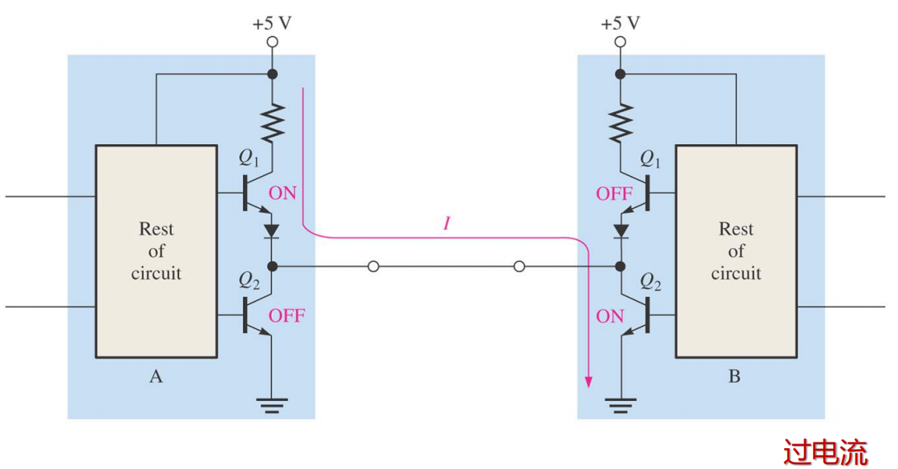

> [!knowledge]
> - ==🔴开集电极的外接负载==
> 	- **开集电极门**需要**外部上拉或负载支路**。输出晶体管导通时把节点拉低，电流经外部负载流过；晶体管截止时无此电流通路。
> 	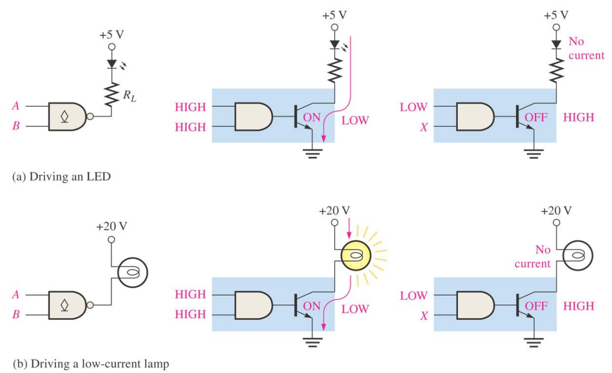

> [!knowledge]
> - ==🔴开集电极输出的线与==（wired-AND）
> 	- 传统连接多输出的方式需要多一个与门：
> 	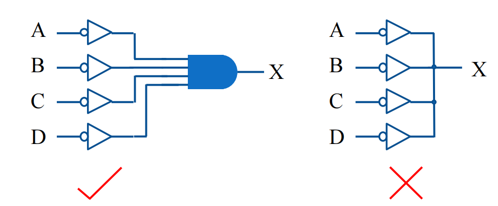
> 	- 但若**输出**是**集电极开路**时，那么多个输出可接到同一节点，并由外部上拉电阻决定无人下拉时的高电平。
> 	- 公共输出逻辑：**只要一个或多个**输出晶体管导通，公共节点就是**低电平**；只有**所有**输出晶体管都截止，公共节点才被上拉为**高电平**。
> 	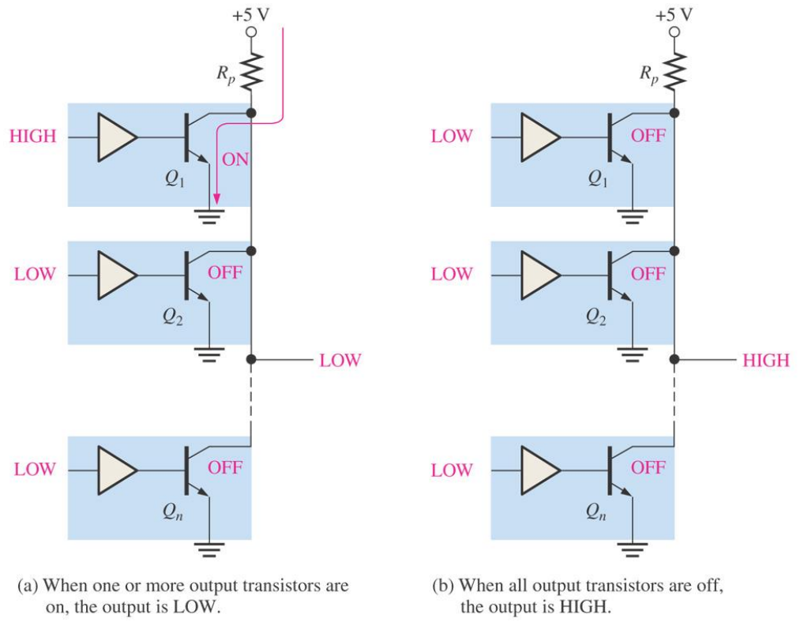

> [!knowledge]
> - ==🔴未使用 TTL 输入==
> 	- **悬空 TTL 输入通常表现为高电平**，原因是输入晶体管的发射结处于反向偏置；但实际中不应让未使用输入保持悬空。
> 	- 三种处理方法（需使输入逻辑确定，且不影响原逻辑）：
> 		- 把**未用输入与一个已用输入**相连；
> 		- **接到 $V_{CC}$ 或地**；
> 		- 接到未使用门的输出端。

## 3.6 固定功能逻辑芯片与 74xx 系列

> [!knowledge]
> - ==🔴固定功能逻辑芯片：先读编号，再比较系列参数==
> 	- ==74LS04 的编号含义==
> 		- 对==$74\mathrm{LS}04$==：`74` 表示系列，`LS` 表示==低功耗肖特基 TTL（Low-power Schottky TTL）==，`04` 表示==六反相器（hex inverter）==。
> 	- ==课件列出的逻辑技术类别==
> 		- 固定功能逻辑芯片按技术分为==双极型 TTL（Bipolar TTL）==、==BiCMOS==和==CMOS==；课件的 CMOS 比较又按 $5\,\text{V}$ 与 $3.3\,\text{V}$ 系列列出。
> 		- 双极型 TTL 包括 F（高速）、LS（低功耗）和 ALS（先进低功耗）；课件还列出 BiCMOS 的 ABT、$5\,\text{V}$ CMOS 的 HC/AC/AHC，以及 $3.3\,\text{V}$ CMOS 的 LV/LVC/ALVC。
> 	- ==课件的系列性能对比：双极型 TTL 与 BiCMOS==
>
> | 系列 | 传播延迟 $t_p$ | 最大时钟频率 | 每门功耗 | 输出驱动 $I_{OL}$ |
> | --- | --- | --- | --- | --- |
> | F | $3.3\,\text{ns}$ | $145\,\text{MHz}$ | $6\,\text{mW}$ | $20\,\text{mA}$ |
> | LS | $10\,\text{ns}$ | $33\,\text{MHz}$ | $2.2\,\text{mW}$ | $8\,\text{mA}$ |
> | ALS | $7\,\text{ns}$ | $45\,\text{MHz}$ | $1.4\,\text{mW}$ | $8\,\text{mA}$ |
> | ABT（BiCMOS） | $3.2\,\text{ns}$ | $150\,\text{MHz}$ | $17\,\text{mW}$ | $64\,\text{mA}$ |
>
> [!knowledge]
> - ==🔴CMOS 系列性能对比：电源电压也是条件==
> 	- ==$5\,\text{V}$ CMOS==
>
> | 系列 | 传播延迟 $t_p$ | 最大时钟频率 | 静态功耗 | 输出驱动 $I_{OL}$ |
> | --- | --- | --- | --- | --- |
> | HC | $7\,\text{ns}$ | $50\,\text{MHz}$ | $2.75\,\mu\text{W}$ | $4\,\text{mA}$ |
> | AC | $5\,\text{ns}$ | $160\,\text{MHz}$ | $0.55\,\mu\text{W}$ | $24\,\text{mA}$ |
> | AHC | $3.7\,\text{ns}$ | $170\,\text{MHz}$ | $2.75\,\mu\text{W}$ | $8\,\text{mA}$ |
> - ==$3.3\,\text{V}$ CMOS==
>
> | 系列 | 传播延迟 $t_p$ | 最大时钟频率 | 静态功耗 | 输出驱动 $I_{OL}$ |
> | --- | --- | --- | --- | --- |
> | LV | $9\,\text{ns}$ | $90\,\text{MHz}$ | $1.6\,\mu\text{W}$ | $12\,\text{mA}$ |
> | LVC | $4.3\,\text{ns}$ | $100\,\text{MHz}$ | $0.8\,\mu\text{W}$ | $24\,\text{mA}$ |
> | ALVC | $3\,\text{ns}$ | $150\,\text{MHz}$ | $0.8\,\mu\text{W}$ | $24\,\text{mA}$ |

# 第四章：布尔代数（Boolean algebra）与逻辑化简

## 4.1 布尔变量（Boolean variable）、文字（literal）与运算符

> [!knowledge]
> - ==🔴逻辑变量与反变量==
> 	- ==逻辑变量==只能取 0 或 1；反变量（补）表示相反逻辑值，记作 $\bar A$。
> - ==🔴文字（literal）==
> 	- **变量或其反变量统称为文字。**
> - ==🔴基本运算符==
> 	- 加号 $+$ 表示==逻辑或==，连接或乘号表示==逻辑与==，例如 $AB=A\cdot B$。

## 4.2 布尔代数基本定律

> [!knowledge]
> - ==🔴交换律与结合律==
> 	- ==交换律==：$A+B=B+A$，$AB=BA$；
> 	- ==结合律==：$(A+B)+C=A+(B+C)$，$(AB)C=A(BC)$。
> - ==🔴分配律==
> 	- $A(B+C)=AB+AC$，$A+BC=(A+B)(A+C)$；
> 	- **它既可用于展开，也可反向用于因式分解。**
> - ==🔴恒等律、零律与互补律==
> 	- ==恒等律与零律==：$A+0=A$，$A\cdot1=A$，$A+1=1$，$A\cdot0=0$。
> 	- ==幂等律、互补律、双重否定==：$A+A=A$，$AA=A$，$A+\bar A=1$，$A\bar A=0$，$\overline{\bar A}=A$。
> - ==🔴吸收律==
> 	- $A+AB=A$，$A(A+B)=A$；**含有 $A$ 的较复杂项可被 $A$ 吸收。**
> - ==🔴推论==
> 	- $A+\bar AB=A+B$，以及 $(A+B)(A+C)=A+BC$。

**[ 例题 ] 证明 $(A+B)(A+C)=A+BC$**
用布尔代数证明 $(A+B)(A+C)=A+BC$。

> 解
> 1. 展开：$(A+B)(A+C)=AA+AC+AB+BC$。
> 2. 用幂等律化为 $A+AC+AB+BC$。
> 3. 提取 $A$：$A(1+C+B)+BC$。
> 4. 因为 $1+C+B=1$，所以结果为 $A+BC$。

## 4.3 德摩根定律（De Morgan's laws）
> [!knowledge]
> - ==🔴对乘积取反==
> 	- **乘积的反等于各因子反的和。**$\overline{AB}=\bar A+\bar B$。
> 	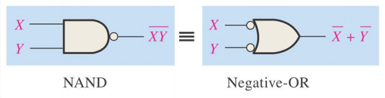
> - ==🔴对和取反==
> 	- **和的反等于各项反的积。**$\overline{A+B}=\bar A\bar B$。
> 	 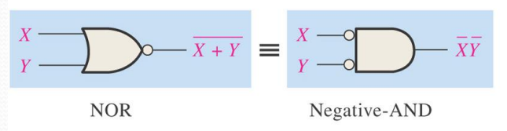
> - ==🔴多变量的德摩根定律==
> 	- 对多变量同样成立：$\overline{XYZ}=\bar X+\bar Y+\bar Z$，$\overline{X+Y+Z}=\bar X\bar Y\bar Z$；**取反穿过括号时，运算符必须互换。**

**[ 例题 ] 对含多个乘积项的表达式取反**

写出 $\overline{\bar A B C+A\bar B C+AB\bar C}$ 的等价乘积和形式。

> 解
> 1. 对最外层的和使用德摩根定律，得到各乘积项反的乘积。
> 2. 分别对每个乘积项取反：$\overline{\bar A B C}=A+\bar B+\bar C$，$\overline{A\bar B C}=\bar A+B+\bar C$，$\overline{AB\bar C}=\bar A+\bar B+C$。
> 3. 因而原式等于 $(A+\bar B+\bar C)(\bar A+B+\bar C)(\bar A+\bar B+C)$。

## 4.4 用布尔代数化简逻辑电路
> [!knowledge]
> - ==🔴列写中间节点与输出表达式==
> 	1. 按门电路连接关系写出==中间节点==与==输出表达式==。
> 	2. 先处理最内层门的输出，再代入后级；**反相小圆圈或上划线的作用范围必须用括号明确。**
> - ==🔴使用布尔代数基本定律化简==
> 	1. 使用==基本定律==、==吸收律==、==德摩根定律==化简。
> - ==🔴验证化简前后的功能==
> 	1. 用==真值表==或==逻辑等价关系==确认功能不变。

**[ 例题 ] 由门电路写出并化简输出函数**
某门电路的输出函数为 $Y=AB+A(B+C)+B(B+C)$。将其化简。

> 解
> 1. 合并前两项：$AB+A(B+C)=A(B+B+C)=A(B+C)$。
> 2. 因而 $Y=A(B+C)+B(B+C)=AB+AC+B+BC$。
> 3. 利用 $B+AB=B$、$B+BC=B$，得 $Y=B+AC$。
> 4. 因此原电路可由一个与门产生 $AC$，再与 $B$ 经过或门得到输出。

**[ 例题 ] 根据表达式确定逻辑电路的输出条件**

课件电路的输出为 $Y=A(B+CD)$。说明 $Y$ 在哪些输入条件下为 1。

> 解
> 1. 当 $A=0$ 时，$Y=0$，无论 $B,C,D$ 取何值。
> 2. 当 $A=1,B=1$ 时，括号内为 1，故 $Y=1$，无论 $C,D$ 取何值。
> 3. 当 $A=1,B=0$ 时，只有 $C=1,D=1$ 使 $CD=1$，此时 $Y=1$。
> 4. 所以输出为 1 的条件是 $A=1$ 且“$B=1$ 或 $C,D$ 同时为 1”，这与表达式 $A(B+CD)$ 一致。

**[ 例题 ] 吸收化简**
化简 $Y_1=(\overline{\bar A B}+C)ABD+AD$，以及 $Y_2=AB+AB\bar C+ABD+AB(\bar C+\bar D)$。

> 解
> 1. 对 $Y_1$，先把与 $B$ 相乘的部分合并：$Y_1=[(\overline{\bar A B}+C)B]AD+AD$；后项 $AD$ 吸收前项，故 $Y_1=AD$。
> 2. 对 $Y_2$，提取 $AB$：$Y_2=AB[1+\bar C+D+(\bar C+\bar D)]$。
> 3. 方括号中含有 1，故 $Y_2=AB$。

**[ 例题 ] 利用 $A+\bar AB=A+B$ 化简**
化简下列三个函数：$Y_1=\bar B+ABC$，$Y_2=A\bar B+B+\bar A B$，$Y_3=AC+\bar AD+\bar CD$。

> 解
> 1. $Y_1=\bar B+ABC=\bar B+AC$，使用 $\bar B+B(AC)=\bar B+AC$。
> 2. $Y_2=A\bar B+B+\bar A B=A+B+\bar A B=A+B$。
> 3. $Y_3=AC+(\bar A+\bar C)D=AC+\overline{AC}D=AC+D$。

**[ 例题 ] 展开最小项后再合并**
化简 $Y=A\bar B+\bar AB+B\bar C+\bar BC$。

> 解
> 1. 对需要配对的项乘以 $C+\bar C$ 或 $A+\bar A$，把它们展开为含相同变量数的乘积项。
> 2. 按课件的配对合并，可得 $Y=A\bar B+B\bar C+\bar AC$。
> 3. 该过程展示了“引入互补项后再用相邻最小项合并”的思路。

## 4.5 标准积之和（standard sum of products, SOP）与标准和之积（standard product of sums, POS）

> [!knowledge]
> - ==🔴SOP 与 POS 的形式==
> 	- ==SOP==是若干乘积项的逻辑或（相加）；==POS==是若干和项的逻辑与（相乘）。
> - ==🔴最小项与最大项==
> 	- 标准 SOP 的每个乘积项称==最小项==；标准 POS 的每个和项称==最大项==。
> - ==🔴把非标准项补成标准项==
> 	- 乘积项补成标准 SOP：乘以 $X+\bar X=1$；
> 	- 和项补成标准 POS：用 $X\bar X=0$，即 $A+X\bar X=(A+X)(A+\bar X)$。
> - ==🔴编号与二进制变量的对应==
> 	- 变量的排列顺序必须固定。
> 	- 对最小项，二进制位 1 写原变量、0 写反变量，**使该最小项恰在对应输入组合下取 1？**
> 	- 对最大项，二进制位 0 写原变量、1 写反变量，**使该最大项恰在对应输入组合下取 0。**
> 	- $Y=\sum m(\cdots)$ 列出**输出为 1**的编号；$Y=\prod M(\cdots)$ 列出**输出为 0**的编号。
> 	- **同一函数的两组编号在全部 $2^n$ 个组合中互补。（由于01相反，以及德摩根定律）**

**[ 例题 ] 化为标准 SOP（最小项之和）**
将 $Y=A\bar B\bar CD+\bar ACD+AC$ 化为四变量 $A,B,C,D$ 的标准 SOP。

> 解
> 1. 对缺少变量的项补入恒等式：$\bar ACD=\bar A(B+\bar B)CD$，$AC=A(B+\bar B)C(D+\bar D)$。
> 2. 展开并与原来的 $A\bar B\bar CD$ 合并，课件得到的最小项编号为 $3,7,9,10,11,14,15$。
> 3. 因而可写为 $Y=\sum m_i\;(i=3,7,9,10,11,14,15)$。

**[ 例题 ] 由标准 SOP 得到标准 POS**
三变量函数的标准 SOP 覆盖的二进制组合为 $000,010,011,101,111$。写出它的标准 POS。

> 解
> 1. 三变量共有 $2^3=8$ 个组合，未被覆盖的组合为 $001,100,110$。
> 2. 对未覆盖组合写出对应最大项：$001\to(A+B+\bar C)$，$100\to(\bar A+B+C)$，$110\to(\bar A+\bar B+C)$。
> 3. 因而该函数的标准 POS 为 $(A+B+\bar C)(\bar A+B+C)(\bar A+\bar B+C)$。

**[ 例题 ] 从真值表写出函数**
课件真值表中，只有输入组合 $101$、$110$、$111$ 时 $Y=1$。写出标准 SOP 并化简。

> 解
> 1. 按变量顺序 $A,B,C$，三行对应的最小项依次为 $A\bar BC$、$AB\bar C$、$ABC$。
> 2. 标准 SOP 为 $Y=A\bar BC+AB\bar C+ABC$。
> 3. 重复引入 $ABC$ 配对：$A\bar BC+ABC=AC$，$AB\bar C+ABC=AB$。
> 4. 所以 $Y=AC+AB=A(B+C)$。

## 4.6 卡诺图（Karnaugh map, K-map）化简
> [!knowledge]
> - ==🔴特点：==
> 	- 卡诺图按==格雷码顺序==排列变量取值，使相邻单元只相差一个变量。
> 	- 图的左右边、上下边也相邻；3/4 变量卡诺图将全部==最小项==映射到相应格子。
> 	- **四个角落的格子是相邻关系**
> 	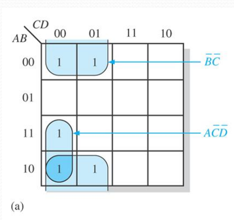
> 	- **对角线上的格子不相邻。**
> - ==🔴圈组与读出表达式==
> 	- 化简 SOP 时圈取值为 1 的格子：
> 		- 每组数量必须为 $2^n$，
> 		- 组应尽可能大、数量尽可能少
> 		- 所有 1 必须覆盖，允许重叠。
> 	- 每组中==保持不变的变量==构成乘积项；**各乘积项之和即为化简后的 SOP。**

> [!knowledge]
> - ==🔴三变量卡诺图：==
>
> | 三变量：$A\backslash BC$ | 00 | 01 | 11 | 10 |
> | --- | --- | --- | --- |
> | $A=0$ | $m_0$ | $m_1$ | $m_3$ | $m_2$ |
> | $A=1$ | $m_4$ | $m_5$ | $m_7$ | $m_6$ |
>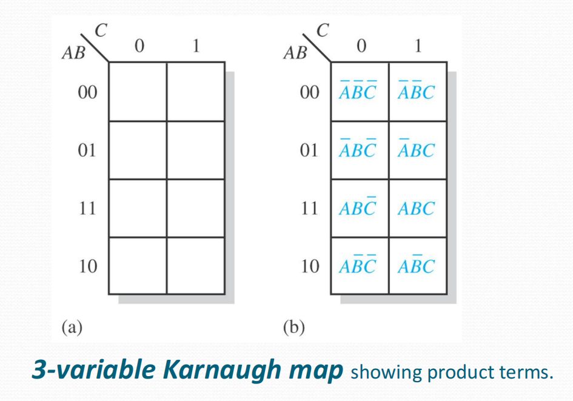
> - ==🔴四变量卡诺图：$AB$ 为行，$CD$ 为列==
>
> | 四变量：$AB\backslash CD$ | 00 | 01 | 11 | 10 |
> | --- | --- | --- | --- |
> | 00 | $m_0$ | $m_1$ | $m_3$ | $m_2$ |
> | 01 | $m_4$ | $m_5$ | $m_7$ | $m_6$ |
> | 11 | $m_{12}$ | $m_{13}$ | $m_{15}$ | $m_{14}$ |
> | 10 | $m_8$ | $m_9$ | $m_{11}$ | $m_{10}$ |
> 
> - ==🔴五变量卡诺图：==
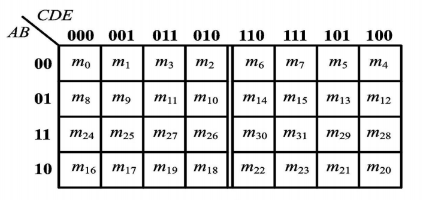

> [!knowledge]
> - ==🔴格雷码次序==
> 	- 行、列次序为 $00,01,11,10$，而非普通二进制顺序 $00,01,10,11$；**这是让相邻格只改变一个变量的关键。**

> [!knowledge]
> - ==🔴无关项==
> 	- 实际系统中永远不会出现、或输出无关紧要的输入组合可标为==无关项==（X）。
> 	- 无关项可按有利于形成==更大分组==的方式当作 1 使用，也可不使用。
> 	
> - ==🔴8421 BCD 示例==
> 	- 8421 BCD 只使用 $0000$ 到 $1001$；$1010$ 到 $1111$ 是不允许的输入组合，课件示例可把它们标为无关项，以简化有效 BCD 输入范围内的逻辑。

**[ 例题 ] 用三变量卡诺图化简课件真值表**
对最小项 $m_5,m_6,m_7$，用三变量卡诺图写出最简 SOP。

> 解
> 1. 由三变量卡诺图定位：$m_5$ 在 $(A,BC)=(1,01)$，$m_6$ 在 $(1,10)$，$m_7$ 在 $(1,11)$。
> 2. 圈 $m_5,m_7$：两格中 $A=1,C=1$ 保持不变，得到项 $AC$。
> 3. 圈 $m_6,m_7$：两格中 $A=1,B=1$ 保持不变，得到项 $AB$。$m_7$ 允许同时属于两个组。
> 4. 故最简 SOP 为 $Y=AC+AB=A(B+C)$，与由真值表直接化简的结果一致。

# 第五章：组合逻辑（combinational logic）分析

## 5.1 基本组合逻辑电路

### 5.1.1 与或逻辑（AND-OR）与积之和（SOP）

> [!knowledge]
> - ==🔴SOP：先与后或的两级实现==
> 	1. 每个==乘积项==对应一个 AND 门。
> 	2. 用一个 OR 门对所有乘积项求和。
> 

### 5.1.2 与或非逻辑（AND-OR-Invert）与积之和的反（POS）
> [!knowledge]
> - ==🔴SOP 与 POS 的实现结构==
> 	- ==SOP==可直接用 AND-OR 结构实现。
> 	- ==POS==可用 AND-OR-Invert 结构实现：先形成各个和项的乘积，再对结果取反。
> 	- 在 AND-OR 结构最后加==非门==，即可得到 AND-OR-Invert。
> 

### 5.1.3 异或（exclusive-OR, XOR）与同或（exclusive-NOR, XNOR）

> [!knowledge]
> - ==🔴异或：不同为 1；同或：相同为 1==
> | 门电路  | 输出为 $1$ 的条件 | 表达式                                               |
> | ---  | ----------- | ---------------------------------------------------- |
> | 异或门 |  两个输入不同      | $X=A\overline B+\overline A B=A\oplus B$             |
> | 同或门 |  两个输入相同      | $X=AB+\overline A\,\overline B=\overline{A\oplus B}$|
> 	1. ==异或门==
> 	   
> 	2. ==同或门==（两种形式）
> 	   

### 5.1.4 偶校验的生成与检查

> [!knowledge]
> - ==🔴偶校验：异或求校验位，再异或检错==
> 	- 四位数据 $A_0,A_1,A_2,A_3$ 的偶校验位为 ==$P=A_0\oplus A_1\oplus A_2\oplus A_3$==。
> 	- 若数据中 1 的个数为奇数，则 ==$P=1$==，使五位码中 1 的总数变为偶数。
> 
> 	- 检查时，对四位数据和偶校验位继续异或；==结果为 1 表示发生奇偶校验错误==。
> 

## 5.2 组合逻辑的实现

### 5.2.1 由布尔表达式画逻辑电路

> [!knowledge]
> - ==🔴由表达式画电路：先内后外，逐层设节点==
> 	- 按运算层级设置==中间节点==，再按从内到外的顺序连接门电路。
> | 表达式                     | 直接实现思路                                   |
> | ----------------------- | -------------------------------------- |
> | $X=AB+CDE$              | 先形成 $AB$、$CDE$，再经 OR 门相加。                |
> | $X=AB(C\overline D+EF)$ | 先得到 $C\overline D$ 与 $EF$，相加后再与 $AB$ 相与。 |
> | $X=ABC\overline D+ABEF$ | 这是上一式展开后的 SOP 形式。                        |
> 	- 下图均表示同一逻辑；==图 b 更优：级数更少==。
> （a）
> 
> （b）
> 

### 5.2.2 由真值表写出逻辑表达式

> [!knowledge]
> - ==🔴真值表到电路：先写最小项，再画 SOP==
> 	1. 对每一行 $X=1$：输入为 1 的变量写原变量，输入为 0 的变量写反变量；将所有==最小项相加得到 SOP==。
> 
> 	2. 通过 SOP 画出逻辑电路。
> 

> [!tip] 关键提示
> 写最小项时，一行真值表必须包含所有输入变量；不要省略该行取 $0$ 的变量的反变量。

### 5.2.3 典型例题

**[ 例题 ] 交通信号灯故障监视器**

输入为红 $R$、黄 $A$、绿 $G$；输出 $Z=1$ 表示故障。正常状态仅为 $001$、$010$、$100$，其余五种状态均为故障。

> 解
> 1. 将五种故障状态写为最小项并化简，得 $Z=\overline R\,\overline A\,\overline G+\overline R A G+R\overline A G+RA\overline G+RAG=\overline R\,\overline A\,\overline G+RA+RG+AG$。
> 
> 2. 按化简后的表达式画出逻辑电路。
> 

**[ 例题 ] 卡诺图化简**

将原电路的函数用卡诺图化简。

> 解
> 1. 按图将函数填入卡诺图并分组，得到 $X=A\overline C\,\overline D+\overline B\,\overline C$。
> 2. 注意：==卡诺图上下本质上相连==。
> 

## 5.3 NAND 与 NOR 门的通用性

### 5.3.1  NAND 门搭建其他“门”

> [!knowledge]
> - ==🔴NAND 是通用门==
> 	- NAND 逻辑：==$X=\overline{AB}$==。
> | 目标门 | 使用NAND 门实现 | 
> | --- | --- |
> | NOT | 将 NAND 门的两个输入端相连：$\overline{AA}=\overline A$ | 
> | AND | 用非门将 NAND=$\overline{AB}$ 反相：$\overline{\overline{AB}}=AB$ |
> | OR | 先产生 $\overline A,\overline B$，再 NAND：$\overline{\overline A\,\overline B}=A+B$ |
> | NOR | 在上述 OR 输出后再反相 |
> 	1. ==NOT==
> 	   
> 	2. ==AND==
> 	   
> 	3. ==OR==
> 	   
> 	4. ==NOR==
> 	   

### 5.3.2 NOR 门搭建其他“门”

> [!knowledge]
> - ==🔴NOR 是通用门==
> 	- NOR 逻辑：==$X=\overline{A+B}$==。
> | 目标门 | 使用NOR 门实现                                                                     | 
> | ---- | --------------------------------------------------------------------------- | 
> | NOT  | 将 NOR 门的两个输入端相连：$\overline{A+A}=\overline A$                          |
> | OR   | 先得 $\overline{A+B}$，再用 NOR 作反相：$\overline{\overline{A+B}}=A+B$              |
> | AND  | 先产生 $\overline A,\overline B$，再 NOR：$\overline{\overline A+\overline B}=AB$ |
> | NAND | 在上述 AND 输出后再反相                                                              | 
> 	1. ==NOT==
> 	   
> 	2. ==OR==
> 	   
> 	3. ==AND==
> 	   
> 	4. ==NAND==
> 	   

> [!knowledge]
> - ==🔴通用门结论==
> 	- NAND 与 NOR 都能单独实现==NOT、AND、OR==，因此都是==通用逻辑门==。

## 5.4 仅用 NAND / NOR 门实现组合逻辑

### 5.4.1 用 NAND 门实现 SOP

> [!knowledge]
> - ==🔴NAND 实现 SOP：先反相乘积，再作与非==
> 	1. 对 $X=AB+CD$，有 $X=\overline{\overline{AB}\cdot\overline{CD}}=AB+CD$。
> 	2. 第一级 NAND 门产生 $\overline{AB}$、$\overline{CD}$；最后一级依据德摩根定律得到 OR 运算。
> 

### 5.4.2 用 NOR 门实现 POS

> [!knowledge]
> - ==🔴NOR 实现 POS：先反相和项，再作或非==
> 	1. 对 $X=(A+B)(C+D)$，有 $X=\overline{\overline{A+B}+\overline{C+D}}=(A+B)(C+D)$。
> 	2. 第一级 NOR 门产生 $\overline{A+B}$、$\overline{C+D}$；最后一级得到 AND 运算。
> 

### 5.4.3 双重符号与气泡抵消

> [!knowledge]
> - ==🔴气泡抵消：相邻反相小圆圈可相消==
> 	- 导线相连的两个==气泡（反相小圆圈）==可相互抵消。
> 
> 	- 利用双重符号，可按等效的 AND/OR 功能逐级读电路，不必反复展开反相符号。
> 	1. 原门电路逻辑
> 	   
> 	2. 每个或非门实际扮演的门
> 	   
> 	3. 将后级或非门转为非与门后，气泡相消
> 	   

> [!tip] 关键提示
> 读多级 NAND/NOR 电路时，先标出每一级输出；若相邻连接端的两个气泡相对，则先抵消，再判断该级等效为 AND 还是 OR。

## 5.5 脉冲波形输入下的逻辑电路分析

### 5.5.1 四类基本门的时序判定

> [!knowledge]
> - ==🔴四类基本门：由输出条件判波形==
> | 门 | 输出为高电平的条件 | 输出为低电平的条件 |
> | --- | --- | --- |
> | AND | 所有输入同时为高 | 至少一个输入为低 |
> | OR | 至少一个输入为高 | 所有输入均为低 |
> | NAND | 至少一个输入为低 | 所有输入同时为高 |
> | NOR | 所有输入均为低 | 至少一个输入为高 |

### 5.5.2 通用分析步骤

> [!knowledge]
> - ==🔴波形分析：节点 → 分段 → 推演 → 复核==
> 	1. 按信号流向为各==中间节点==命名并写出表达式。
> 	2. 以所有输入的==跳变时刻==划分时间区间。
> 	3. 从最前级门开始，逐区间画出中间节点波形。
> 	4. 最后画输出波形，并用总表达式复核。
> 	- 可用==布尔化简、气泡化简、波特图化简==简化表达式。

**[ 例题 ] NAND 输出波形**

根据图示输入波形，分析 NAND 电路的输出波形。

> 解
> 1. 中间节点为 $Y=B+C$，输出为 $X=\overline{A(B+C)}=\overline A+\overline B\,\overline C$。
> 2. 因而仅当 $A=1$ 且 $B+C=1$ 时，$X=0$；其余时段 $X=1$。
> 

## 5.6 本章复习主线

> [!abstract] 本节小结
> 1. **表达式实现：** SOP 对应 AND-OR；真值表中所有 $X=1$ 的行写成最小项后求和。
> 2. **设计流程：** 逻辑抽象 → 定义输入/输出 → 真值表 → 表达式 → 化简 → 画电路。
> 3. **通用门：** NAND 与 NOR 都能单独构成 NOT、AND、OR，因此可实现任意组合逻辑。
> 4. **门图读式：** NAND 适合实现 SOP，NOR 适合实现 POS；双重符号和气泡抵消可减少反相符号干扰。
> 5. **时序分析：** 先画中间节点，再画最终输出；每次跳变都按各门的逻辑条件逐区间判断。

# 第六章：组合逻辑功能
## 6.1 基本加法器（adder）
### 6.1.1 半加器（Half-Adder）

> [!knowledge]
> ==🔴半加器==
>
> - 半加器只将两个 1 位二进制数相加，==不接收低位进位==。
> - 二进制加法规则为：$0+0=0$，$0+1=1$，$1+0=1$，$1+1=10$。
> - 输入为加数 $A$、$B$；输出为==和 $\Sigma$==与==进位 $C_{out}$==。
> - 和由异或门实现：==$\Sigma=A\overline B+\overline A B=A\oplus B$==；进位由与门实现：==$C_{out}=AB$==。
>
> | $A$ | $B$ | $C_{out}$ | $\Sigma$ |
> | --- | --- | --- | --- |
> | 0 | 0 | 0 | 0 |
> | 0 | 1 | 0 | 1 |
> | 1 | 0 | 0 | 1 |
> | 1 | 1 | 1 | 0 |

### 6.1.2 全加器（Full-Adder）
> [!knowledge]
> ==🔴全加器：多一个低位进位输入==
>
> - 输入为加数 $A$、$B$ 与低位进位==$C_{in}$==；输出为和 $\Sigma$ 与进位 $C_{out}$。
> 	- 和的积之和形式为 $\Sigma=\overline A\,\overline B C_{in}+\overline A B\overline{C_{in}}+A\overline B\,\overline{C_{in}}+ABC_{in}=A\oplus B\oplus C_{in}$。
> 	- 进位的积之和形式为 $C_{out}=\overline A B C_{in}+A\overline B C_{in}+AB\overline{C_{in}}+ABC_{in}=AB+(A\oplus B)C_{in}$。
> - 结构为==两个半加器加一个或门==：第一半加器处理 $A,B$，第二半加器处理其和与 $C_{in}$，两路半加器进位经或门得到 $C_{out}$。
> 
>
> | $A$ | $B$ | $C_{in}$ | $C_{out}$ | $\Sigma$ |
> | --- | --- | --- | --- | --- |
> | 0 | 0 | 0 | 0 | 0 |
> | 0 | 0 | 1 | 0 | 1 |
> | 0 | 1 | 0 | 0 | 1 |
> | 0 | 1 | 1 | 1 | 0 |
> | 1 | 0 | 0 | 0 | 1 |
> | 1 | 0 | 1 | 1 | 0 |
> | 1 | 1 | 0 | 1 | 0 |
> | 1 | 1 | 1 | 1 | 1 |

**[ 例题 ] 全加器逐级求值**
输入 $A=1$、$B=0$、$C_{in}=1$，确定中间与最终输出。

> 解
> 1. 第一半加器输入 $1,0$，得和 $1$、进位 $0$。
> 2. 第二半加器输入 $1,1$，得和 $0$、进位 $1$。
> 3. 或门综合两进位，最终 ==$C_{out}=1,\ \Sigma=0$==。

## 6.2 并行二进制加法器（parallel binary adder）
> [!knowledge]
> ==🔴并行加法器：全加器逐位级联==
>
> - 加 1 位以上的二进制数需级联多个全加器：每级==进位输出接高一位进位输入==。
> - 2 位并行加法器由两个全加器构成，最低位进位输入一般接地，即 ==$C_0=0$==。
> - 4 位并行加法器从最低位（LSB）向最高位（MSB）依次传递 $C_1,C_2,C_3$，最终输出为 $C_4$；各级分别输出 $\Sigma_1$ 至 $\Sigma_4$。
> 

**[ 例题 ] 3 位并行加法器**
$101+011$，标出中间进位。

> 解
> 1. 第 0 位：$1+1$ 得 $\Sigma_0=0$、$C_1=1$。
> 2. 第 1 位：$0+1+C_1$ 得 $\Sigma_1=0$、$C_2=1$。
> 3. 第 2 位：$1+0+C_2$ 得 $\Sigma_2=0$、$C_3=1$。
> 4. 因而 $\Sigma_2\Sigma_1\Sigma_0=000$，$C_{out}=C_3=1$，结果为 ==$1000$==。

### 6.2.1 集成加法器 74LS283

> [!knowledge]
> ==🔴74LS283：4 位并行加法器，可级联扩展==
> 
>
> - ==74LS283==的逻辑符号有两组 4 位输入 $A_1\sim A_4$、$B_1\sim B_4$，一组 4 位和输出 $\Sigma_1\sim\Sigma_4$，并具有输入进位 $C_0$ 和输出进位 $C_4$。
> - 课件给出的引脚对应关系如下；其余连线关系应以逻辑符号和实物引脚图共同核对。
>
> | 功能 | 端子／引脚号 |
> | --- | --- |
> | 电源 | $V_{CC}$：16；GND：8 |
> | 初始／最高位进位 | $C_0$：7；$C_4$：9 |
> | $A_1,A_2,A_3,A_4$ | 5，3，14，12 |
> | $B_1,B_2,B_3,B_4$ | 6，2，15，11 |
> | $\Sigma_1,\Sigma_2,\Sigma_3,\Sigma_4$ | 4，1，13，10 |
>
> - 两片 74LS283 可级联构成 8 位加法器：==低位片 $C_4$ 接高位片 $C_0$==。
> - 四片 4 位加法器按相同方向级联，可构成 16 位加法器；最低位片的 $C_0$ 可接地。

**[ 例题 ] 8 位级联求和**
$A_8\cdots A_1=10111001$，$B_8\cdots B_1=10011110$，$C_0=0$。

> 解
> 1. 逐位相加得 $S_8\cdots S_1=01010111$，$C_{out}=1$。
> 2. 因而结果为 ==$1\,01010111_2=343$==，与 $185+158=343$ 一致。

**[ 例题 ] 六人投票系统**
课件以六个 YES/NO 开关为例，使用全加器和并行二进制加法器分别统计赞成票与反对票，并将结果显示在七段数码管上。

> 解
> 1. 上方的 YES logic 与下方的 NO logic 分别由全加器和 4 位并行加法器组成，得到两类票数的二进制计数结果。
> 2. 两路 4 位和输出各接一个 BCD-七段译码器（BCD-to-7-segment decoder），再驱动对应的七段显示器，分别显示 YES 与 NO 的计数。
> 3. 课件图注要求：全加器未使用的输入端经电阻接地，避免输入悬空。

## 6.3 纹波进位（ripple carry，也称异步进位）与超前进位（carry look-ahead）加法器

> [!knowledge]
> ==🔴纹波进位（异步进位）与超前进位==
> 
>
> - ==纹波进位加法器（ripple carry adder，异步进位加法器）==：
> 	- 每个全加器的进位输出接到下一高位级的进位输入，进位逐级传递，因此存在==时间延迟（time delay）==。
> 	- 课件给出的 4 位最坏情况中，进位需依次穿过 4 级全加器；每级传播延迟为 $8\ \text{ns}$，总延迟为==$32\ \text{ns}$==。
> - ==超前进位加法器（look-ahead carry adder，超前进位加法器）==
> 	- 预先估计每一级的输出进位，并根据输入通过==进位产生==或==进位传递==得到该输出进位。

> [!knowledge]
> ==🔴超前进位的生成、传递与展开规律==
>
> - ==进位产生（carry generation）==：$C_g=AB$（两位同为1的时候进位）
> - ==进位传递（carry propagation）==：$C_p=A+B$（有一位为1，再与上上级进位）
> - 每级输出进位满足 ==$C_{out,i}=C_{g,i}+C_{p,i}C_{in,i}$==。
> - 对 4 位加法器，$C_{g,i}=A_iB_i$、$C_{p,i}=A_i+B_i$；展开后：
>   - $C_{out1}=C_{g1}+C_{p1}C_{in1}$。
>   - $C_{out2}=C_{g2}+C_{p2}C_{g1}+C_{p2}C_{p1}C_{in1}$。
>   - $C_{out3}=C_{g3}+C_{p3}C_{g2}+C_{p3}C_{p2}C_{g1}+C_{p3}C_{p2}C_{p1}C_{in1}$。
>   - $C_{out4}=C_{g4}+C_{p4}C_{g3}+C_{p4}C_{p3}C_{g2}+C_{p4}C_{p3}C_{p2}C_{g1}+C_{p4}C_{p3}C_{p2}C_{p1}C_{in1}$。
> - 因而每一级输出进位只依赖==初始进位 $C_{in1}$、本级的 $C_g,C_p$ 与所有低级的 $C_g,C_p$==；不必让进位在串行链中逐级等待。
> 

## 6.4 比较器（comparator）

> [!knowledge]
> - ==🔴相等比较：逐位同或，再相与==
>  
> 	- 比较器判断两个数是否相等；相等比较用==同或门逐位判等后再相与==。
> 	- 应用：计算机的==标识符地址比较==。

**[ 例题 ] 跟踪比较器电平**
分别比较输入 $10$ 与 $10$、$11$ 与 $10$。

> 解
> 1. $10$ 与 $10$：两同或门输出均为 1，与门输出 1，判==相等==。
> 2. $11$ 与 $10$：$A_0=1,B_0=0$ 的同或门输出 0，与门输出 0，判==不等==。

### 6.4.1    4 位数值比较大小
> [!knowledge]
> - ==🔴数值比较：从最高位向低位比较==
> 
> 	- 若 $A_3=1,B_3=0$ 则 $A$ 大；若 $A_3=0,B_3=1$ 则 $A$ 小；若 $A_3=B_3$ 则继续比较次低位。
> 	- ==74HC85==为 4 位数值比较器；两片可级联为 8 位比较器，低位片比较输出接高位片级联输入。
> 	
> 	- 真值表：（ ==$X$==表示无关项）
> 	
>

电路逻辑：
比较 $A_3A_2A_1A_0$ 与 $B_3B_2B_1B_0$（$\overline{A\oplus B}$ 为同或，即对应位相等）：

$$Y_{(A<B)}=\overline{A}_3B_3+\overline{A_3\oplus B_3}\,\overline{A}_2B_2+\overline{A_3\oplus B_3}\,\overline{A_2\oplus B_2}\,\overline{A}_1B_1+\overline{A_3\oplus B_3}\,\overline{A_2\oplus B_2}\,\overline{A_1\oplus B_1}\,\overline{A}_0B_0$$

$$Y_{(A=B)}=\overline{(A_3\oplus B_3)(A_2\oplus B_2)(A_1\oplus B_1)(A_0\oplus B_0)}$$

$$Y_{(A>B)}=\overline{(Y_{(A<B)}+Y_{(A=B)})}$$

电路实现：

> [!knowledge]
> ==🔴74HC85-1 内部电路分析：先比较高位==
>
> - 内部电路含==4 个同或门==和==2 个负与门==。本图先分析最高两位 $A_3/B_3$、$A_2/B_2$ 的比较路径。
> - ==当 $A_3$ 与 $B_3$ 不相等时==：
> 	- 同或门 1 输出为 0，将与门 $b\sim k$ 封锁；这些与门的输出均为 0，故输出端 $O_{A=B}=0$。
> 	- 若 $A_3>B_3$，与门 $a$ 输出为 0，负与门 1 输出为 1，指示 $A>B$。
> 	- 若 $A_3<B_3$，与门 $l$ 输出为 0，负与门 2 输出为 1，指示 $A<B$。
> - ==当 $A_3$ 与 $B_3$ 相等时==：
> 	- 同或门 1 输出为 1；与门 $a,l$ 输出为 0，继续比较 $A_2$ 与 $B_2$。
> 	- 若 $A_2$ 与 $B_2$ 不相等，同或门 2 输出为 0，将与门 $c\sim j$ 封锁；这些与门的输出均为 0，故 $O_{A=B}=0$。
> 	- 若 $A_2>B_2$，与门 $b$ 输出为 0，负与门 1 输出为 1，指示 $A>B$；若 $A_2<B_2$，与门 $k$ 输出为 0，负与门 2 输出为 1，指示 $A<B$。

## 6.5 译码器（decoder）

> [!knowledge]
> - ==🔴译码器：指定码出现，指定输出有效==
> 	- 译码器检测输入端是否出现指定的位组合，并以规定输出电平指示该码出现。
> 	- 应用：计算机读取指令时的==指令译码==。

### 6.5.1 基本二进制译码

> [!knowledge]
> - ==🔴译码门的选择由有效电平决定==
> 	- 译 $1001$ 且高有效：用与门组合 $A_3$、$\overline{A_2}$、$\overline{A_1}$、$A_0$。
> 	- ==高有效输出用与门，低有效输出用与非门==。

**[ 例题 ] 译 1011**

输入为 $1011$ 时输出高电平：用与门组合 $A_3$、$\overline{A_2}$、$A_1$、$A_0$。

> 解
> 1. 输入 $1011$ 对应 $A_3=1,A_2=0,A_1=1,A_0=1$。
> 2. 因此高有效译码式为 ==$A_3\overline{A_2}A_1A_0$==。

> [!note] 待插图
> 来源：课件 p.38–40；内容：$1001$ 与 $1011$ 译码逻辑、4 线-16 线（1-of-16）译码器符号（低有效输出）；用途：区分高/低有效输出的门选择。
> 裁剪建议：保留输入反相标注与输出有效电平。

### 6.5.2 集成译码器 74HC154

> [!knowledge]
> - ==🔴74HC154：1-of-16，可扩展译 5 位数==
> 	- ==74HC154==为 1-of-16 译码器，引脚编号见课件图。
> 	- 用两片译 5 位数时，最高位==$A_4$ 接片选输入==；输入 $10110$ 时输出为 22。
> 	- 应用：用 4 条地址线作==计算机 I/O 端口地址译码==。

> [!note] 待插图
> 来源：课件 p.42–44；内容：74HC154 引脚与符号、两片扩展译 5 位数、I/O 端口译码应用；用途：记住 $A_4$ 选片与地址译码接法。
> 裁剪建议：保留引脚号、片选连线与端口框图。

### 6.5.3 BCD-十进制译码与七段显示

> [!knowledge]
> - ==🔴BCD 译码与七段显示的极性==
> 	- BCD-十进制译码将 8421 码译成 10 个十进制指示之一，如 ==74HC42==。
> 	- 七段显示分为==共阴极与共阳极==两种。
> 	- ==74LS47 低电平有效，74LS48 高电平有效==。
> 	- $10\sim15$ 为==无效 BCD 输入==，化简时作无关项处理。
> | 数字 | $A_3A_2A_1A_0$ | $Y_aY_bY_cY_dY_eY_fY_g$ |
> | --- | --- | --- |
> | 0 | 0000 | 1111110 |
> | 1 | 0001 | 0110000 |
> | 2 | 0010 | 1101101 |
> | 3 | 0011 | 1111001 |
> | 4 | 0100 | 0110011 |
> | 5 | 0101 | 1011011 |
> | 6 | 0110 | 0011111 |
> | 7 | 0111 | 1110000 |
> | 8 | 1000 | 1111111 |
> | 9 | 1001 | 1110011 |
> | 10 | 1010 | 0001101 |
> | 11 | 1011 | 0001101 |
> | 12 | 1100 | 0100011 |
> | 13 | 1101 | 1001011 |
> | 14 | 1110 | 0001111 |
> | 15 | 1111 | 0000000 |

> [!note] 待插图
> 来源：课件 p.46–56；内容：BCD-七段译码表与字形、七段管段标、74LS47 引脚、灭零示例、74LS48 逻辑图；用途：背段码表与区分 47/48 输出极性。
> 裁剪建议：保留段码表、字形列与引脚号。

**[ 例题 ] e 段卡诺图化简**

对 $0$ 圈组，再在显示段内部逻辑基础上取反码得到最终表达式。

> 解
> 1. 对 1 圈组得 $Y_e=A_1\overline{A_0}+\overline{A_2}\,\overline{A_0}$。
> 2. 对 0 圈组得 $Y_e=\overline{(A_0+A_2\overline{A_1})}$。
> 3. 两式化简后==等价==。

## 6.6 编码器（encoder）

> [!knowledge]
> - ==🔴编码器：译码的反功能==
> 	- 某输入端出现代表数字的有效电平，即转为==编码输出==。
> 	- 应用：将助记指令转换成计算机可识别的==机器码指令==。

### 6.6.1 十进制-BCD 编码器

> [!knowledge]
> - ==🔴十进制-BCD 编码：按输入线合成输出位==
> 	- 十进制数 $3$ 的编码过程：顶部两或门输出 1（见课件红线），故输出为 ==$0011$==。

> [!note] 待插图
> 来源：课件 p.62–64；内容：十进制-BCD 编码器符号、功能表与逻辑图、$3\to0011$ 实例；用途：看清或门综合规则。
> 裁剪建议：保留功能表、或门接线与实例红线。

### 6.6.2 优先编码器（priority encoder）

> [!knowledge]
> - ==🔴优先编码器：高优先级输入优先响应==
> 	- ==74HC147==为十进制-BCD 优先编码器，HPRI 表示最高位输入优先。
> 	- ==74LS148==为 8 线-3 线编码器：EI 低有效；EO 在 EI 低且无有效输入时为低；GS 在 EI 低且有输入有效时为低。
> 	- 可用 74LS148 加外部逻辑构成==16 线-4 线==编码器。
> 	- 键盘编码器可用 HPRI/BCD 型 74HC147；输入输出==全低有效==、输出为反码，$X$ 表示无关项。
> | $\overline{EI}$ | 最高优先的 $0$ 输入 | $\overline{Y_2}\,\overline{Y_1}\,\overline{Y_0}$ | $\overline{EO}$ $\overline{GS}$ |
> | --- | --- | --- | --- |
> | 1 | 无关 | 111 | 1 1 |
> | 0 | 无（全为 1） | 111 | 0 1 |
> | 0 | $\overline{I_7}$ | 000 | 1 0 |
> | 0 | $\overline{I_6}$ | 001 | 1 0 |
> | 0 | $\overline{I_5}$ | 010 | 1 0 |
> | 0 | $\overline{I_4}$ | 011 | 1 0 |
> | 0 | $\overline{I_3}$ | 100 | 1 0 |
> | 0 | $\overline{I_2}$ | 101 | 1 0 |
> | 0 | $\overline{I_1}$ | 110 | 1 0 |
> | 0 | $\overline{I_0}$ | 111 | 1 0 |

> [!note] 待插图
> 来源：课件 p.65–69；内容：74HC147 引脚与符号、74LS148 符号与真值表、16 线-4 线扩展、键盘编码器；用途：记住 EI/EO/GS 配合与优先规则。
> 裁剪建议：保留引脚号、扩展级联线与键盘矩阵接线。

> [!warning] 易错点
> 74LS148 输入输出全低有效，输出为反码；EI 为 $1$ 时输出全 $1$ 不代表编码 $7$，而是未使能。

## 6.7 多路选择器（multiplexer，数据选择器）

> [!knowledge]
> - ==🔴多路选择器：选择线决定哪一路数据通过==
> 	- 多路选择器将多路数字信息选一路送到单线上传输。
> 	- 4 选 1 输出为 $Y=\overline{S_1}\,\overline{S_0}D_0+\overline{S_1}S_0D_1+S_1\overline{S_0}D_2+S_1S_0D_3$。
> 	- ==74LS151==为 8 输入数据选择器，输出为 8 个相应最小项之和；两片可构成==16 选 1==，$S_3$ 作片选。
> 	- ==74HC157==为共用选择线的双 2 选 1 四路选择器。

> [!note] 待插图
> 来源：课件 p.70–83；内容：4 选 1 与 74LS151 逻辑图、两片扩展成 16 选 1、74HC157 符号、七段复用逻辑；用途：记住选择线与数据线的对应下标。
> 裁剪建议：保留 $S$/$D$ 下标标注与片选连线。

**[ 例题 ] 用 74LS151 实现 3 变量函数**

真值表给出 $Y$ 在 $001$、$011$、$101$、$110$ 时为 $1$，即 $Y=\overline{A_2}\,\overline{A_1}A_0+\overline{A_2}A_1A_0+A_2\overline{A_1}A_0+A_2A_1\overline{A_0}$。

> 解
> 1. 令 $A_2A_1A_0\to S_2S_1S_0$，按最小项号置数据端。
>
> | $S_2S_1S_0$ | 最小项 | $Y$ | $D_i$ |
> | --- | --- | --- | --- |
> | 000 | $m_0$ | 0 | 0 |
> | 001 | $m_1$ | 1 | 1 |
> | 010 | $m_2$ | 0 | 0 |
> | 011 | $m_3$ | 1 | 1 |
> | 100 | $m_4$ | 0 | 0 |
> | 101 | $m_5$ | 1 | 1 |
> | 110 | $m_6$ | 1 | 1 |
> | 111 | $m_7$ | 0 | 0 |
> 2. 因此==$D_1,D_3,D_5,D_6$ 接高电平==，其余数据端接低电平。

> [!tip] 关键提示
> 出现该最小项的 $D_i$ 接高电平 $1$，不出现的接地 $0$；选择线直接接函数变量。

## 6.8 数据分配器（demultiplexer）

> [!knowledge]
> - ==🔴数据分配器：选择线决定数据送往哪一路==
> 	- 数据分配器是多路选择器的==反功能==：将单线数字信息分发到指定输出线。
> 	- 1 线-4 线分配器：数据输入与选择线经与门阵列产生 $D_0\sim D_3$。
> 	- 1 线-8 线分配器：选择 $A,B,C$，输入数据 $D$，各通道输出即带 $D$ 的最小项。
> | 通道 | $ABC$ | 输出 |
> | --- | --- | --- |
> | $F_0$ | 000 | $\overline{A}\,\overline{B}\,\overline{C}D$ |
> | $F_1$ | 001 | $\overline{A}\,\overline{B}CD$ |
> | $F_2$ | 010 | $\overline{A}B\overline{C}D$ |
> | $F_3$ | 011 | $\overline{A}BCD$ |
> | $F_4$ | 100 | $A\overline{B}\,\overline{C}D$ |
> | $F_5$ | 101 | $A\overline{B}CD$ |
> | $F_6$ | 110 | $AB\overline{C}D$ |
> | $F_7$ | 111 | $ABCD$ |

> [!note] 待插图
> 来源：课件 p.85–87；内容：1 线-4 线分配器逻辑与各通道时序、1 线-8 线分配器框图；用途：核对选择码与通道波形的对应。
> 裁剪建议：保留选择线虚线时刻、通道波形标注与 $F_0$–$F_7$ 表达式。

**[ 例题 ] 用分配器实现任意 4 变量函数**

输入数据 $D$ 接高电平 $1$ 即得 8 个最小项输出，再用或门综合所需的最小项；具体接法见课件 p.87 图。

> 解
> 1. 令 ==$D=1$==，8 路输出即对应 8 个最小项。
> 2. 将目标函数所需最小项输出经过或门综合，即可实现该函数。

## 6.9 奇偶发生器（parity generator）/校验器（parity checker）

> [!knowledge]
> - ==🔴奇偶发生与校验：模 2 和只看 1 的个数==
> 	- 给信息位附加校验位，使 1 的总数为==偶数或奇数==。
> 	- 模 2 和不计进位：==偶数个 1 之和为 0，奇数个 1 之和为 1==。
> 	- 4 位模 2 和可用 3 个异或门级联；==74LS280==为 9 位奇偶发生器/校验器。
> 	- 发送端用奇校验和 $\Sigma Odd$ 产生校验位，接收端作偶校验。

> [!note] 待插图
> 来源：课件 p.89–92；内容：异或级联模 2 和、74LS280、带检错的传输系统、有无误码传输示例；用途：记住发送端产生、接收端校验的分工。
> 裁剪建议：保留 $\Sigma Odd$/Even check 标注与误码示例对比。

## 6.10 本章复习主线

> [!abstract] 本节小结
> 1. **加法器：** 半加和异或、进位相与；全加为双半加加或门；多位级联进位链，超前加法用 $C_g$/$C_p$ 算进位。
> 2. **比较器：** 逐位同或判等；自高位向下比，首个不等位定大小；74HC85 级联靠前级输入传递。
> 3. **译码器：** 指定码出现即有效输出；1-of-16 低有效；BCD 转十进制与七段码表要熟，47 低有效、48 高有效。
> 4. **编码器：** 译码之逆；优先编码高位优先；74LS148 全低有效、输出反码，注意 EI/EO/GS 配合。
> 5. **复用与分配：** 选择线定下标，数据端按最小项置 $1$/$0$；分配器 $D$ 接 $1$ 即作译码器用。
> 6. **奇偶校验：** 模 2 和判 $1$ 的个数奇偶，发送产生、接收校验。

## 6.11 课后作业

HW-6：教材 p. 347–352，第 14、19、23、28、29、31、46、51 题。

## 待处理清单

- 待插图：6.1 p.3–8 半/全加器框图与逻辑图（正文已占位）。
- 待插图：6.2 p.10–17 并行加法器、74LS283、8 位级联与投票系统图（正文已占位）。
- 待插图：6.3 p.18–24 纹波延迟、$C_g$/$C_p$ 与超前逻辑图（正文已占位）。
- 待插图：6.4 p.26–34 比较器逻辑、74HC85 引脚级联与内部逻辑图（正文已占位）。
- 待插图：6.5 p.38–56 译码逻辑、74HC154、I/O 端口、74HC42、七段显示与 74LS47/48 图（正文已占位）。
- 待插图：6.6 p.62–69 编码器符号功能表、74HC147/148、扩展与键盘图（正文已占位）。
- 待插图：6.7 p.70–83 选择器逻辑、74LS151、扩展、74HC157 与复用逻辑图（正文已占位）。
- 待插图：6.8 p.85–87 分配器逻辑时序与 1-8 分配器框图（正文已占位）。
- 待插图：6.9 p.89–92 异或级联、74LS280、传输系统与误码示例图（正文已占位）。

